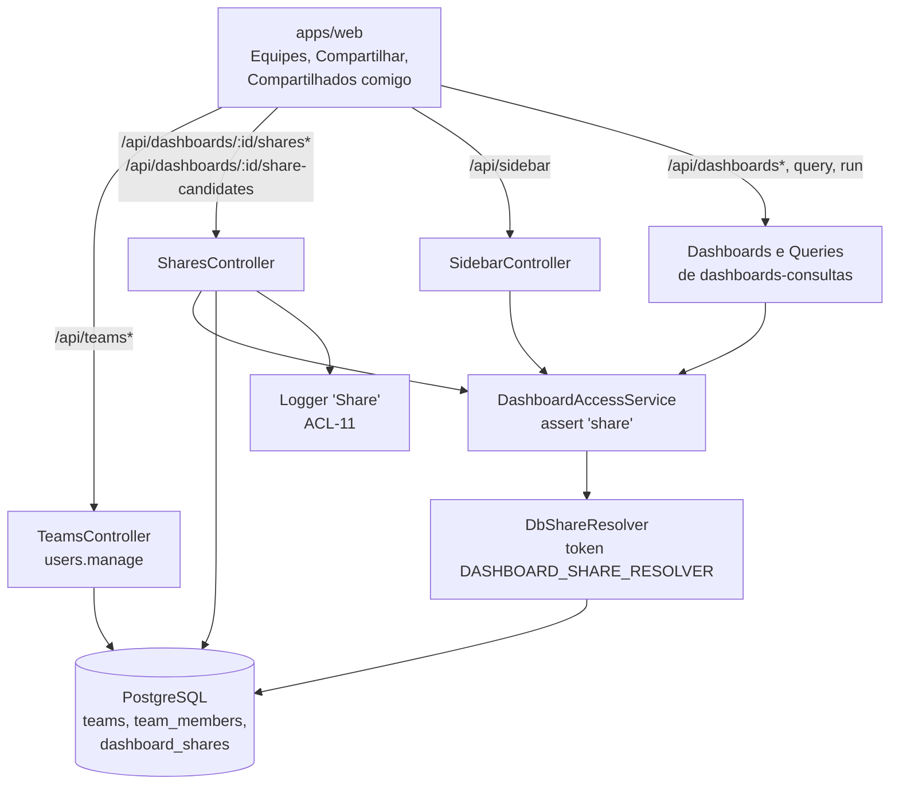

# Compartilhamento Design

**Spec**: `.specs/features/compartilhamento/spec.md`
**Context**: `.specs/features/compartilhamento/context.md`
**Status**: Approved (o usuário dispensou a aprovação do design: "Não precisa da validação do design.")

Segue a arquitetura de `.specs/features/fundacao-auth/design.md` e as interfaces de `.specs/features/dashboards-consultas/design.md` (`DashboardAccessService`, `DashboardShareResolver`, `SidebarService`, `DashboardDto`, `SidebarDto`, `DashboardPage`, `SidebarDashboards`, `layout.ts`). As decisões novas desta feature são AD-047 a AD-053 em `.specs/STATE.md`.

**Estado do código no momento deste design:** o repositório tem o scaffolding e as primeiras tasks de `fundacao-auth` (contratos de papéis, schema `users`/`sessions`, harness `createTestApp`, hash de senha, sessões). `conexoes-schema` e `dashboards-consultas` ainda não foram implementadas. Este design parte do que os design.md e tasks.md delas definem. Quem implementar segue o código real quando ele divergir daqui e marca a diferença com `SPEC_DEVIATION`.

Divergência já visível: a matriz real de `packages/contracts/src/roles.ts` já tem `dashboards.shared` e `sidebar.own` (todos os papéis) e `users.manage` e `dashboards.all` (Admin). Esta feature não acrescenta permissão global: as rotas de equipe usam `users.manage` (AD-050) e as de compartilhamento usam a permissão por dashboard (AD-048).

---

## Architecture Overview

O backend ganha dois módulos: `teams` (equipes e membros, só Admin) e `sharing` (compartilhamentos de um dashboard, busca de destinatários e o `DbShareResolver`, que substitui o `NoSharesResolver` no token `DASHBOARD_SHARE_RESOLVER`). `DashboardAccessService` passa a limitar o Visualizador a "pode ver", ganha a necessidade `'share'` e a mensagem de edição perdida. `SidebarService` passa a separar os compartilhados que o usuário ainda não organizou na seção "Compartilhados comigo". O web ganha a seção "Equipes" na aba "Usuários", o diálogo "Compartilhar" e a seção "Compartilhados comigo" na sidebar.



### Permissão efetiva em cada requisição

```mermaid
sequenceDiagram
    participant R as Rota de dashboard
    participant A as DashboardAccessService
    participant S as DbShareResolver
    participant DB as PostgreSQL
    R->>A: assert(user, dashboardId, need)
    A->>DB: dashboard existe? dono?
    alt dono ou Admin (dashboards.all)
        A-->>R: ver, editar, excluir, compartilhar
    end
    A->>S: accessFor(user.id, dashboardId)
    S->>DB: max(permissão) dos compartilhamentos diretos,<br/>das equipes do usuário e de "Todos da instalação"
    S-->>A: 'view' | 'edit' | null
    A->>A: papel Visualizador → no máximo 'view' (ACL-02)
    alt null
        A-->>R: 404 DASHBOARD_NOT_FOUND
    else falta a necessidade
        A-->>R: 403 (edit: DASHBOARD_EDIT_FORBIDDEN; delete/share: FORBIDDEN)
    end
    A-->>R: DashboardAccess
```

Nada é guardado em cache: membro removido de equipe, compartilhamento alterado ou removido valem na próxima requisição (TEAM-05, SHARE-07, SHARE-08, ACL-12).

### Adicionar ou mudar um compartilhamento

```mermaid
sequenceDiagram
    participant W as Web (ShareDialog)
    participant C as SharesController
    participant A as DashboardAccessService
    participant DB as PostgreSQL
    W->>C: POST /api/dashboards/:id/shares { recipient, permission }
    C->>A: assert(user, id, 'share')
    C->>C: destinatário existe, ativo, não é o dono; Visualizador só 'view'
    C->>DB: INSERT ... ON CONFLICT (dashboard_id, recipient_key)<br/>DO UPDATE SET permission, updated_at RETURNING (xmax = 0) AS inserted
    C->>C: log share action=created|updated
    C-->>W: 200 DashboardSharesDto (lista inteira)
```

### Onde as regras rodam

| Regra | Camada | Testada por |
| ----- | ------ | ----------- |
| Permissão mais alta entre direto, equipes e "todos"; "todos" inclui usuários futuros | `DbShareResolver` (SQL) | testes de rota/serviço da API |
| Visualizador limitado a "pode ver"; dono e Admin compartilham | `DashboardAccessService` | testes da API |
| Uma linha por destinatário, última gravação vale | índice único + `ON CONFLICT` | testes da API e de integração (corrida) |
| Busca de destinatários (contém, sem diferenciar maiúsculas, sem o dono, só ativos) | `ShareCandidatesService` (SQL) | testes da API |
| Ordem da lista de compartilhamentos e de equipes | `SharesService.list`, `TeamsService.list` | testes da API |
| Nome de equipe único sem diferenciar maiúsculas | índice único `lower(name)` + `TeamsService` | testes da API |
| Seção "Compartilhados comigo" e poda de dashboards perdidos | `SidebarService` | testes da API |
| Arrastar de "Compartilhados comigo" para a sidebar | `layout.ts` (`moveItem`, pura) | testes unitários do web |
| Opções de permissão por destinatário (Visualizador só "Pode ver") | `shareOptionsFor` em `@ninbi/contracts` | testes de contratos e do web |

---

## Code Reuse Analysis

### Existing Components to Leverage

| Component | Location | How to Use |
| --------- | -------- | ---------- |
| `createTestApp`, `createTestDb`, `FakeClock` | `apps/api/test/harness.ts`, `apps/api/test/db.ts` | Base dos testes; sem a opção `shares`, o app usa o `DbShareResolver` real |
| `FakeShareResolver`, opção `shares` | `apps/api/test/fakes/` (dashboards-consultas T3) | Continua valendo para os testes de `dashboards-consultas`; os testes desta feature usam o resolver real |
| harness de integração | `apps/api/test-int/harness.ts` | Corrida de SHARE-17 no PostgreSQL real |
| `DashboardAccessService`, `DASHBOARD_SHARE_RESOLVER`, `NoSharesResolver` | `apps/api/src/dashboard-access/` | O token passa a apontar para `DbShareResolver`; `NoSharesResolver` é apagado |
| `SidebarService` | `apps/api/src/sidebar/` | Ganha `shared` e a poda |
| `DashboardsService` (montagem do `DashboardDto`) | `apps/api/src/dashboards/` | `permissions` ganha `share` |
| `@RequirePermission('users.manage')`, `@CurrentUser()`, `AppError`, `ZodValidationPipe`, `MESSAGES`, `ERROR_CODES` | `apps/api/src/auth/`, `apps/api/src/common/`, `packages/contracts/src/` | Rotas de equipe e erros com corpo `{ code, message, fieldErrors }` |
| `Logger` do Nest com captura no teste | padrão de `HttpLoggingMiddleware` (fundacao-auth T12) | Log de ACL-11 |
| `UsersTab`, `useUsers`, `NewUserDialog`, `UserRowActions` | `apps/web/src/features/users/` | A seção "Equipes" entra abaixo da tabela; padrão de esqueleto, erro, diálogo e confirmação; `useUsers` alimenta a escolha de membros |
| `DashboardPage`, `useDashboardEditor`, `useTopBarAction` | `apps/web/src/features/dashboards/` | Botão "Compartilhar", "Compartilhado por", mensagem de ACL-13 |
| `SidebarDashboards`, `layout.ts`, `useSaveSidebar` | `apps/web/src/features/sidebar/` | Seção "Compartilhados comigo" e arrastar dela |
| `renderApp`, MSW `server`, fixtures de dashboards | `apps/web/src/test/` | Testes de tela com gesto |
| shadcn `dialog`, `alert-dialog`, `dropdown-menu`, `table`, `skeleton`, `select`, `input`, `checkbox`, `badge`, `button`, `form` | `apps/web/src/components/ui/` | Telas desta feature |

### Integration Points

| System | Integration Method |
| ------ | ------------------ |
| PostgreSQL | Três tabelas novas (Data Models), migração do drizzle-kit |
| `dashboards-consultas` | Troca o provider de `DASHBOARD_SHARE_RESOLVER`; altera `DashboardAccessService`, `SidebarService`, `DashboardDto.permissions`, `SidebarDto`, `DashboardPage`, `SidebarDashboards`, `layout.ts` |
| `fundacao-auth` | `UsersTab` recebe a seção "Equipes"; o teste de USR da aba continua verde porque o handler MSW padrão de `GET /api/teams` devolve lista vazia |
| Features seguintes (`widgets-graficos`, `ia-cypher`, `interatividade`, `ia-dashboard`) | Usam `DashboardAccessService.assert` sem mudança; a permissão já é a real |

---

## Components

### Backend

#### Tabelas e migração
- **Location**: `apps/api/src/database/schema.ts` (acréscimos), migração em `apps/api/drizzle/`.
- Ver Data Models.

#### `TeamsService` / `TeamsController`
- **Purpose**: Equipes e membros, só Admin (TEAM-01 a TEAM-09).
- **Location**: `apps/api/src/teams/`
- **Rotas** (todas `@RequirePermission('users.manage')`: Editor e Visualizador recebem 403, TEAM-09):

| Rota | Resposta |
| ---- | -------- |
| `GET /api/teams` | `TeamDto[]` em `localeCompare('pt-BR', { sensitivity: 'base' })` de `name` (TEAM-01) |
| `POST /api/teams` `{ name, memberIds }` | 201 `TeamDto` (TEAM-03); 400 `VALIDATION_ERROR` com `fieldErrors.name` (vazio, 41+, repetido sem diferenciar maiúsculas: TEAM-04) ou `fieldErrors.memberIds` "Usuário não encontrado" |
| `PATCH /api/teams/:id` `{ name?, memberIds? }` | 200 `TeamDto`; `memberIds` troca a lista inteira (TEAM-05); `name` renomeia (TEAM-06); 404 `TEAM_NOT_FOUND`; 400 como no `POST` |
| `DELETE /api/teams/:id` | 204; a chave estrangeira apaga os compartilhamentos da equipe (TEAM-08); 404 |

- **Nome repetido**: o serviço procura `lower(name)` antes de gravar; a violação do índice único `teams_name_lower_uq` (corrida) vira a mesma resposta 400.
- **`TeamDto`**: `{ id, name, memberCount, members: { id, name, email }[], shareCount }`. `shareCount` = número de dashboards compartilhados com a equipe, usado na confirmação de TEAM-07. Membros em ordem de nome.
- **Log**: `Logger('Team')` registra `team deleted by=<id> team=<id> shares=<n>`.

#### `DbShareResolver`
- **Purpose**: Implementação real de `DashboardShareResolver` (AD-044) sobre `dashboard_shares` (ACL-01, ACL-14, ACL-15, TEAM-05).
- **Location**: `apps/api/src/sharing/db-share-resolver.ts`
- **Interfaces** (as de AD-044):
  ```typescript
  accessFor(userId: string, dashboardId: string): Promise<'view' | 'edit' | null>
  sharedDashboardIds(userId: string): Promise<string[]>
  ```
- **Predicado** (um só, usado pelas duas consultas): `s.recipient_type = 'EVERYONE' OR s.user_id = $u OR s.team_id IN (SELECT team_id FROM team_members WHERE user_id = $u)`.
- `accessFor`: `max(CASE permission WHEN 'edit' THEN 2 ELSE 1 END)` sobre o predicado e o dashboard; 2 → `'edit'`, 1 → `'view'`, nenhuma linha → `null`.
- `sharedDashboardIds`: `DISTINCT` dashboards com o predicado e `owner_id <> $u`, em ordem de `dashboards.created_at`.
- **Registro**: o `DashboardAccessModule` passa a prover `{ provide: DASHBOARD_SHARE_RESOLVER, useClass: DbShareResolver }`; `NoSharesResolver` é apagado. `createTestApp({ shares })` continua sobrescrevendo o token.

#### `DashboardAccessService` (modify)
- **ACL-02**: depois de somar dono, Admin e resolver, um usuário com papel `VIEWER` tem `canEdit = false` (o Visualizador nunca é dono, porque não cria dashboards).
- **`'share'`**: `assert(user, id, 'share')` exige dono ou `dashboards.all`, igual a `'delete'`. `DashboardAccess` ganha `canShare`.
- **ACL-13**: falta de `'edit'` responde 403 `DASHBOARD_EDIT_FORBIDDEN` com "Você não tem mais permissão para editar este dashboard"; falta de `'delete'` e `'share'` continua 403 `FORBIDDEN`.
- **`DashboardDto.permissions`** ganha `share: boolean` (SHARE-01), preenchido em `DashboardsService` a partir de `canShare`.

#### `SharesService` / `SharesController`
- **Purpose**: Ler e alterar os compartilhamentos de um dashboard (SHARE-02, SHARE-06 a SHARE-12, SHARE-16, SHARE-17, ACL-11).
- **Location**: `apps/api/src/sharing/`
- **Rotas** (todas começam com `access.assert(user, id, 'share')`: quem não alcança recebe 404 `DASHBOARD_NOT_FOUND`; quem alcança sem ser dono nem Admin, 403 `FORBIDDEN`, AD-049):

| Rota | Resposta |
| ---- | -------- |
| `GET /api/dashboards/:id/shares` | 200 `DashboardSharesDto` |
| `POST /api/dashboards/:id/shares` `{ recipient, permission }` | 200 `DashboardSharesDto`; cria ou atualiza a linha do destinatário (SHARE-06, SHARE-09, SHARE-17) |
| `PATCH /api/dashboards/:id/shares/:shareId` `{ permission }` | 200 `DashboardSharesDto` (SHARE-07); 404 `SHARE_NOT_FOUND` |
| `DELETE /api/dashboards/:id/shares/:shareId` | 200 `DashboardSharesDto` (SHARE-08); 404 `SHARE_NOT_FOUND` |
| `GET /api/dashboards/:id/share-candidates?q=` | 200 `ShareCandidatesDto` (SHARE-04, SHARE-05, SHARE-11) |

- **Recusas do destinatário** (400 `VALIDATION_ERROR`, `fieldErrors.recipient`): usuário inexistente ou desativado → "Usuário não encontrado"; equipe inexistente → "Equipe não encontrada"; o dono → "O dono já tem acesso a este dashboard"; usuário com papel Visualizador e `permission: 'edit'` → "Visualizadores só podem receber Pode ver" (SHARE-10; vale também no `PATCH`).
- **`recipient_key`**: `user:<uuid>`, `team:<uuid>` ou `everyone`, calculado no serviço; o índice único `(dashboard_id, recipient_key)` garante uma linha por destinatário, e `ON CONFLICT DO UPDATE` faz a última gravação valer (SHARE-09, SHARE-17).
- **Ordem da lista**: "Todos da instalação" primeiro, depois equipes e depois usuários, cada grupo em `localeCompare('pt-BR', { sensitivity: 'base' })` de nome.
- **SHARE-16**: linhas de usuários desativados continuam na lista com `recipient.disabled: true`.
- **Log (ACL-11)**: `Logger('Share')`, uma linha por criação, mudança e remoção: `share action=<created|updated|removed> by=<userId> dashboard=<id> recipient=<user:<id>|team:<id>|everyone> permission=<view|edit>`. `created` ou `updated` sai do `RETURNING (xmax = 0) AS inserted`.

#### `ShareCandidatesService`
- **Location**: `apps/api/src/sharing/share-candidates.service.ts`
- **Regra (AD-052)**: `q` com `trim`; usuários com `status = 'ACTIVE'`, `id <> owner_id` (SHARE-11) e `name ILIKE %q%` ou `email ILIKE %q%`; equipes com `name ILIKE %q%`; `%`, `_` e `\` de `q` escapados. Cada lista em ordem de nome, até 20 itens. `everyone: true` sempre (SHARE-04). `q` vazio devolve os 20 primeiros de cada lista. Usuários trazem `role`, para o web oferecer só "Pode ver" a Visualizadores.

#### `SidebarService` (modify)
- **ACL-04, ACL-10 (AD-051)**: `SidebarDto` ganha `shared: SidebarDashboardNode[]`: os dashboards de `sharedDashboardIds` que não estão no documento do usuário, em ordem de criação. Os próprios que faltam continuam entrando no fim, soltos (AD-042).
- **ACL-05**: quando o usuário arrasta um compartilhado para a sidebar, o `PUT /api/sidebar` o leva no documento e ele sai de `shared`.
- **ACL-09**: o `GET` tira do documento gravado os ids que o usuário não alcança mais e regrava o documento quando algum saiu, para que um novo compartilhamento do mesmo dashboard volte a "Compartilhados comigo".

### Frontend

| Componente | Location | Interfaces / comportamento |
| ---------- | -------- | -------------------------- |
| `teamsApi` | `src/features/teams/api.ts` | `useTeams()`, `useCreateTeam()`, `useUpdateTeam(id)`, `useDeleteTeam(id)`; handler MSW padrão `GET /api/teams` → `[]` em `src/test/server.ts` |
| `TeamsSection` | `src/features/teams/TeamsSection.tsx` | dentro de `UsersTab`, abaixo da tabela: título "Equipes", botão "Nova equipe", tabela "Nome" e "Membros" (número) na ordem da API (TEAM-01); "Nenhuma equipe criada" (TEAM-02); esqueleto; "Não foi possível carregar as equipes" + "Tentar novamente" (TEAM-10); menu da linha com "Editar equipe" e "Excluir equipe" |
| `TeamDialog` | `src/features/teams/TeamDialog.tsx` | "Nova equipe" e "Editar equipe": campo "Nome" (1 a 40, `teamSchema`) e lista de usuários ativos com caixa de seleção (de `useUsers`), membros atuais marcados; `fieldErrors.name` da API no campo (TEAM-04); "Salvar" desabilitado durante o envio |
| `DeleteTeamDialog` | `src/features/teams/DeleteTeamDialog.tsx` | `MESSAGES.teamDeleteConfirm(nome, shareCount)` (TEAM-07); confirmar chama `DELETE` e tira a linha (TEAM-08) |
| `sharingApi` | `src/features/sharing/api.ts` | `useShares(dashboardId)`, `useShareCandidates(dashboardId, q)` (com `q` atrasado 250 ms), `useAddShare`, `useChangeShare`, `useRemoveShare`; as três mutações gravam a resposta (`DashboardSharesDto`) no cache da query |
| `ShareDialog` | `src/features/sharing/ShareDialog.tsx` | título "Compartilhar"; "Dono: <nome>" (SHARE-02); `ShareSearch` fixo no topo e, abaixo, a lista em contêiner `overflow-y-auto` com altura máxima (SHARE-15); cada linha com o nome (usuário: nome e e-mail; equipe: nome; "Todos da instalação"), selo "Desativado" (SHARE-16), select "Pode ver"/"Pode editar" (opções de `shareOptionsFor`) e "Remover"; "Só você vê este dashboard" sem linhas (SHARE-03); linhas de esqueleto (SHARE-13); falha ao carregar ou ao alterar mantém a lista anterior e mostra "Não foi possível atualizar o compartilhamento" + "Tentar novamente" (SHARE-14) |
| `ShareSearch` | `src/features/sharing/ShareSearch.tsx` | campo "Adicionar pessoas ou equipes"; resultados com "Todos da instalação", equipes e usuários (nome e e-mail), cada um com o select de permissão (padrão "Pode ver"; Visualizador só "Pode ver": SHARE-10) e "Adicionar" (SHARE-06); "Nenhum usuário ou equipe encontrado" quando as duas listas vêm vazias e o texto não casa com "Todos da instalação" (SHARE-05) |
| `DashboardPage` (modify) | `src/features/dashboards/DashboardPage.tsx` | botão "Compartilhar" no cabeçalho só com `permissions.share` (SHARE-01) que abre o `ShareDialog`; "Compartilhado por <ownerName>" junto ao nome quando `ownerId` ≠ usuário da sessão (ACL-08); "Editar" só com `permissions.edit` (ACL-06, ACL-07, já de DASH-18); 403 `DASHBOARD_EDIT_FORBIDDEN` ao salvar mantém a edição e mostra a `message` da API (ACL-13); 404 em qualquer ação mostra "Dashboard não encontrado" (ACL-12, mesmo caminho de DASH-15) |
| `SidebarDashboards` (modify) | `src/features/sidebar/SidebarDashboards.tsx` | seção "Compartilhados comigo" depois dos itens do usuário, só quando `shared` não está vazio (ACL-04, ACL-10); itens com o mesmo link, `truncate` e `title`; itens arrastáveis para a sidebar (ACL-05); a seção não é alvo de soltar |
| `layout.ts` (modify) | `src/features/sidebar/layout.ts` | `moveItem` insere o dashboard arrastado quando ele não está no layout (vem de "Compartilhados comigo") |

---

## Data Models

```typescript
// apps/api/src/database/schema.ts (acréscimos)
shareRecipientTypeEnum = pgEnum('share_recipient_type', ['USER', 'TEAM', 'EVERYONE'])
sharePermissionEnum    = pgEnum('share_permission', ['view', 'edit'])

teams: {
  id: uuid pk default gen_random_uuid()
  name: varchar(40) not null
  createdAt, updatedAt: timestamptz not null default now()
}  unique index teams_name_lower_uq on (lower(name))

team_members: {
  teamId: uuid not null references teams(id) on delete cascade
  userId: uuid not null references users(id) on delete cascade   // usuários não são apagados; desativar mantém a linha
  primary key (team_id, user_id)
}  index on (user_id)

dashboard_shares: {
  id: uuid pk default gen_random_uuid()
  dashboardId: uuid not null references dashboards(id) on delete cascade   // SHARE-18
  recipientType: share_recipient_type not null
  userId: uuid null references users(id) on delete cascade
  teamId: uuid null references teams(id) on delete cascade                 // TEAM-08
  recipientKey: varchar(60) not null                                        // 'user:<uuid>' | 'team:<uuid>' | 'everyone'
  permission: share_permission not null
  createdBy: uuid not null references users(id)
  createdAt, updatedAt: timestamptz not null default now()
}  unique index (dashboard_id, recipient_key)                                // SHARE-09, SHARE-17
   index on (user_id), index on (team_id)
   check: (USER → user_id not null and team_id null) and (TEAM → team_id not null and user_id null) and (EVERYONE → ambos null)
```

```typescript
// packages/contracts/src/sharing.ts
type SharePermission = 'view' | 'edit'
const SHARE_PERMISSION_LABELS: Record<SharePermission, string> = { view: 'Pode ver', edit: 'Pode editar' }
function shareOptionsFor(recipient: { type: 'USER'; role: Role } | { type: 'TEAM' } | { type: 'EVERYONE' }): SharePermission[]
  // Visualizador: ['view']; demais: ['view', 'edit']

type ShareRecipientInput = { type: 'USER'; userId: string } | { type: 'TEAM'; teamId: string } | { type: 'EVERYONE' }
type ShareRecipientDto =
  | { type: 'USER'; id: string; name: string; email: string; role: Role; disabled: boolean }
  | { type: 'TEAM'; id: string; name: string }
  | { type: 'EVERYONE' }
interface ShareDto { id: string; recipient: ShareRecipientDto; permission: SharePermission }
interface DashboardSharesDto { dashboardId: string; ownerId: string; ownerName: string; shares: ShareDto[] }
interface ShareCandidatesDto { everyone: true; teams: { id: string; name: string }[];
                               users: { id: string; name: string; email: string; role: Role }[] }
interface TeamMemberDto { id: string; name: string; email: string }
interface TeamDto { id: string; name: string; memberCount: number; members: TeamMemberDto[]; shareCount: number }

// schemas zod
teamCreateSchema   { name (trim, 1-40), memberIds: uuid[] sem repetição }
teamUpdateSchema   { name?, memberIds? } com ao menos um dos dois
shareUpsertSchema  { recipient: ShareRecipientInput (discriminado por type), permission: 'view' | 'edit' }
shareUpdateSchema  { permission: 'view' | 'edit' }

// packages/contracts/src/dashboards.ts (modify)
DashboardDto.permissions: { edit: boolean; delete: boolean; share: boolean }
SidebarDto: { items: (SidebarDashboardNode | SidebarGroupNode)[]; shared: SidebarDashboardNode[] }
```

**Relationships**: `team_members` liga `teams` a `users`; `dashboard_shares` liga `dashboards` a um usuário, a uma equipe ou a todos. Apagar dashboard ou equipe apaga os compartilhamentos; usuários só são desativados, e as linhas deles ficam (SHARE-16, ACL-16).

### Validação e mensagens

| Campo / situação | Regra | Mensagem |
| ---------------- | ----- | -------- |
| Nome da equipe | obrigatório depois de `trim` | "Informe o nome" |
| Nome da equipe | até 40 caracteres | "O nome pode ter até 40 caracteres" |
| Nome da equipe | único sem diferenciar maiúsculas | "Já existe uma equipe com este nome" |
| Membro | usuário existente | "Usuário não encontrado" |
| Destinatário usuário | existente e ativo | "Usuário não encontrado" |
| Destinatário equipe | existente | "Equipe não encontrada" |
| Destinatário dono | recusado | "O dono já tem acesso a este dashboard" |
| Visualizador com "Pode editar" | recusado | "Visualizadores só podem receber Pode ver" |

Textos de tela em `MESSAGES`: "Equipes", "Nova equipe", "Editar equipe", "Excluir equipe", "Nenhuma equipe criada", "Não foi possível carregar as equipes", `teamDeleteConfirm(nome, n)` = "Excluir a equipe <nome>? <n> dashboards deixarão de estar compartilhados com ela.", "Compartilhar", "Dono: <nome>", "Só você vê este dashboard", "Adicionar pessoas ou equipes", "Nenhum usuário ou equipe encontrado", "Todos da instalação", "Pode ver", "Pode editar", "Adicionar", "Remover", "Desativado", "Não foi possível atualizar o compartilhamento", `sharedBy(nome)` = "Compartilhado por <nome>", "Compartilhados comigo", "Você não tem mais permissão para editar este dashboard". Códigos novos em `ERROR_CODES`: `TEAM_NOT_FOUND`, `SHARE_NOT_FOUND`, `DASHBOARD_EDIT_FORBIDDEN`.

---

## Error Handling Strategy

| Error Scenario | Handling | User Impact |
| -------------- | -------- | ----------- |
| Editor ou Visualizador nas rotas de equipe | 403 `FORBIDDEN` | A seção só aparece na aba "Usuários", que só o Admin vê |
| Nome de equipe inválido ou repetido | 400 `VALIDATION_ERROR` com `fieldErrors.name` | Mensagem no campo "Nome" |
| Equipe inexistente | 404 `TEAM_NOT_FOUND` | Lista recarregada |
| Lista de equipes não carrega | query em erro | "Não foi possível carregar as equipes" + "Tentar novamente" |
| Quem não alcança o dashboard nas rotas de compartilhamento | 404 `DASHBOARD_NOT_FOUND` | "Dashboard não encontrado" |
| Quem alcança sem ser dono nem Admin | 403 `FORBIDDEN` | Botão "Compartilhar" não aparece |
| Destinatário inválido, dono, Visualizador com "Pode editar" | 400 `VALIDATION_ERROR` com `fieldErrors.recipient` | "Não foi possível atualizar o compartilhamento" |
| Compartilhamento já removido | 404 `SHARE_NOT_FOUND` | "Não foi possível atualizar o compartilhamento"; "Tentar novamente" recarrega a lista |
| PostgreSQL falha ao ler ou alterar | 500 `INTERNAL_ERROR` | Lista anterior mantida + "Não foi possível atualizar o compartilhamento" + "Tentar novamente" |
| Acesso removido com o dashboard aberto | 404 na próxima ação | "Dashboard não encontrado" (ACL-12) |
| Permissão caiu para "pode ver" durante a edição | 403 `DASHBOARD_EDIT_FORBIDDEN` no `PUT` | "Você não tem mais permissão para editar este dashboard", rascunho mantido (ACL-13) |

---

## Test Strategy

| Nível | O que cobre | Onde |
| ----- | ----------- | ---- |
| Contratos | schemas de equipe e compartilhamento, `shareOptionsFor`, mensagens | `packages/contracts/src/sharing.spec.ts` |
| API rápida (PGlite, resolver real) | tabelas e cascatas, equipes, resolver, acesso, compartilhamentos, busca, sidebar, ACL nas rotas, log | `apps/api/test/{database,teams,sharing,sidebar}/*.spec.ts` |
| API integração | SHARE-17 com dois `POST` simultâneos no PostgreSQL real | `apps/api/test-int/sharing.int.spec.ts` |
| Web | gesto + texto visível com MSW; `moveItem` com item vindo de fora do layout | `apps/web/src/features/{teams,sharing,dashboards,sidebar}/*.test.ts(x)` |

- Os testes desta feature criam usuários, equipes, dashboards e compartilhamentos pelas rotas ou direto no banco, e conferem o acesso pelas rotas de `dashboards-consultas` com o `DbShareResolver` real (sem `shares` em `createTestApp`).
- Log: o teste troca o logger de `Share` por um que guarda as linhas, como em `http-logging.spec.ts`.
- Busca com atraso: o teste de tela usa `vi.useFakeTimers({ shouldAdvanceTime: true })` ou espera o resultado com `findBy*`.

---

## Risks & Concerns

| Concern | Location (file:line) | Impact | Mitigation |
| ------- | -------------------- | ------ | ---------- |
| `dashboards-consultas` ainda não implementada | `apps/api/src/dashboard-access/`, `apps/api/src/sidebar/`, `apps/web/src/features/{dashboards,sidebar}/` | Os arquivos que esta feature altera não existem | Pré-requisito explícito no tasks.md; quem implementar segue o código real e marca `SPEC_DEVIATION` |
| Testes de `dashboards-consultas` mudam de expectativa | `apps/api/test/dashboards/dashboards.spec.ts` (DASH-18), `apps/api/test/sidebar/sidebar.spec.ts` (DASH-01) | `permissions` ganha `share`; um compartilhado fora do layout passa de `items` para `shared` | AD-048 e AD-051 registram a mudança; as tasks T5 e T8 atualizam esses testes para a nova expectativa sem afrouxar asserções |
| `FakeShareResolver` não limita o Visualizador | `apps/api/test/fakes/fake-share-resolver.ts` | Um teste antigo que dá `edit` a um Visualizador passaria a receber só ver | O limite fica no `DashboardAccessService`, não no resolver; T5 confere os testes de `dashboards-consultas` |
| Security: busca expõe nome e e-mail | `GET /api/dashboards/:id/share-candidates` | Um Editor lista usuários ativos da instalação | Só dono e Admin chamam a rota (assert `'share'`), e a spec aceita nome e e-mail (Assumptions); no máximo 20 por busca |
| Security: `%` e `_` na busca | `ShareCandidatesService` | `ILIKE` trataria `%` como curinga | O serviço escapa `%`, `_` e `\` |
| Performance: uma consulta a mais por requisição de dashboard | `DbShareResolver.accessFor` | Latência extra | Índices em `dashboard_shares(dashboard_id, recipient_key)`, `(user_id)`, `(team_id)` e `team_members(user_id)`; AD-044 já aceitou o custo |
| Busca sem diferenciar acentos | `ILIKE` | "Joao" não acha "João" | Aceito no MVP (AD-052); `unaccent` exigiria extensão no PostgreSQL e no PGlite |
| Test gap: PGlite tem uma conexão só | `apps/api/test/` | SHARE-17 não é corrida real | Provado em `test-int/` contra o PostgreSQL do compose de dev |
| Test gap: jsdom não calcula layout | `ShareDialog` | SHARE-15 não é medido | O teste confere `overflow-y-auto` no contêiner da lista e que o campo de busca está fora dele (AD-023) |

---

## Tech Decisions (only non-obvious ones)

| Decision | Choice | Rationale |
| -------- | ------ | --------- |
| Uma linha por destinatário | `recipient_key` texto com índice único por dashboard, além de `user_id`/`team_id` para as chaves estrangeiras (AD-047) | `ON CONFLICT` simples para SHARE-09 e SHARE-17, sem índices parciais |
| Permissão efetiva | Calculada por requisição no SQL, sem cache (AD-048) | TEAM-05, SHARE-07, SHARE-08 valem na próxima requisição |
| Limite do Visualizador | No `DashboardAccessService`, não no dado (AD-048) | Mudar o papel de alguém para Visualizador corta a edição sem reescrever compartilhamentos |
| Rotas de equipe | `users.manage`, sem permissão nova (AD-050) | Equipes moram na aba "Usuários", que é do Admin |
| Mutação devolve a lista inteira | `DashboardSharesDto` em toda resposta (AD-049) | O web troca o cache de uma vez e mantém a lista anterior em erro (SHARE-14) |
| "Compartilhados comigo" | Campo `shared` no `SidebarDto`, montado na leitura (AD-051) | Compartilhar não mexe no documento de ninguém (AD-042) |
| Busca de destinatários | No backend, `ILIKE`, 20 por lista (AD-052) | Filtrar é regra e roda numa camada testada; o web não recebe a lista inteira de usuários |
