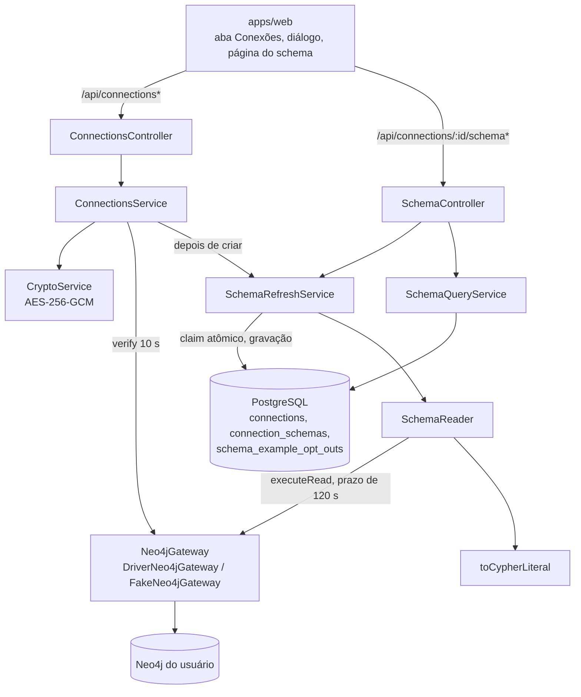

# Conexões e Schema Design

**Spec**: `.specs/features/conexoes-schema/spec.md`
**Status**: Approved (o usuário dispensou a aprovação do design: "Não precisa da validação do design.")

Segue a arquitetura de `.specs/features/fundacao-auth/design.md` (seção "Arquitetura das features seguintes") e as decisões AD-024 a AD-037 de `.specs/STATE.md`. As decisões novas desta feature são AD-038 a AD-041.

**Estado do código no momento deste design:** o repositório só tem o scaffolding inicial da raiz (`package.json`, `pnpm-workspace.yaml`, `tsconfig.base.json`); `apps/` e `packages/` ainda não existem. Este design parte do que `fundacao-auth/tasks.md` define (harness `createTestApp`, `createTestDb`, `renderApp`, `SETTINGS_TABS`, `useTopBarAction`, `AppErrorFilter`, `@RequirePermission`). Quem implementar segue o código real quando ele divergir daqui e registra a diferença com `SPEC_DEVIATION`.

---

## Architecture Overview

O backend ganha três módulos: `crypto` (cifra a senha), `neo4j` (único ponto que fala com o Neo4j do usuário) e `connections` + `schema` (cadastro, leitura e cache). A leitura do schema é assíncrona: a rota responde na hora com o estado, e o trabalho roda no processo da API. O estado da leitura fica na linha da conexão no PostgreSQL (AD-038).



### Leitura do schema

```mermaid
sequenceDiagram
    participant W as Web (SchemaPage)
    participant C as SchemaController
    participant R as SchemaRefreshService
    participant DB as PostgreSQL
    participant RD as SchemaReader
    participant N as Neo4j
    W->>C: POST /api/connections/:id/schema/refresh
    C->>R: start(id)
    R->>DB: UPDATE connections SET schema_status='READING' WHERE id AND (status<>'READING' OR started_at < agora-150s) RETURNING
    alt nenhuma linha (já está lendo)
        R-->>C: estado atual (READING)
    else claim obtido
        R-)RD: read(cfg, prazo 120 s) em segundo plano
        R-->>C: estado READING
    end
    C-->>W: 202 { status: 'READING', startedAt }
    loop a cada 2 s enquanto READING
        W->>C: GET /api/connections/:id/schema
    end
    RD->>N: db.schema.nodeTypeProperties(), db.schema.relTypeProperties()
    RD->>N: padrões por tipo de relacionamento, exemplos por label e por tipo
    alt sucesso
        R->>DB: transação: SELECT conexão FOR UPDATE (sumiu? descarta), UPSERT connection_schemas, apaga opt-outs órfãos, status READY, read_at
    else falha, permissão ou prazo
        R->>DB: status FAILED, schema_error = mensagem; o schema anterior fica
    end
    R->>R: log: conexão, duração, labels, tipos, resultado
```

---

## Code Reuse Analysis

### Existing Components to Leverage

| Component | Location | How to Use |
| --------- | -------- | ---------- |
| `createTestApp`, `createTestDb`, `Clock` falso | `apps/api/test/harness.ts`, `apps/api/test/db.ts` (fundacao-auth T10, T11) | Ganha a opção `neo4j` (um `FakeNeo4jGateway` por padrão) e a chave de criptografia de teste |
| harness de integração | `apps/api/test-int/harness.ts` (fundacao-auth T19) | Corridas CONN-22 e SCH-11; leitura real do dataset "Varejo" |
| `@RequirePermission`, `PermissionGuard`, `can()` | `apps/api/src/auth/`, `packages/contracts/src/roles.ts` | `connections.read` (Admin, Editor) e `connections.manage` (Admin) já existem na matriz |
| `AppErrorFilter`, `ZodValidationPipe`, `AppError` | `apps/api/src/common/` | Corpo `{ code, message, fieldErrors }` |
| `MESSAGES`, `ERROR_CODES` | `packages/contracts/src/` | Recebem os textos e códigos desta feature |
| `renderApp`, MSW `server` | `apps/web/src/test/` | Testes de tela com gesto |
| `SETTINGS_TABS`, `SettingsPage` | `apps/web/src/features/settings/` | Liga `available: true` na aba "Conexões" |
| `useTopBarAction` | `apps/web/src/features/shell/` | Botão "Nova conexão" na barra superior |
| `UsersTab`, `NewUserDialog`, `UserRowActions` | `apps/web/src/features/users/` | Mesmo padrão de tabela, esqueleto, erro, diálogo e confirmação |
| shadcn `table`, `skeleton`, `dialog`, `alert-dialog`, `form`, `input`, `button`, `badge` | `apps/web/src/components/ui/` | Telas desta feature; `switch` é adicionado aqui |
| Dataset "Varejo" | `infra/neo4j/seed.cypher` (AD-034) | Fonte real dos testes de integração do schema |

### Integration Points

| System | Integration Method |
| ------ | ------------------ |
| PostgreSQL | Três tabelas novas (Data Models), migração gerada pelo drizzle-kit |
| Neo4j do usuário | `neo4j-driver` 5.x, um driver por operação, sessões com `defaultAccessMode: READ` e `executeRead` |
| `apps/api/src/config/env.ts` | `NINBI_ENCRYPTION_KEY` passa a ser obrigatória (base64 de 32 bytes) |
| `docker-compose.yml`, `apps/api/.env.example` | Valor padrão de desenvolvimento para `NINBI_ENCRYPTION_KEY`, como previsto no design da fundação |
| Features seguintes | `dashboards-consultas` usa `Neo4jGateway.read` e `connections`; `ia-cypher` e `ia-dashboard` leem `ConnectionSchemaDto` e respeitam `sendExample` |

---

## Components

### Backend

#### `CryptoService`
- **Purpose**: Cifra e decifra segredos com AES-256-GCM.
- **Location**: `apps/api/src/crypto/crypto.service.ts`
- **Interfaces**:
  - `encrypt(plain: string): string` → `v1:<iv base64>:<tag base64>:<cifra base64>`, IV aleatório de 12 bytes
  - `decrypt(stored: string): string` → lança em formato ou tag inválidos
- **Dependencies**: `node:crypto`, `env.NINBI_ENCRYPTION_KEY`.
- **Env (CONN-21)**: `env.ts` exige a variável. Ausente ou vazia, a validação lança `Error('NINBI_ENCRYPTION_KEY não definida')`; com valor que não decodifica para 32 bytes, `'NINBI_ENCRYPTION_KEY deve ter 32 bytes em base64'`. `main.ts` captura o erro do `bootstrap()`, grava a mensagem com `Logger.error` e sai com código 1.

#### `Neo4jGateway`
- **Purpose**: Único acesso ao Neo4j do usuário (AD-032, AD-040).
- **Location**: `apps/api/src/neo4j/neo4j.gateway.ts` (interface + token `NEO4J_GATEWAY`), `driver-neo4j.gateway.ts`, `neo4j.module.ts`; fake em `apps/api/test/fakes/fake-neo4j.gateway.ts`
- **Interfaces**:
  ```typescript
  interface Neo4jConnectionConfig { uri: string; database: string | null; username: string; password: string }
  interface Neo4jReadResult { keys: string[]; rows: Record<string, unknown>[] }  // valores nativos do neo4j-driver
  interface Neo4jGateway {
    verify(cfg: Neo4jConnectionConfig, opts: { timeoutMs: number }): Promise<void>
    read(cfg: Neo4jConnectionConfig, cypher: string, params: Record<string, unknown>,
         opts: { timeoutMs: number; maxRows?: number; signal?: AbortSignal }): Promise<Neo4jReadResult>
  }
  class Neo4jTimeoutError extends Error {}
  class Neo4jGatewayError extends Error {}   // message = mensagem do Neo4j, sem alteração
  ```
- **Comportamento do driver real**: cria o driver com `connectionTimeout` e `connectionAcquisitionTimeout` iguais ao prazo, abre a sessão com `database: cfg.database ?? undefined` (sem banco, o servidor usa o padrão: CONN-12) e `defaultAccessMode: neo4j.session.READ`, roda o trabalho em `session.executeRead(tx => tx.run(...), { timeout: timeoutMs })` (SCH-12) e fecha sessão e driver no `finally`. `verify` roda `RETURN 1` do mesmo jeito, o que prova URI, credenciais e banco de uma vez. Um `setTimeout` do prazo, ou o `signal`, fecha o driver e rejeita com `Neo4jTimeoutError`. Nenhum método escreve.
- **Fake**: `FakeNeo4jGateway` implementa a interface; `whenVerify(ok | Error | 'hang')`, `whenRead(match: string | RegExp, rows | Error | 'hang')`, `release()` para soltar chamadas penduradas, `calls` com cada `{ method, cfg, cypher, params }`. Respeita `timeoutMs` com o relógio real (os testes passam prazos curtos).

#### `toCypherLiteral`
- **Purpose**: Converte um valor do neo4j-driver no literal Cypher que o representa (SCH-27). Todos os exemplos são guardados assim (AD-039).
- **Location**: `apps/api/src/schema/cypher-literal.ts`
- **Regras**: string → `'...'` com `\` e `'` escapados; `Integer` → dígitos (`toString()`, sem perda); número → `String(n)` (`1.0` vira `1.0`); boolean; `Date` → `date('2024-01-05')`; `DateTime` → `datetime('...')`; `LocalDateTime` → `localdatetime('...')`; `Time` → `time('...')`; `LocalTime` → `localtime('...')`; `Duration` → `duration('P...')`; `Point` → `point({srid: 4326, x: -46.6, y: -23.5})` (com `z` em 3D); lista → `[a, b]`; mapa → `{chave: valor}` com a chave entre crases quando não é identificador simples; `null` → `null`. Não corta nada (SCH-04).

#### `SchemaReader`
- **Purpose**: Lê o schema enriquecido de uma conexão, só com `Neo4jGateway.read`.
- **Location**: `apps/api/src/schema/schema-reader.ts`
- **Interfaces**: `read(cfg, { deadline: number, signal: AbortSignal }): Promise<ReadSchema>`
- **Consultas** (cada uma com o tempo que falta até `deadline`):
  1. `CALL db.schema.nodeTypeProperties() YIELD nodeLabels, propertyName, propertyTypes` → cada label de `nodeLabels` recebe a propriedade; tipos de linhas repetidas são unidos sem repetir (SCH-02). Linha com `propertyName` nulo registra o label sem propriedade.
  2. `CALL db.schema.relTypeProperties() YIELD relType, propertyName, propertyTypes` → `relType` vem como ``:`FEZ` ``; o nome é extraído sem `:` e crases (SCH-03).
  3. Por tipo de relacionamento: ``MATCH (a)-[:`T`]->(b) UNWIND labels(a) AS from UNWIND labels(b) AS to RETURN DISTINCT from, to`` (SCH-05).
  4. Por label com propriedades: ``UNWIND $props AS p CALL { WITH p MATCH (n:`L`) WHERE n[p] IS NOT NULL RETURN n[p] AS v LIMIT 1 } RETURN p, v``; por tipo de relacionamento, o mesmo com ``MATCH ()-[r:`T`]->()``. A propriedade sem linha fica com `example: null` (SCH-04, SCH-18).
- Identificadores entram com crases, e crase interna dobrada (`escapeIdentifier`). Nenhum valor do usuário entra no texto da consulta além dos nomes que o próprio banco devolveu.
- Erro do gateway sobe sem tradução: a mensagem do Neo4j chega ao usuário (SCH-09, SCH-26).

#### `SchemaRefreshService`
- **Purpose**: Máquina de estados da leitura e gravação do cache (SCH-01, SCH-06 a SCH-11, SCH-14, SCH-23, SCH-25, SCH-28, SCH-29).
- **Location**: `apps/api/src/schema/schema-refresh.service.ts`
- **Interfaces**:
  - `start(connectionId): Promise<SchemaStateDto>`: claim atômico (ver diagrama); sem claim devolve o estado atual sem iniciar outra leitura (SCH-11).
  - `whenSettled(connectionId): Promise<void>`: só para testes, espera a leitura em segundo plano terminar.
  - Token `SCHEMA_READ_TIMEOUT_MS`, padrão `120_000` (SCH-10); `CONNECTION_VERIFY_TIMEOUT_MS`, padrão `10_000` (CONN-09). Os testes sobrescrevem com prazos curtos e conferem os padrões.
- **Estados** (`schema_status`): `NEVER` → `READING` → `READY` | `FAILED`; `READY`/`FAILED` → `READING` pelo botão. Um `READING` com `schema_read_started_at` há mais de 150 s é considerado órfão (processo reiniciado) e pode ser retomado.
- **Gravação**: em uma transação, trava a conexão (`FOR UPDATE`); se ela não existe mais, descarta (SCH-29). Senão substitui o documento em `connection_schemas` com `read_at = clock.now()` (SCH-06), apaga de `schema_example_opt_outs` as linhas cujo label, tipo ou propriedade não existe no schema novo (SCH-28) e mantém as demais (SCH-23). Propriedade nova não tem linha, logo envia o exemplo (SCH-25).
- **Falha**: `schema_status = 'FAILED'`, `schema_error` = mensagem do Neo4j, ou `MESSAGES.schemaReadTimeout` ("A leitura do schema passou de 120 s") no prazo; o documento anterior fica (SCH-09).
- **Log (SCH-14)**: `Logger('Schema')`, uma linha por leitura: `schema read connection=<id> durationMs=<n> labels=<n> relationshipTypes=<n> result=<ok|failed|timeout|discarded>`. Nunca grava exemplos nem a mensagem de erro completa com dados.

#### `ConnectionsService` / `ConnectionsController`
- **Location**: `apps/api/src/connections/`
- **Rotas**:

| Rota | Permissão | Resposta |
| ---- | --------- | -------- |
| `GET /api/connections` | `connections.read` | `ConnectionDto[]` em `ORDER BY lower(name), name` |
| `POST /api/connections` | `connections.manage` | 201 `ConnectionDto`; 400 `VALIDATION_ERROR`; 409 `CONNECTION_NAME_TAKEN` (campo `name`); 422 `NEO4J_UNAVAILABLE` (mensagem do Neo4j); 422 `NEO4J_TIMEOUT` ("Não foi possível conectar em 10 s") |
| `PATCH /api/connections/:id` | `connections.manage` | 200 `ConnectionDto`; os mesmos erros; 404 `CONNECTION_NOT_FOUND` |
| `DELETE /api/connections/:id` | `connections.manage` | 204; 404 |

- **Criar**: valida (zod) → nome livre? (409 cedo) → `verify` com 10 s (CONN-06, CONN-09) → `insert` com `password_encrypted = crypto.encrypt(password)` (CONN-13) → `refresh.start(id)` sem esperar (SCH-01) → 201. A violação de `connections_name_lower_uq` vira 409 (CONN-22).
- **Editar**: senha vazia ou ausente mantém a guardada (CONN-15); `verify` com os dados novos e a senha efetiva antes de gravar (CONN-16); falha não muda a linha. A última gravação vale. Editar não relê o schema: o usuário usa "Atualizar schema".
- **Excluir**: `DELETE` em cascata apaga `connection_schemas` e `schema_example_opt_outs` (CONN-18). `dashboards-consultas` acrescenta depois a recusa de DASH-14.
- **Senha**: nenhum DTO tem campo de senha; o mapeamento linha → DTO é uma função só (`toConnectionDto`) (CONN-14).

#### `SchemaController` / `SchemaQueryService`
- **Location**: `apps/api/src/schema/schema.controller.ts`, `schema-query.service.ts`
- **Rotas**:

| Rota | Permissão | Resposta |
| ---- | --------- | -------- |
| `GET /api/connections/:id/schema` | `connections.read` | `ConnectionSchemaDto` |
| `POST /api/connections/:id/schema/refresh` | `connections.read` | 202 `SchemaStateDto` |
| `PUT /api/connections/:id/schema/example-settings` | `connections.manage` | 204; 404 `SCHEMA_PROPERTY_NOT_FOUND` |

- `SchemaQueryService.get(id)` monta o DTO: labels, tipos de relacionamento, propriedades e padrões em ordem alfabética (`localeCompare('pt-BR', { sensitivity: 'base' })`) no backend (SCH-15), com `sendExample = false` onde há opt-out. `ia-cypher` reaproveita este serviço.

### Frontend

| Componente | Location | Interfaces / comportamento |
| ---------- | -------- | -------------------------- |
| `connectionsApi` | `src/features/connections/api.ts` | hooks TanStack Query: `useConnections()`, `useCreateConnection()`, `useUpdateConnection()`, `useDeleteConnection()`, `useConnectionSchema(id)` (com `refetchInterval: 2000` enquanto `status === 'READING'`), `useRefreshSchema(id)`, `useSetExampleSetting(id)` |
| `ConnectionsTab` | `src/features/connections/ConnectionsTab.tsx` | tabela "Nome", "URI", "Banco", "Última leitura do schema"; banco vazio mostra "Padrão do servidor"; data `dd/mm/aaaa hh:mm` por `formatDateTime` (`src/lib/format.ts`); sem leitura: "Nunca lido"; esqueleto; erro com "Tentar novamente"; "Nenhuma conexão cadastrada"; nome da linha é link para o schema; "Nova conexão" na TopBar e "Editar"/"Excluir" por linha só para Admin (`can(role, 'connections.manage')`) |
| `ConnectionFormDialog` | `src/features/connections/ConnectionFormDialog.tsx` | modo criar e editar; campos "Nome", "URI", "Banco", "Usuário", "Senha"; na edição a senha fica vazia com a ajuda "Deixe em branco para manter a senha atual"; "Salvar" desabilitado durante o envio; `fieldErrors` no campo; erro do Neo4j ou de prazo em um alerta dentro do diálogo, com o formulário preenchido |
| `ConnectionRowActions` | `src/features/connections/ConnectionRowActions.tsx` | "Editar" abre o diálogo; "Excluir" abre o alert-dialog "Excluir a conexão <nome>? O schema guardado também será apagado." com "Excluir" e "Cancelar" |
| `SchemaPage` | `src/features/connections/SchemaPage.tsx` | rota `/configuracoes/conexoes/:connectionId`; título com o nome, "Última leitura: <data>", botão "Atualizar schema"; enquanto `READING`: "Lendo schema..." e botão desabilitado; `FAILED`: alerta "Não foi possível ler o schema" + `error`, mantendo o schema anterior; lido e sem labels: "Este banco não tem dados" |
| `SchemaElementList` | `src/features/connections/SchemaElementList.tsx` | grupos "Labels" e "Tipos de relacionamento" na ordem da API, item selecionado com `aria-current`, contêiner `overflow-y-auto` próprio |
| `SchemaPropertiesTable` | `src/features/connections/SchemaPropertiesTable.tsx` | colunas "Propriedade", "Tipos", "Exemplo", "Enviar exemplo à IA"; contêiner `overflow-y-auto`, `thead` `sticky top-0`; exemplo em célula `truncate` com `title` igual ao valor inteiro; "sem exemplo"; padrões `(:Origem)-[:TIPO]->(:Destino)` acima da tabela para tipos de relacionamento |
| `ExampleToggle` | `src/features/connections/ExampleToggle.tsx` | `switch` do shadcn com `aria-label="Enviar exemplo à IA"`, desabilitado para quem não tem `connections.manage`; desligado mostra "exemplo não enviado" ao lado do exemplo |

---

## Data Models

```typescript
// apps/api/src/database/schema.ts (acréscimos)
export const schemaStatusEnum = pgEnum('schema_status', ['NEVER', 'READING', 'READY', 'FAILED'])
export const schemaElementKindEnum = pgEnum('schema_element_kind', ['LABEL', 'RELATIONSHIP'])

connections: {
  id: uuid pk default gen_random_uuid()
  name: varchar(80) not null              // sem espaços nas pontas
  uri: text not null
  database: varchar(120) null              // null = banco padrão do servidor
  username: varchar(120) not null
  passwordEncrypted: text not null         // v1:<iv>:<tag>:<cifra>
  schemaStatus: schemaStatusEnum not null default 'NEVER'
  schemaReadStartedAt: timestamptz null
  schemaError: text null
  createdAt, updatedAt: timestamptz not null default now()
}  uniqueIndex connections_name_lower_uq on (lower(name))

connection_schemas: {
  connectionId: uuid pk references connections(id) on delete cascade
  readAt: timestamptz not null
  document: jsonb not null                 // StoredSchema
}

schema_example_opt_outs: {                 // presença = "Enviar exemplo à IA" desligado
  connectionId: uuid references connections(id) on delete cascade
  elementKind: schemaElementKindEnum
  elementName: text
  propertyName: text
}  pk (connection_id, element_kind, element_name, property_name)
```

```typescript
// apps/api/src/schema/types.ts
interface StoredSchema {
  labels: { name: string; properties: StoredProperty[] }[]
  relationshipTypes: { name: string; properties: StoredProperty[]; patterns: { from: string; to: string }[] }[]
}
interface StoredProperty { name: string; types: string[]; example: string | null }  // example em literal Cypher
```

```typescript
// packages/contracts/src/connections.ts
type SchemaStatus = 'NEVER' | 'READING' | 'READY' | 'FAILED'
interface ConnectionDto { id: string; name: string; uri: string; database: string | null; username: string; schemaStatus: SchemaStatus; schemaReadAt: string | null }
interface SchemaStateDto { status: SchemaStatus; readAt: string | null; startedAt: string | null; error: string | null }
interface SchemaPropertyDto { name: string; types: string[]; example: string | null; sendExample: boolean }
interface SchemaElementDto { name: string; properties: SchemaPropertyDto[] }
interface ConnectionSchemaDto extends SchemaStateDto {
  connectionId: string; connectionName: string
  labels: SchemaElementDto[]
  relationshipTypes: (SchemaElementDto & { patterns: { from: string; to: string }[] })[]
}
// schemas zod: connectionCreateSchema, connectionUpdateSchema, exampleSettingSchema
```

**Relationships**: `connection_schemas` e `schema_example_opt_outs` pertencem à conexão e somem com ela. `dashboards.connection_id` (feature seguinte) aponta para `connections.id`.

### Validação e mensagens

| Campo | Regra | Mensagem |
| ----- | ----- | -------- |
| Nome | obrigatório depois de `trim` | "Informe o nome" |
| Nome | até 80 caracteres | "O nome pode ter até 80 caracteres" |
| Nome | único sem diferenciar maiúsculas | "Já existe uma conexão com este nome" (409, campo `name`) |
| URI | começa com `neo4j://`, `neo4j+s://`, `neo4j+ssc://`, `bolt://`, `bolt+s://` ou `bolt+ssc://` (sem diferenciar maiúsculas) e tem host | "URI inválida" |
| Banco | opcional; vazio vira `null` | - |
| Usuário | obrigatório | "Informe o usuário" |
| Senha | obrigatória ao criar; na edição, vazia mantém a atual | "Informe a senha" |

As mensagens de "Nome" além da da spec ("mensagem no campo") foram fixadas aqui; ficam em `MESSAGES` de `@ninbi/contracts`, compartilhadas entre front e back.

---

## Error Handling Strategy

| Error Scenario | Handling | User Impact |
| -------------- | -------- | ----------- |
| Corpo inválido | 400 `VALIDATION_ERROR` + `fieldErrors` | Mensagem no campo |
| Nome repetido, inclusive em corrida | 409 `CONNECTION_NAME_TAKEN`, `fieldErrors.name` | "Já existe uma conexão com este nome" no campo "Nome" |
| Neo4j recusa (credencial, host, banco inexistente) | 422 `NEO4J_UNAVAILABLE`, `message` = mensagem do Neo4j | Alerta no diálogo; formulário preenchido; nada salvo |
| Neo4j não responde em 10 s | 422 `NEO4J_TIMEOUT` | "Não foi possível conectar em 10 s" |
| Conexão inexistente | 404 `CONNECTION_NOT_FOUND` | "Conexão não encontrada" |
| Propriedade inexistente no "Enviar exemplo à IA" | 404 `SCHEMA_PROPERTY_NOT_FOUND` | "Propriedade não encontrada no schema" |
| Editor ou Visualizador em rota de gestão; Visualizador em rota de leitura | 403 `FORBIDDEN` | Botões não aparecem; a URL mostra a página de permissão |
| Leitura do schema falha ou sem permissão nos procedimentos | estado `FAILED`, `error` = mensagem do Neo4j; schema anterior mantido | "Não foi possível ler o schema" + mensagem |
| Leitura passa de 120 s | driver fechado, estado `FAILED`, `error` = "A leitura do schema passou de 120 s" | Mesmo alerta |
| Pedido de leitura com outra em andamento | 202 com o estado `READING` atual | "Lendo schema..." |
| Conexão excluída durante a leitura | resultado descartado, log `result=discarded` | nenhum |
| `NINBI_ENCRYPTION_KEY` ausente | `bootstrap` loga "NINBI_ENCRYPTION_KEY não definida" e sai com 1 | O backend não sobe |
| Senha guardada não decifra (chave trocada) | `CryptoService.decrypt` lança; vira 422 `NEO4J_UNAVAILABLE` com "Não foi possível decifrar a senha da conexão. Cadastre a senha de novo." | O Admin edita e informa a senha |

---

## Test Strategy

| Nível | O que cobre | Onde |
| ----- | ----------- | ---- |
| Contratos | regras de campo e mensagens (CONN-10, CONN-11, CONN-12) | `packages/contracts/src/connections.spec.ts` |
| API rápida (PGlite + `FakeNeo4jGateway`) | rotas, permissões, cifra, máquina de estados, leitor de schema com respostas simuladas, literal Cypher | `apps/api/test/{crypto,neo4j,schema,connections}/*.spec.ts` |
| API integração | driver real contra o Neo4j do compose de dev: verificação, recusa de escrita, schema do "Varejo"; corridas CONN-22 e SCH-11 no PostgreSQL real | `apps/api/test-int/*.int.spec.ts` |
| Web | gesto + texto visível, com MSW | `apps/web/src/features/connections/*.test.tsx` |

- O Neo4j de dev é `bolt://localhost:7688`, usuário `neo4j`, senha `ninbi-dev-password` (fundacao-auth T7).
- Prazos: os testes injetam `CONNECTION_VERIFY_TIMEOUT_MS` e `SCHEMA_READ_TIMEOUT_MS` curtos e conferem, em teste separado, que os valores padrão do módulo são `10_000` e `120_000`.
- Datas no web: `apps/web/vitest.config.ts` fixa `TZ=America/Sao_Paulo` em `test.env` para que `formatDateTime` seja determinístico.

---

## Risks & Concerns

| Concern | Location (file:line) | Impact | Mitigation |
| ------- | -------------------- | ------ | ---------- |
| Testes existentes de fundacao-auth mudam de resultado | `apps/web/src/features/shell/Sidebar.test.tsx` (ROLE-04), `apps/web/src/features/settings/SettingsPage.test.tsx` (CFG-02) | Ligar a aba "Conexões" faz o Editor ver "Configurações" e o Admin ver duas abas; os testes antigos ficam vermelhos | Previsto por AD-033 e registrado em AD-041: a T11 atualiza esses dois testes para a nova expectativa, sem afrouxar nada |
| Performance: padrões por tipo de relacionamento varrem todas as relações do tipo | `apps/api/src/schema/schema-reader.ts` | Em grafos com centenas de milhões de relações a leitura passa de 120 s e falha | O prazo de 120 s cancela e mantém o schema anterior (SCH-10); uma amostragem fica para depois, se um usuário precisar |
| Exemplos por label: uma consulta por label com `CALL {}` por propriedade | `apps/api/src/schema/schema-reader.ts` | Propriedade rara faz varrer o label inteiro | Mesmo prazo; `LIMIT 1` para no primeiro valor nas propriedades comuns |
| Security: chave padrão de desenvolvimento no `docker-compose.yml` | `docker-compose.yml` | Quem instala sem trocar a chave tem senhas cifradas com uma chave pública | O valor padrão segue o design da fundação para o `docker compose up` funcionar; o compose comenta que deve ser trocado; um alerta no log quando a chave é a padrão fica registrado como melhoria |
| Security: mensagem do Neo4j repassada ao usuário | `ConnectionsService`, `SchemaRefreshService` | Pode revelar host ou nome de banco | Só Admin cria conexões e só Admin e Editor veem o schema; a mensagem não contém a senha |
| Estado `READING` órfão após reinício da API | `connections.schema_status` | Botão ficaria desabilitado para sempre | Claim aceita `READING` com início há mais de 150 s |
| Driver por operação | `driver-neo4j.gateway.ts` | Abrir conexão a cada consulta custa algumas dezenas de ms | Aceitável para a leitura do schema; `dashboards-consultas` decide sobre cache de drivers (AD-040) |
| Test gap: PGlite tem uma conexão só | `apps/api/test/` | CONN-22 e SCH-11 não provam corrida real | Provados em `test-int/` contra o PostgreSQL do compose de dev |
| Test gap: jsdom não mede layout | `SchemaPropertiesTable` | SCH-20 e SCH-21 não são medidos | Testes conferem classes (`overflow-y-auto`, `sticky`, `truncate`) e o `title`; a medição visual fica com o usuário (AD-023) |

---

## Tech Decisions (only non-obvious ones)

| Decision | Choice | Rationale |
| -------- | ------ | --------- |
| Leitura assíncrona com estado no PostgreSQL | `schema_status` na conexão + claim por `UPDATE ... WHERE` | Uma requisição HTTP de 120 s é frágil; o claim atômico resolve SCH-11 até entre duas abas (AD-038) |
| Formato do cache | um documento JSONB por conexão + tabela de opt-outs | O schema é lido e escrito inteiro; as escolhas do Admin sobrevivem à troca do documento (AD-039) |
| Exemplo guardado | literal Cypher em texto, inclusive strings entre aspas | Representação única para tela e IA; datas, pontos, listas e mapas sem ambiguidade (SCH-27, AD-039) |
| Origem dos tipos | `db.schema.nodeTypeProperties()` / `relTypeProperties()` | Procedimentos nativos de leitura do Neo4j 5 e do AuraDB; não exigem APOC |
| Padrões de relacionamento | `MATCH ... RETURN DISTINCT` por tipo | `db.schema.visualization()` pode listar pares que não existem; a varredura é exata |
| Exemplo por propriedade | uma consulta por label/tipo com `CALL { ... LIMIT 1 }` por propriedade | Atende "uma consulta de exemplo por label" e acha o primeiro valor não nulo de cada propriedade |
| Prazo | `executeRead` com `timeout` + fechamento do driver no prazo total | O Neo4j cancela a transação do lado do servidor, e o cliente não espera além de 120 s |
| Hover do exemplo | atributo `title` | Funciona sem JS extra e é testável no jsdom |
