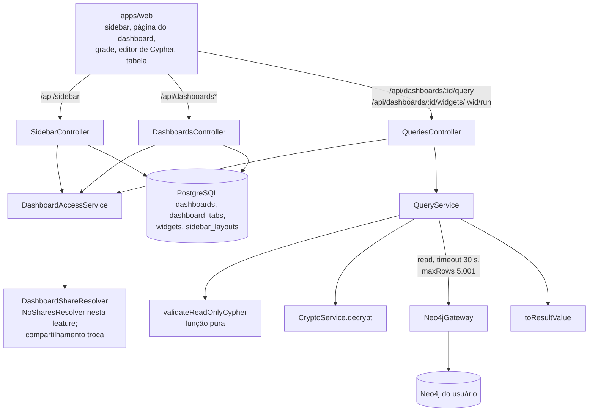

# Dashboards e Consultas Design

**Spec**: `.specs/features/dashboards-consultas/spec.md`
**Context**: `.specs/features/dashboards-consultas/context.md`
**Status**: Approved (o usuário dispensou a aprovação do design: "Não precisa da validação do design.")

Segue a arquitetura de `.specs/features/fundacao-auth/design.md` e as interfaces de `.specs/features/conexoes-schema/design.md` (`Neo4jGateway`, `CryptoService`, `connections`). As decisões novas desta feature são AD-042 a AD-046 em `.specs/STATE.md`.

**Estado do código no momento deste design:** o repositório tem só o scaffolding de `fundacao-auth` (T1 a T4: workspace, `@ninbi/contracts`, `apps/api` e `apps/web` vazios). `conexoes-schema` ainda não foi implementada. Este design parte do que os tasks.md dessas duas features definem (`createTestApp` com a opção `neo4j`, `FakeNeo4jGateway`, `renderApp`, `SETTINGS_TABS`, `useTopBarAction`, `Sidebar` com a lista rolável vazia, `HomePage`, `ConnectionRowActions`). Quem implementar segue o código real quando ele divergir daqui e marca a diferença com `SPEC_DEVIATION`.

Divergência já visível: `apps/web/package.json` instalou `react-router` 8, e AD-036 fala em React Router 7. O design usa só `createBrowserRouter`, `useParams`, `useSearchParams`, `useNavigate` e `useBlocker`, presentes nas duas versões.

---

## Architecture Overview

O backend ganha quatro módulos: `dashboard-access` (quem vê, edita e exclui cada dashboard), `dashboards` (criar, abrir, salvar de uma vez, excluir, lista do Admin), `sidebar` (organização por usuário) e `queries` (validação somente leitura e execução com limites). O web ganha a lista da sidebar, a página do dashboard com o modo de edição, a grade, o editor de Cypher, o widget de tabela e a aba "Dashboards" de "Configurações".



### Execução de um widget

```mermaid
sequenceDiagram
    participant W as Web (WidgetCard)
    participant C as QueriesController
    participant A as DashboardAccessService
    participant Q as QueryService
    participant G as Neo4jGateway
    W->>C: POST /api/dashboards/:id/widgets/:wid/run {params?}
    C->>A: assert(user, id, 'view')
    alt não alcança
        C-->>W: 404 DASHBOARD_NOT_FOUND
    end
    C->>Q: run({ connectionId, cypher salvo, params, widgetId, user })
    Q->>Q: tamanho (20.000) → várias instruções → cláusula bloqueada
    alt recusado
        Q-->>W: 400 QUERY_TOO_LONG | QUERY_MULTIPLE_STATEMENTS | QUERY_WRITE_BLOCKED
    end
    Q->>Q: $parametros sem valor → null
    Q->>G: read(cfg, cypher, params, { timeoutMs: 30.000, maxRows: 5.001 })
    alt prazo
        Q-->>W: 422 QUERY_TIMEOUT "A consulta excedeu o tempo limite de 30 s"
    else escrita em transação de leitura
        Q-->>W: 422 QUERY_WRITE_BLOCKED "Somente consultas de leitura são permitidas"
    else banco inacessível
        Q-->>W: 422 NEO4J_UNAVAILABLE "Não foi possível conectar ao banco <nome>"
    else outro erro do Neo4j
        Q-->>W: 422 QUERY_FAILED (mensagem do Neo4j; quem só vê recebe "Não foi possível carregar este widget")
    end
    Q->>Q: corta em 5.000, converte valores (toResultValue)
    Q->>Q: log: usuário, conexão, widget, duração, linhas, resultado
    C-->>W: 200 { columns, rows, truncated, rowLimit }
```

### Salvar o dashboard

```mermaid
sequenceDiagram
    participant W as Web (modo de edição)
    participant C as DashboardsController
    participant A as DashboardAccessService
    participant DB as PostgreSQL
    W->>C: PUT /api/dashboards/:id { version, name, connectionId, tabs[widgets] }
    C->>A: assert(user, id, 'edit')
    C->>DB: BEGIN; UPDATE dashboards SET ..., version = version + 1 WHERE id AND version = $v RETURNING
    alt nenhuma linha
        C-->>W: 409 DASHBOARD_VERSION_CONFLICT (ou 404 se sumiu)
    end
    C->>DB: apaga abas (cascata nos widgets), insere abas e widgets com os ids do rascunho; COMMIT
    C-->>W: 200 DashboardDto (version nova)
```

### Onde as regras rodam

| Regra | Camada | Testada por |
| ----- | ------ | ----------- |
| Somente leitura, uma instrução, 20.000 caracteres, parâmetros sem valor | `apps/api/src/queries/read-only-cypher.ts` (pura) | testes unitários da API |
| Prazo, 5.000 linhas, tradução de erros do Neo4j, log, mensagem genérica para quem só vê | `QueryService` | testes rápidos (fake) e de integração (Neo4j real) |
| Quem alcança, edita e exclui | `DashboardAccessService` | testes de rota |
| Ordem da sidebar, inclusão de dashboards novos, retirada dos apagados | `SidebarService` | testes de rota |
| Mover item e grupo, excluir grupo | `apps/web/src/features/sidebar/layout.ts` (pura) | testes unitários do web |
| Ordenar e paginar a tabela, formatar célula | `apps/web/src/features/widgets/table-rules.ts` (pura) | testes unitários do web |
| Aba nova "Aba N", posição do widget novo, rascunho sujo | `apps/web/src/features/dashboards/draft.ts` (pura) | testes unitários do web |
| Valores do Neo4j em JSON sem perda (inteiros > 2^53, nós, listas, mapas) | `apps/api/src/queries/result-value.ts` (pura) | testes unitários da API |
| Lista do Admin em ordem alfabética | `DashboardsService.listAll` | testes de rota |

---

## Code Reuse Analysis

### Existing Components to Leverage

| Component | Location | How to Use |
| --------- | -------- | ---------- |
| `createTestApp`, `createTestDb`, `Clock` falso, `FakeNeo4jGateway` | `apps/api/test/` (fundacao-auth T11, conexoes-schema T4) | Ganha a opção `shares` (um `FakeShareResolver`) |
| harness de integração | `apps/api/test-int/harness.ts` | EDIT-04 em corrida real; consultas contra o "Varejo" |
| `Neo4jGateway.read`, `Neo4jTimeoutError`, `Neo4jGatewayError` | `apps/api/src/neo4j/` (conexoes-schema T4) | Única forma de falar com o Neo4j; esta feature acrescenta `code` ao erro e confia em `maxRows` (ver Risks) |
| `CryptoService.decrypt` | `apps/api/src/crypto/` | Senha da conexão na hora de executar |
| `ConnectionsService.delete` | `apps/api/src/connections/` | Ganha a recusa de DASH-14 |
| `@RequirePermission`, `can()`, `@CurrentUser()` | `apps/api/src/auth/`, `packages/contracts/src/roles.ts` | `dashboards.create` (Admin, Editor), `dashboards.all` (Admin), `sidebar.own` (todos) já existem na matriz |
| `AppError`, `AppErrorFilter`, `ZodValidationPipe`, `MESSAGES`, `ERROR_CODES` | `apps/api/src/common/`, `packages/contracts/src/` | Corpo `{ code, message, fieldErrors }` |
| `renderApp`, MSW `server`, fixtures | `apps/web/src/test/` | Testes de tela com gesto |
| `Sidebar` (lista rolável vazia), `HomePage`, `useTopBarAction` | `apps/web/src/features/shell/`, `features/home/` | A lista recebe `SidebarDashboards`; a página inicial passa a depender da sidebar |
| `SETTINGS_TABS`, `SettingsPage` | `apps/web/src/features/settings/` | Nova aba "Dashboards" |
| `UsersTab`, `ConnectionsTab`, `ConnectionRowActions` | `apps/web/src/features/users/`, `features/connections/` | Padrão de tabela, esqueleto, erro e confirmação |
| `useConnections()` | `apps/web/src/features/connections/api.ts` | Campo "Conexão" de "Novo dashboard" e do modo de edição |
| shadcn `card`, `tabs`, `dialog`, `alert-dialog`, `dropdown-menu`, `table`, `skeleton`, `select`, `form`, `input`, `button`, `sonner` | `apps/web/src/components/ui/` | Telas desta feature; `tooltip` não é usado (o nome inteiro sai em `title`) |

### Integration Points

| System | Integration Method |
| ------ | ------------------ |
| PostgreSQL | Quatro tabelas novas (Data Models), migração do drizzle-kit; `dashboards.connection_id` com `ON DELETE RESTRICT` |
| Neo4j do usuário | `Neo4jGateway.read` com `timeoutMs` e `maxRows`; driver por operação (AD-040), sem cache nesta feature |
| `apps/api/src/config/env.ts` | `NINBI_QUERY_TIMEOUT_MS` (padrão `30000`) e `NINBI_QUERY_MAX_ROWS` (padrão `5000`) |
| `compartilhamento` | Troca o provider de `DASHBOARD_SHARE_RESOLVER`; nada mais muda nas rotas |
| `widgets-graficos` | Lê `QueryResultDto` e `ResultValue`; acrescenta valores a `WIDGET_VISUALIZATIONS` e usa `widgets.config` |
| `interatividade` | Envia `params` nas duas rotas de execução; reaproveita `QueryService.run` para a origem "Consulta Cypher" |
| `ia-cypher` / `ia-dashboard` | Reaproveitam `validateReadOnlyCypher` e `QueryService.run`; escrevem no rascunho do modo de edição |

---

## Components

### Backend

#### `validateReadOnlyCypher` e `extractParameterNames`
- **Purpose**: Recusar Cypher de escrita antes do Neo4j (QRY-02 a QRY-05, QRY-09, QRY-15) e achar os `$parametros` (QRY-10).
- **Location**: `apps/api/src/queries/read-only-cypher.ts`
- **Interfaces**:
  ```typescript
  type CypherCheck =
    | { ok: true }
    | { ok: false; code: 'QUERY_TOO_LONG' | 'QUERY_MULTIPLE_STATEMENTS' | 'QUERY_WRITE_BLOCKED'; message: string; clause?: string }
  function validateReadOnlyCypher(cypher: string, maxLength = 20_000): CypherCheck
  function extractParameterNames(cypher: string): string[]   // sem repetição, na ordem em que aparecem
  ```
- **Tokenizador** (um só, usado pelas duas funções): percorre o texto e pula strings entre `'` e entre `"` (com `\` escapando), comentários `//` até o fim da linha e `/* ... */`, e identificadores entre crases (crase dobrada é crase literal). O que sobra vira palavras (`[A-Za-z_][A-Za-z0-9_]*`), `$nome`, `;` e outros símbolos.
- **Ordem das recusas**: (1) mais de `maxLength` caracteres → "A consulta passa de 20.000 caracteres"; (2) um `;` fora de string, comentário e crase seguido de qualquer palavra ou símbolo → "Envie uma consulta por vez" (um `;` final, seguido só de espaços e comentários, é aceito); (3) primeira cláusula bloqueada encontrada → "Somente consultas de leitura são permitidas. Cláusula bloqueada: <cláusula>".
- **Cláusulas**: palavras `CREATE`, `MERGE`, `DELETE`, `SET`, `REMOVE`, `DROP`, `ALTER`, `RENAME`, `GRANT`, `DENY`, `REVOKE`, `FOREACH`, e os pares de palavras consecutivas `LOAD CSV` e `IN TRANSACTIONS`, comparadas sem diferenciar maiúsculas (QRY-03). A cláusula sai na mensagem em maiúsculas, com um espaço nos pares. Só palavras inteiras contam: `created_at`, `createLabel` e `resetting` passam (QRY-15). Uma palavra logo depois de `.` (propriedade, `n.set`) ou de `$` (parâmetro, `$create`) não é cláusula (AD-045).
- **Procedimentos**: `CALL db.createLabel('X')` passa no validador; a transação de leitura recusa (QRY-01, QRY-06).

#### `toResultValue`
- **Purpose**: Converter cada valor do `neo4j-driver` num valor JSON sem perda (TBL-06, TBL-08).
- **Location**: `apps/api/src/queries/result-value.ts`
- **Interfaces**: `toResultValue(value: unknown): ResultValue` (tipo em `@ninbi/contracts`).
- **Regras**: `null`/`undefined` → `null`; boolean e string ficam; número JS fica; `Integer` dentro de ±(2^53 − 1) → número, fora → `{ kind: 'bigint', value: '<dígitos>' }`; `Date`, `DateTime`, `LocalDateTime`, `Time`, `LocalTime`, `Duration` e `Point` → `toString()` do driver; nó → `{ kind: 'json', value: JSON de { labels, properties } }`; relacionamento → `{ kind: 'json', value: JSON de { type, properties } }`; caminho → `{ kind: 'json', value: JSON de { nodes, relationships } }`; lista e mapa → `{ kind: 'json', value: <JSON> }`. Dentro do JSON, um `Integer` sai como os dígitos crus (`{"id":9007199254740993}`), sem passar por `Number`.

#### `QueryService`
- **Purpose**: Executar um Cypher numa conexão com validação, limites, tradução de erros e log (QRY-01, QRY-06 a QRY-10, QRY-13, QRY-14).
- **Location**: `apps/api/src/queries/query.service.ts`
- **Interfaces**:
  ```typescript
  run(input: { userId: string; connectionId: string; cypher: string;
               params?: Record<string, unknown>; widgetId?: string | null;
               maskErrors?: boolean }): Promise<QueryResultDto>
  ```
- **Fluxo**: `validateReadOnlyCypher` → 400 com o código e a mensagem; conexão inexistente → 404 `CONNECTION_NOT_FOUND`; `params` = cada nome de `extractParameterNames` com `null`, sobrescrito pelo que veio em `params` (QRY-10); `gateway.read(cfg, cypher, params, { timeoutMs: QUERY_TIMEOUT_MS, maxRows: QUERY_MAX_ROWS + 1 })`; mais de `QUERY_MAX_ROWS` linhas → corta e marca `truncated: true` (QRY-08); cada linha vira `keys.map(k => toResultValue(row[k]))`.
- **Erros** (`AppError`, status 422 salvo indicação):

| Origem | Código | Mensagem |
| ------ | ------ | -------- |
| `Neo4jTimeoutError` | `QUERY_TIMEOUT` | "A consulta excedeu o tempo limite de 30 s" (segundos de `QUERY_TIMEOUT_MS`) |
| `Neo4jGatewayError` com `code` `Neo.ClientError.Statement.AccessMode`, ou mensagem com "access mode" | `QUERY_WRITE_BLOCKED` | "Somente consultas de leitura são permitidas" |
| `Neo4jGatewayError` com `code` `ServiceUnavailable` ou `SessionExpired`, ou `decrypt` falhando | `NEO4J_UNAVAILABLE` | "Não foi possível conectar ao banco <nome da conexão>" |
| outro `Neo4jGatewayError` | `QUERY_FAILED` | mensagem do Neo4j, sem alteração |

  Com `maskErrors: true` (quem só vê o dashboard), toda mensagem de 422 vira "Não foi possível carregar este widget", mantendo o código (TBL-12; quem só vê não enxerga Cypher nem o erro do banco).
- **Tokens**: `QUERY_TIMEOUT_MS` e `QUERY_MAX_ROWS`, lidos de `env` (`NINBI_QUERY_TIMEOUT_MS`, padrão `30000`; `NINBI_QUERY_MAX_ROWS`, padrão `5000`). Os testes sobrescrevem os tokens e conferem os padrões em teste separado.
- **Log (QRY-14)**: `Logger('Query')`, uma linha por execução, inclusive as recusadas: `query user=<id> connection=<id> widget=<id|-> durationMs=<n> rows=<n> result=<ok|truncated|blocked|timeout|unavailable|failed>`. Nunca grava o Cypher, os parâmetros nem as linhas.

#### `DashboardAccessService` e `DashboardShareResolver`
- **Purpose**: Decidir quem alcança, edita e exclui um dashboard (DASH-13, DASH-17 a DASH-19, QRY-11, QRY-16), com um ponto de troca para `compartilhamento` (AD-044).
- **Location**: `apps/api/src/dashboard-access/`
- **Interfaces**:
  ```typescript
  interface DashboardShareResolver {               // token DASHBOARD_SHARE_RESOLVER
    accessFor(userId: string, dashboardId: string): Promise<'view' | 'edit' | null>
    sharedDashboardIds(userId: string): Promise<string[]>
  }
  class NoSharesResolver implements DashboardShareResolver   // provider padrão: null e []
  interface DashboardAccess { dashboardId: string; ownerId: string; connectionId: string; canView: true; canEdit: boolean; canDelete: boolean }
  class DashboardAccessService {
    find(user: SessionUser, dashboardId: string): Promise<DashboardAccess | null>
    assert(user: SessionUser, dashboardId: string, need: 'view' | 'edit' | 'delete'): Promise<DashboardAccess>
    sidebarDashboardIds(user: SessionUser): Promise<string[]>   // próprios ∪ compartilhados, por created_at
  }
  ```
- **Regras**: dono → ver, editar, excluir; papel com `dashboards.all` (Admin) → ver, editar, excluir qualquer um; compartilhamento `edit` → ver e editar; `view` → ver. Sem nenhum desses, ou dashboard inexistente → 404 `DASHBOARD_NOT_FOUND` "Dashboard não encontrado" (não revela que existe). Alcança mas falta `edit`/`delete` → 403 `FORBIDDEN`. Id que não é UUID → 404.
- **Fake de teste**: `apps/api/test/fakes/fake-share-resolver.ts` com `grant(userId, dashboardId, 'view' | 'edit')`; `createTestApp({ shares })` registra o fake no token.

#### `DashboardsService` / `DashboardsController`
- **Location**: `apps/api/src/dashboards/`
- **Rotas**:

| Rota | Guarda | Resposta |
| ---- | ------ | -------- |
| `POST /api/dashboards` `{ name, connectionId }` | `dashboards.create` | 201 `DashboardDto` com uma aba "Aba 1", dono = usuário (DASH-05); 400 `VALIDATION_ERROR` (nome, conexão inexistente em `fieldErrors.connectionId` "Conexão não encontrada"); 403 Visualizador (DASH-12) |
| `GET /api/dashboards` | `dashboards.all` | `DashboardSummaryDto[]` em ordem alfabética de nome (`localeCompare('pt-BR', { sensitivity: 'base' })`) (DASH-20); 403 Editor e Visualizador (DASH-22) |
| `GET /api/dashboards/:id` | `assert('view')` | `DashboardDto`; 404 (DASH-13) |
| `PUT /api/dashboards/:id` | `assert('edit')` | 200 `DashboardDto`; 403 (DASH-19); 404; 409 `DASHBOARD_VERSION_CONFLICT` (EDIT-04); 400 |
| `DELETE /api/dashboards/:id` | `assert('delete')` | 204, cascata em abas e widgets (DASH-11); 403 (DASH-19); 404 |

- **`DashboardDto` por permissão**: `permissions: { edit, delete }` vêm do `DashboardAccess`. Para quem não pode editar, `cypher` de cada widget sai `null` e `hasQuery` diz se há consulta (AD-043).
- **Salvar**: ver o diagrama. Os ids de abas e widgets vêm do rascunho (UUID gerado no navegador com `crypto.randomUUID()`), para que o widget mantenha o id entre gravações; id que já pertence a outro dashboard → 400 `VALIDATION_ERROR`. A ordem das abas é a do array. `updated_at` = `clock.now()`.

#### `SidebarService` / `SidebarController`
- **Location**: `apps/api/src/sidebar/`
- **Rotas** (ambas `sidebar.own`, todos os papéis: SIDE-13):
  - `GET /api/sidebar` → `SidebarDto`
  - `PUT /api/sidebar` `SidebarLayoutInput` → 200 `SidebarDto`; 400 `VALIDATION_ERROR` (nome de grupo vazio ou com mais de 40 caracteres, ids repetidos)
- **Montagem (AD-042)**: lê o documento do usuário em `sidebar_layouts` (sem linha: documento vazio), tira os dashboards que ele não alcança mais ou que foram apagados (DASH-11), acrescenta no fim, soltos, os de `sidebarDashboardIds` que faltam, em ordem de criação (DASH-05), e devolve cada dashboard com o nome atual. Grupos vazios ficam.
- **Gravação**: substitui o documento inteiro do usuário (`INSERT ... ON CONFLICT (user_id) DO UPDATE`); a última gravação vale (SIDE-17). Dashboards que o usuário não alcança são descartados antes de gravar. Nunca toca o documento de outro usuário (SIDE-10).

#### Acréscimo em `ConnectionsService.delete`
- Antes do `DELETE`, conta `dashboards` com a conexão: N > 0 → 409 `CONNECTION_IN_USE` "Esta conexão é usada por N dashboard(s)" (DASH-14). A chave estrangeira `ON DELETE RESTRICT` segura o caso de corrida.

### Frontend

| Componente | Location | Interfaces / comportamento |
| ---------- | -------- | -------------------------- |
| `dashboardsApi` | `src/features/dashboards/api.ts` | `useSidebar()`, `useSaveSidebar()` (otimista com volta em erro), `useDashboard(id)`, `useCreateDashboard()`, `useSaveDashboard(id)`, `useDeleteDashboard(id)`, `useAllDashboards()`; `runWidget(dashboardId, widgetId, signal)`, `runQuery(dashboardId, { cypher, connectionId }, signal)` |
| fixtures | `src/test/fixtures/dashboards.ts` | `DashboardDto`, `SidebarDto`, `QueryResultDto` de exemplo, handlers MSW |
| `layout.ts` | `src/features/sidebar/layout.ts` | puras: `moveItem(layout, draggedId, target)` com `target` = `{ before: id }` \| `{ intoGroup: groupId }` \| `{ rootEnd: true }`; `addGroup(layout, id, name)`; `renameGroup`; `removeGroup` (dashboards do grupo ficam soltos na posição dele: SIDE-09); grupo nunca entra em grupo |
| `SidebarDashboards` | `src/features/sidebar/SidebarDashboards.tsx` | dentro da lista rolável da `Sidebar`; esqueleto (DASH-03); erro "Não foi possível carregar os dashboards" + "Tentar novamente" (DASH-04); dashboards soltos e grupos; item ativo com `aria-current="page"` e o gradiente (DASH-08); nome com `truncate` e `title` (SIDE-15); cabeçalho do grupo é um botão com `aria-expanded` que recolhe e expande, estado em `localStorage['ninbi-sidebar-collapsed']` (SIDE-07); "Grupo vazio" (SIDE-14); botões "Novo dashboard" (só com `dashboards.create`: DASH-09) e "Novo grupo" |
| arrastar na sidebar | mesmo componente | arrastar nativo do HTML5 (`draggable`, `onDragStart`, `onDragOver`, `onDrop`): soltar sobre um item põe antes dele, no mesmo contêiner; soltar no cabeçalho de um grupo põe no fim do grupo; soltar na faixa final da lista põe no fim, solto; cada mudança aplica `moveItem` na hora e chama `PUT /api/sidebar`; erro volta ao layout anterior e mostra o toast "Não foi possível salvar a organização" (SIDE-12) |
| `GroupDialogs` | `src/features/sidebar/GroupDialogs.tsx` | "Novo grupo" e "Renomear grupo" (campo "Nome", 1 a 40); menu do grupo com "Renomear grupo" e "Excluir grupo" (sem confirmação: nenhum dashboard é apagado) |
| `NewDashboardDialog` | `src/features/dashboards/NewDashboardDialog.tsx` | "Nome" e "Conexão" (select de `useConnections`); sem conexões: aviso "Cadastre uma conexão antes de criar um dashboard" e "Criar" desabilitado (DASH-07); "Criar" desabilitado durante o envio (DASH-16); sucesso abre `/dashboards/<id>?editar=1` |
| `HomePage` | `src/features/home/HomePage.tsx` (modify) | sem dashboards na sidebar: "Nenhum dashboard ainda" (DASH-02); com dashboards: "Escolha um dashboard na barra lateral" |
| `DashboardPage` | `src/features/dashboards/DashboardPage.tsx` | rota `/dashboards/:dashboardId`; esqueleto; 404 → "Dashboard não encontrado" + link "Ir para a página inicial" (DASH-13); qualquer 404 `DASHBOARD_NOT_FOUND` posterior (salvar, executar, excluir) troca a página por essa mensagem (DASH-15); cabeçalho com o nome, "Atualizar" (TBL-15), menu "Mais ações" com "Excluir" (só `permissions.delete`); ação principal da TopBar "Editar" (só `permissions.edit`: DASH-18) ou "Salvar" em edição; `?editar=1` entra direto em edição |
| `DashboardTabsBar` | `src/features/dashboards/DashboardTabsBar.tsx` | abas na ordem, ativa com `aria-selected` (TAB-01); contêiner `overflow-x-auto` e `whitespace-nowrap` (TAB-08); em edição: "Nova aba", e no menu da aba "Renomear aba" e "Excluir aba" (desabilitado com uma aba só: TAB-06; com widgets pede "Excluir a aba <nome> e seus N widgets?": TAB-05) |
| `draft.ts` | `src/features/dashboards/draft.ts` | puras sobre `DashboardDraft`: `fromDto`, `toSavePayload`, `addTab` ("Aba N" com N = número de abas depois de adicionar: TAB-03), `renameTab`, `removeTab`, `addWidget` (4×4 "Novo widget" em `x: 0`, `y` = maior `y + h` da aba: GRID-05), `updateWidget`, `removeWidget`, `setLayout`, `setName`, `setConnection`, `isDirty` |
| modo de edição | `src/features/dashboards/useDashboardEditor.ts` | estado visualização ↔ edição; "Salvar" manda o rascunho inteiro (EDIT-02) e fica desabilitado durante o envio (EDIT-09); erro 500 mantém o rascunho com "Não foi possível salvar. Tente novamente." (EDIT-03); 409 mostra a mensagem da API (EDIT-04); "Descartar" com mudanças pede "Descartar as alterações?" (EDIT-05, EDIT-06); `useBlocker` + `beforeunload` pedem "Sair sem salvar as alterações?" (EDIT-07); campos "Nome" e "Conexão" do dashboard em edição (EDIT-08) |
| `DashboardGrid` | `src/features/dashboards/DashboardGrid.tsx` | `react-grid-layout`, 12 colunas (GRID-01), `compactType: 'vertical'` e sem sobreposição (GRID-02), `minW: 2`, `minH: 2`, `maxW: 12` (GRID-03), `isDraggable`/`isResizable` só em edição (GRID-04), alça de arrasto no título do card; largura medida por um hook `useContainerWidth` (ResizeObserver) que o teste fixa em 1.200 px; "Esta aba está vazia" (TAB-07); "Novo widget" em edição (GRID-05) |
| `WidgetCard` | `src/features/widgets/WidgetCard.tsx` | card `bg-card rounded-card` com o título no topo (GRID-07); estados: esqueleto (TBL-09), "A consulta não retornou dados" (TBL-10), erro com a `message` da API e "Tentar novamente" (TBL-11, TBL-12), "Widget sem consulta" sem requisição (TBL-14), tabela; em edição, menu do card com "Editar widget" e "Remover widget" ("Remover o widget <título>?": WDG-08) |
| `useWidgetResult` | `src/features/widgets/useWidgetResult.ts` | TanStack Query; em visualização chave `['widget-run', dashboardId, version, widgetId]` e `runWidget`; em edição chave `['query', dashboardId, connectionId, cypher]` e `runQuery` (troca de conexão roda de novo: EDIT-10); `staleTime: Infinity`, o `signal` da query vai ao `fetch`: sair da aba ou da página cancela e descarta (TBL-17); "Atualizar" invalida só as chaves dos widgets da aba ativa (TBL-15) |
| `ResultTable` / `table-rules.ts` | `src/features/widgets/ResultTable.tsx`, `table-rules.ts` | uma coluna por item de `columns`, na ordem e com repetidas (TBL-01, TBL-16); clique no cabeçalho alterna crescente → decrescente → original, com `aria-sort` (TBL-02); `compareValues`: números (inclusive `bigint` via `BigInt`) por valor, textos por `Intl.Collator('pt-BR')`, nulos sempre por último (TBL-03); 50 linhas por página, "Página X de Y", "Página anterior" e "Próxima página" (TBL-04); contêiner `overflow-auto` com `thead` `sticky top-0` (TBL-05); `formatCell`: `json` → o texto JSON, `bigint` → os dígitos, `null` → "—" (TBL-06 a TBL-08); aviso "Mostrando as primeiras 5.000 linhas" quando `truncated` (QRY-08) |
| `CypherEditor` | `src/features/widgets/CypherEditor.tsx` | `react-simple-code-editor` (textarea com `aria-label="Cypher"`) + realce do `prismjs` com a gramática `cypher`; cores dos tokens por classes ligadas a variáveis do tema, sem cor literal |
| `WidgetEditorDialog` | `src/features/widgets/WidgetEditorDialog.tsx` | "Título", `CypherEditor`, "Executar" (desabilitado com o editor vazio: WDG-04; "Executando..." e desabilitado durante a execução: WDG-10), prévia com `ResultTable` ou a mensagem de erro (WDG-02, WDG-03), "Aplicar" (título 1 a 80: WDG-07; atualiza o rascunho: WDG-05) e "Cancelar" (WDG-06) |
| `DeleteDashboardDialog` | `src/features/dashboards/DeleteDashboardDialog.tsx` | "Excluir o dashboard <nome>? Abas e widgets serão apagados. Esta ação não pode ser desfeita." (DASH-10); confirmar chama `DELETE`, invalida a sidebar e abre `/` (DASH-11) |
| `DashboardsTab` | `src/features/dashboards/DashboardsTab.tsx` | aba "Dashboards" de "Configurações" (`/configuracoes/dashboards`, permissão `dashboards.all`): tabela "Nome", "Dono", "Conexão", "Última alteração" na ordem da API; nome é link para `/dashboards/<id>` (DASH-20, DASH-21); esqueleto e erro com "Tentar novamente" |
| `ConnectionRowActions` (modify) | `src/features/connections/ConnectionRowActions.tsx` | 409 `CONNECTION_IN_USE` no "Excluir" mostra a `message` da API no diálogo e a conexão fica na lista (DASH-14) |

### Rotas novas do web

| Caminho | Tela | Guarda |
| ------- | ---- | ------ |
| `/dashboards/:dashboardId` | `DashboardPage` | sessão |
| `/dashboards/:dashboardId?editar=1` | `DashboardPage` já em edição | sessão; ignorado sem `permissions.edit` |
| `/configuracoes/dashboards` | `DashboardsTab` | sessão + `dashboards.all` |

---

## Data Models

```typescript
// apps/api/src/database/schema.ts (acréscimos)
dashboards: {
  id: uuid pk default gen_random_uuid()
  name: varchar(80) not null
  ownerId: uuid not null references users(id)            // usuário desativado mantém os dashboards
  connectionId: uuid not null references connections(id) on delete restrict   // DASH-14
  version: integer not null default 1                     // EDIT-04
  createdAt, updatedAt: timestamptz not null default now()
}  index on (owner_id), index on (connection_id)

dashboard_tabs: {
  id: uuid pk                                             // gerado no navegador
  dashboardId: uuid not null references dashboards(id) on delete cascade
  name: varchar(40) not null
  position: integer not null
}  index on (dashboard_id)

widgets: {
  id: uuid pk                                             // gerado no navegador
  dashboardId: uuid not null references dashboards(id) on delete cascade
  tabId: uuid not null references dashboard_tabs(id) on delete cascade
  title: varchar(80) not null
  cypher: text null                                       // até 20.000 caracteres
  visualization: varchar(40) not null default 'TABLE'     // widgets-graficos acrescenta valores
  config: jsonb not null default '{}'
  x, y, w, h: integer not null
}  index on (dashboard_id), index on (tab_id)

sidebar_layouts: {
  userId: uuid pk references users(id) on delete cascade
  layout: jsonb not null                                  // SidebarLayoutInput
  updatedAt: timestamptz not null
}
```

```typescript
// packages/contracts/src/dashboards.ts
const WIDGET_VISUALIZATIONS = ['TABLE'] as const
interface WidgetLayout { x: number; y: number; w: number; h: number }   // 0 ≤ x, x + w ≤ 12, 2 ≤ w ≤ 12, h ≥ 2, y ≥ 0
interface WidgetDto { id: string; title: string; cypher: string | null; hasQuery: boolean;
                      visualization: string; config: Record<string, unknown>; layout: WidgetLayout }
interface DashboardTabDto { id: string; name: string; widgets: WidgetDto[] }
interface DashboardDto { id: string; name: string; version: number; updatedAt: string
                         ownerId: string; ownerName: string; connectionId: string; connectionName: string
                         permissions: { edit: boolean; delete: boolean }; tabs: DashboardTabDto[] }
interface DashboardSummaryDto { id: string; name: string; ownerName: string; connectionName: string; updatedAt: string }

type SidebarDashboardNode = { type: 'dashboard'; id: string; name: string }
type SidebarGroupNode = { type: 'group'; id: string; name: string; items: SidebarDashboardNode[] }
interface SidebarDto { items: (SidebarDashboardNode | SidebarGroupNode)[] }
// SidebarLayoutInput: o mesmo formato sem `name` nos dashboards

type ResultValue = null | boolean | number | string | { kind: 'bigint'; value: string } | { kind: 'json'; value: string }
interface QueryResultDto { columns: string[]; rows: ResultValue[][]; truncated: boolean; rowLimit: number }

// schemas zod
dashboardCreateSchema   { name (trim, 1-80), connectionId (uuid) }
dashboardSaveSchema     { version (int ≥ 1), name, connectionId, tabs: [≥ 1] { id (uuid), name (trim, 1-40),
                          widgets: { id (uuid), title (trim, 1-80), cypher (≤ 20.000 | null),
                                     visualization, config, layout } } }
sidebarLayoutSchema     { items: (dashboard | group { id (uuid), name (trim, 1-40), items: dashboard[] })[] }
queryRunSchema          { cypher (1-20.000), connectionId?: uuid, params?: Record<string, unknown> }
widgetRunSchema         { params?: Record<string, unknown> }
```

**Relationships**: `dashboards.owner_id → users.id`; `dashboards.connection_id → connections.id` (restrict); abas e widgets pertencem ao dashboard e somem com ele; `sidebar_layouts` pertence ao usuário. `compartilhamento` liga `dashboard_shares` a `dashboards.id`.

### Validação e mensagens

| Campo | Regra | Mensagem |
| ----- | ----- | -------- |
| Nome do dashboard | obrigatório depois de `trim` | "Informe o nome do dashboard" |
| Nome do dashboard | até 80 caracteres | "O nome pode ter até 80 caracteres" |
| Conexão | obrigatória e existente | "Escolha uma conexão" / "Conexão não encontrada" |
| Nome do grupo e da aba | obrigatório depois de `trim` | "Informe o nome" |
| Nome do grupo e da aba | até 40 caracteres | "O nome pode ter até 40 caracteres" |
| Título do widget | obrigatório depois de `trim` | "Informe o título" |
| Título do widget | até 80 caracteres | "O título pode ter até 80 caracteres" |
| Cypher | até 20.000 caracteres | "A consulta passa de 20.000 caracteres" |

As mensagens de campo que a spec só chama de "mensagem no campo" foram fixadas aqui e ficam em `MESSAGES`.

---

## Error Handling Strategy

| Error Scenario | Handling | User Impact |
| -------------- | -------- | ----------- |
| Corpo inválido | 400 `VALIDATION_ERROR` + `fieldErrors` | Mensagem no campo |
| Dashboard inexistente ou fora do alcance | 404 `DASHBOARD_NOT_FOUND` | "Dashboard não encontrado" + "Ir para a página inicial" |
| Alcança mas não edita (ou não é dono nem Admin, ao excluir) | 403 `FORBIDDEN` | Botões não aparecem |
| Visualizador cria dashboard ou abre a lista de todos | 403 `FORBIDDEN` | Botão não aparece; a URL mostra a página de permissão |
| Versão desatualizada ao salvar | 409 `DASHBOARD_VERSION_CONFLICT` | "Este dashboard foi alterado por outra pessoa. Recarregue para continuar." e continua em edição |
| PostgreSQL falha ao salvar | 500 `INTERNAL_ERROR` | "Não foi possível salvar. Tente novamente." e continua em edição |
| Widget inexistente no dashboard | 404 `WIDGET_NOT_FOUND` | "Não foi possível carregar este widget" |
| Cypher com mais de 20.000 caracteres | 400 `QUERY_TOO_LONG` | Mensagem na prévia ou no card |
| Mais de uma instrução | 400 `QUERY_MULTIPLE_STATEMENTS` | "Envie uma consulta por vez" |
| Cláusula de escrita | 400 `QUERY_WRITE_BLOCKED` | "Somente consultas de leitura são permitidas. Cláusula bloqueada: <cláusula>" |
| Neo4j recusa escrita na transação de leitura | 422 `QUERY_WRITE_BLOCKED` | "Somente consultas de leitura são permitidas" |
| Prazo de 30 s | driver fechado, 422 `QUERY_TIMEOUT` | "A consulta excedeu o tempo limite de 30 s" |
| Neo4j inacessível ou senha que não decifra | 422 `NEO4J_UNAVAILABLE` | "Não foi possível conectar ao banco <nome>" |
| Outro erro do Neo4j | 422 `QUERY_FAILED` com a mensagem do Neo4j | Quem edita vê a mensagem; quem só vê, "Não foi possível carregar este widget" |
| Mais de 5.000 linhas | 200 com `truncated: true` | "Mostrando as primeiras 5.000 linhas" |
| Excluir conexão usada | 409 `CONNECTION_IN_USE` | "Esta conexão é usada por N dashboard(s)" |
| Falha ao gravar a sidebar | o web volta o layout anterior | Toast "Não foi possível salvar a organização" |
| Lista da sidebar não carrega | query em erro | "Não foi possível carregar os dashboards" + "Tentar novamente" |

---

## Test Strategy

| Nível | O que cobre | Onde |
| ----- | ----------- | ---- |
| Contratos | regras de campo e mensagens | `packages/contracts/src/dashboards.spec.ts` |
| API pura | validador somente leitura, parâmetros, conversão de valores | `apps/api/test/queries/*.spec.ts` |
| API rápida (PGlite + `FakeNeo4jGateway` + `FakeShareResolver`) | tabelas, acesso, rotas de dashboard, sidebar, execução, log, DASH-14 | `apps/api/test/{database,dashboards,sidebar,queries,connections}/*.spec.ts` |
| API integração | Neo4j real: transação de leitura recusa procedimento de escrita, prazo real, 5.000 linhas, banco inacessível; EDIT-04 com duas gravações simultâneas no PostgreSQL real | `apps/api/test-int/*.int.spec.ts` |
| Web | gesto + texto visível, com MSW; funções puras da tabela, do rascunho e da sidebar | `apps/web/src/features/{sidebar,dashboards,widgets}/*.test.ts(x)` |

- Arrastar na sidebar: `fireEvent.dragStart`, `dragOver` e `drop` do Testing Library sobre os itens; o componente guarda o id arrastado no estado, sem depender de `dataTransfer`.
- Arrastar e redimensionar na grade: o teste fixa a largura em 1.200 px (100 px por coluna) e simula `mousedown`, `mousemove` e `mouseup` na alça; a posição resultante é lida do `PUT` enviado ao salvar. Uma função pura própria não é criada: a compactação é do `react-grid-layout`.
- Editor de Cypher: o `textarea` do `react-simple-code-editor` aceita `userEvent.type` no jsdom.
- Prazos: os testes injetam `QUERY_TIMEOUT_MS` curto; um teste separado confere os padrões `30000` e `5000` lidos do env.

---

## Risks & Concerns

| Concern | Location (file:line) | Impact | Mitigation |
| ------- | -------------------- | ------ | ---------- |
| `Neo4jGatewayError` sem `code` no design de `conexoes-schema` | `apps/api/src/neo4j/neo4j.gateway.ts` | Sem o código, QRY-06 e QRY-13 dependem só do texto da mensagem | A T10 acrescenta `code?: string` ao erro (preenchido com `error.code` do driver), sem mudar quem já o usa |
| Semântica de `maxRows` não definida em `conexoes-schema` | `apps/api/src/neo4j/driver-neo4j.gateway.ts` | Se `maxRows` lançar erro em vez de cortar, QRY-08 quebra | A T10 confere e, se preciso, faz o driver parar de consumir depois de `maxRows` linhas e devolver as lidas; o teste de integração de QRY-08 prova contra o Neo4j real |
| Código real do erro de escrita em transação de leitura | Neo4j 5 | Procedimento de escrita pode vir com outro código | A tradução aceita o código `Neo.ClientError.Statement.AccessMode` ou "access mode" na mensagem; o teste de integração com `CALL db.createLabel` fixa o comportamento real |
| Driver por operação | `driver-neo4j.gateway.ts` | Um dashboard com 10 widgets abre 10 conexões TCP | Aceitável no MVP (AD-040); cache de drivers por conexão fica para depois, sem mudar a interface |
| Consulta continua no Neo4j depois que o navegador desiste | `QueryService` | Sair da aba não cancela a transação no servidor | O prazo de 30 s limita o custo; o web descarta o resultado (TBL-17) |
| Colunas repetidas | `Neo4jReadResult.rows` é objeto por chave | `RETURN a.x AS v, b.x AS v` perderia uma coluna | O Neo4j 5 recusa colunas com o mesmo nome; TBL-16 é garantido na tabela do web, que mostra o que vier em `columns` |
| Palavra-chave usada como nome de propriedade | validador | `RETURN n.set` passa (regra do `.`), mas `{set: 1}` é recusado | Mensagem diz a cláusula; o usuário usa crases. Registrado em AD-045 |
| Test gap: jsdom não calcula layout | grade, sidebar, abas, tabela | GRID-02, SIDE-16, TAB-08, TBL-05 não são medidos | Grade com largura fixa no teste; os demais conferem classes (`overflow-y-auto`, `overflow-x-auto`, `whitespace-nowrap`, `sticky`); a medição visual fica com o usuário (AD-023) |
| Testes existentes de `fundacao-auth` mudam | `SettingsPage.test.tsx` (CFG-02), `HomePage` (SHELL-07) | Nova aba "Dashboards" para o Admin; a página inicial passa a depender da sidebar | A T28 atualiza CFG-02 (AD-046); SHELL-07 continua valendo porque o MSW padrão devolve a sidebar vazia |
| Test gap: PGlite tem uma conexão só | `apps/api/test/` | EDIT-04 com gravações simultâneas não é corrida real | Provado em `test-int/` contra o PostgreSQL do compose de dev |
| Security: ids de abas e widgets vindos do navegador | `DashboardsService.save` | Um id de outro dashboard poderia sobrescrever dados alheios | A gravação recusa com 400 ids que pertencem a outro dashboard |

---

## Tech Decisions (only non-obvious ones)

| Decision | Choice | Rationale |
| -------- | ------ | --------- |
| Organização da sidebar | Um documento JSONB por usuário, trocado inteiro; montagem com os dashboards alcançáveis na leitura (AD-042) | Arrastar, criar, renomear e excluir grupo viram uma rota só; a última gravação vale (SIDE-17); apagar e criar dashboard não precisam mexer na sidebar de ninguém |
| Gravação do dashboard | Documento inteiro com `version` otimista (AD-043) | "Salvar" grava tudo de uma vez (EDIT-02) e recusa versão velha (EDIT-04) |
| Ponto de troca do compartilhamento | `DashboardShareResolver` por token (AD-044) | DASH-19, QRY-11 e QRY-12 são testáveis agora com um fake; `compartilhamento` só troca o provider |
| Execução | Duas rotas: texto (só quem edita) e widget salvo (quem vê) (AD-045) | QRY-11 e QRY-12 ficam na rota, não na tela |
| Grade | `react-grid-layout` | 12 colunas, arrastar, redimensionar e compactação sem sobreposição prontos |
| Arrastar na sidebar | HTML5 nativo | Lista com um nível de grupo; dispensa biblioteca e é testável com `fireEvent` |
| Editor de Cypher | `react-simple-code-editor` + `prismjs` (gramática `cypher`) | Textarea real: digitar funciona no jsdom; realce sem CodeMirror |
| Ordenação e paginação da tabela | No navegador, em funções puras testadas | O resultado inteiro (até 5.000 linhas) já está no navegador; ordenar no servidor exigiria reexecutar a consulta |
| Aba ativa e modo de edição | Estado da página, não a URL (só `?editar=1` ao criar) | Spec abre sempre na primeira aba (DASH-08) |
