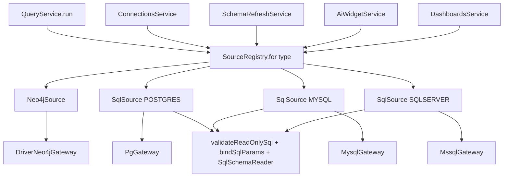

# Fontes SQL Design

**Spec**: `.specs/features/fontes-sql/spec.md`
**Status**: Approved

---

## Architecture Overview

Hoje o Neo4j é falado por três serviços que importam o gateway: `ConnectionsService` (testa), `QueryService` (valida, parametriza, executa, mapeia o resultado) e `SchemaReader` (lê o schema), mais o prompt da IA. A feature troca esse acoplamento por uma **fonte (`Source`) por tipo de conexão**, escolhida por um registro. Cada fonte sabe testar a conexão, validar a consulta, listar os parâmetros, executá-la, ler o schema e descrever o dialeto ao prompt. Os serviços passam a falar só com a interface.

Abordagens consideradas:

| | Abordagem | Custo | Veredito |
| - | --------- | ----- | -------- |
| A | **Uma `Source` por tipo, atrás de um registro; os nomes `cypher` no fio e no banco ficam** | Médio; o Neo4j vira uma `Source` que só embrulha o que já existe | **Recomendada**: o Neo4j não muda de comportamento (SMG-03) e não há renomeação em massa |
| B | Igual a A, mas renomear `cypher` para `query` no contrato, no banco, na API e na web | Alto; toca ~40 arquivos e todos os testes de widget e filtro | Recusada: risco de regressão sem ganho para o usuário |
| C | Biblioteca única de acesso (Knex) por cima dos três drivers | Médio; troca de modelo de transação, timeout e cancelamento por uma camada que não conheço no repositório | Recusada: não verifiquei o suporte a leitura-somente e cancelamento nos três bancos; A usa cada driver pelo que ele documenta |



Execução de uma consulta SQL:

```mermaid
sequenceDiagram
    participant W as Web
    participant Q as QueryService
    participant S as SqlSource
    participant G as PgGateway
    participant DB as Banco do usuário
    W->>Q: run(connectionId, texto, params)
    Q->>S: validate(texto)
    S-->>Q: ok / bloqueada
    Q->>S: parameterNames(texto)
    Q->>S: run(conn, texto, params, opts)
    S->>S: bindSqlParams(texto, params, estilo do banco)
    S->>G: read(cfg, texto', valores, opts)
    G->>DB: BEGIN READ ONLY; SET timeout
    G->>DB: texto' com valores
    DB-->>G: linhas (até 5.001)
    G->>DB: ROLLBACK
    G-->>S: keys + linhas já em ResultValue
    S-->>Q: SourceResult
    Q-->>W: QueryResultDto
```

---

## Code Reuse Analysis

### Existing Components to Leverage

| Component | Location | How to Use |
| --------- | -------- | ---------- |
| `DriverNeo4jGateway`, `Neo4jGateway` | `apps/api/src/neo4j/` | Fica como está; a `Neo4jSource` o embrulha |
| `validateReadOnlyCypher`, `toCypherParams`, `toResultValue` | `apps/api/src/queries/` | Movidos para dentro da `Neo4jSource` sem mudar de lógica |
| `SchemaReader` | `apps/api/src/schema/schema-reader.ts` | A `Neo4jSource.readSchema` o chama |
| `tokenizeCypher`, `extractParameterNames` | `packages/contracts/src/cypher-tokens.ts` | Mesma forma para o SQL (`sql-tokens.ts`); `extractParameterNames` ganha o argumento de linguagem |
| `ResultValue` (`bigint`, `json`) | `packages/contracts/src/dashboards.ts` | O SQL devolve os mesmos tipos; nada muda nos gráficos, CSV e filtros |
| Máquina de estado do schema (claim atômico, 120 s, mantém o anterior) | `apps/api/src/schema/schema-refresh.service.ts` | Reaproveitada inteira; só a leitura vira `source.readSchema` |
| Opt-outs de exemplo | `schema_example_opt_outs`, `SchemaQueryService` | Ganham o tipo de elemento `TABLE` |
| `FakeNeo4jGateway`, `harness.ts` | `apps/api/test/` | Modelo para o `FakeSqlGateway` |
| `QueryService` log, erros mascarados (TBL-12), `AppError` | `apps/api/src/queries/query.service.ts` | Mantidos; o código de erro do driver passa de `neo4jCode` a `dbCode` |
| Formulário, lista, tela de schema, editor | `apps/web/src/features/connections/`, `widgets/CypherEditor.tsx` | Estendidos pelo tipo da conexão |

### Integration Points

| System | Integration Method |
| ------ | ------------------ |
| PostgreSQL do NinBI | Migração `0006_fontes_sql`: `connections` ganha `type`, `host`, `port`, `ssl`; `uri` passa a aceitar nulo; o enum `schema_element_kind` ganha `TABLE` |
| `@ninbi/contracts` | Contratos de conexão (união por `type`), de schema (união por forma), `sql-tokens`, `ConnectionType`, `QueryLanguage`; `dashboards` ganha `connectionType` |
| Drivers | `pg` (já instalado), `pg-cursor`, `mysql2`, `mssql`; versões fixadas na task que os instala |

---

## Components

### SourceRegistry e Source

- **Purpose**: Escolher, pelo tipo da conexão, quem testa, valida, executa e lê o schema.
- **Location**: `apps/api/src/sources/` (`source.ts`, `source-registry.ts`, `sources.module.ts`)
- **Interfaces**:
  - `interface Source { readonly type: ConnectionType; readonly language: QueryLanguage; verify(conn: SourceConnection, opts: { timeoutMs: number }): Promise<void>; validate(query: string): QueryCheck; parameterNames(query: string): string[]; run(conn, query, params, opts: { timeoutMs; maxRows; signal? }): Promise<SourceResult>; readSchema(conn, opts: SchemaReadOptions): Promise<StoredSchema>; dialect: PromptDialect }`
  - `SourceRegistry.for(type: ConnectionType): Source`
  - `SourceConnection = { id, name, type, uri: string | null, host: string | null, port: number | null, ssl: boolean, database: string | null, username, password }` (senha já decifrada pelo chamador)
  - `SourceResult = { keys: string[]; rows: ResultValue[][] }`
  - `SourceTimeoutError`, `SourceGatewayError(message, code?)`; `Neo4jTimeoutError` e `Neo4jGatewayError` passam a estendê-los, então os `catch` e testes que existem seguem valendo
- **Dependencies**: as quatro fontes
- **Reuses**: o desenho de `Neo4jGateway` (verify + read, prazo, `AbortSignal`)

### Neo4jSource

- **Purpose**: A fonte do Neo4j; só embrulha o que existe.
- **Location**: `apps/api/src/sources/neo4j.source.ts`
- **Interfaces**: implementa `Source`; `run` aplica `toCypherParams`, chama o gateway e mapeia com `toResultValue` (o que o `QueryService` fazia)
- **Dependencies**: `NEO4J_GATEWAY`, `SchemaReader`
- **Reuses**: `validateReadOnlyCypher`, `toCypherParams`, `toResultValue`, `SchemaReader`

### SqlSource

- **Purpose**: Uma classe para os três bancos SQL, configurada por um gateway e um dialeto.
- **Location**: `apps/api/src/sources/sql.source.ts`
- **Interfaces**:
  - `new SqlSource(type, gateway: SqlGateway, dialect: SqlDialect)`
  - `validate` usa `validateReadOnlySql`; `parameterNames` usa `extractParameterNames(query, 'SQL')`; `run` usa `bindSqlParams` e o gateway; `readSchema` usa `SqlSchemaReader`
  - `SqlDialect = { placeholder: 'dollar' | 'question' | 'at'; quote(identifier): string; sampleQuery(table, n): string; catalogQueries: { tables: string; foreignKeys: string }; qualifiedNames: boolean; syntaxErrorCodes: Set<string>; label: 'PostgreSQL' | 'MySQL' | 'T-SQL' }`
- **Dependencies**: `SqlGateway`, `SqlSchemaReader`
- **Reuses**: o formato de erro de `QueryService.translate`

### SqlGateway (PgGateway, MysqlGateway, MssqlGateway)

- **Purpose**: O único ponto que importa cada driver SQL.
- **Location**: `apps/api/src/sources/gateways/{pg,mysql,mssql}.gateway.ts` e `sql.gateway.ts` (interface)
- **Interfaces**:
  - `interface SqlGateway { verify(cfg: SqlConnectionConfig, opts: { timeoutMs }): Promise<void>; read(cfg, sql: string, values: unknown[], opts: { timeoutMs; maxRows?; signal? }): Promise<SourceResult> }`
  - `SqlConnectionConfig = { host, port, database, username, password, ssl }`
  - `read` abre uma conexão, inicia a transação (em modo leitura no PostgreSQL e no MySQL), aplica o prazo, lê em fluxo até `maxRows`, termina em `ROLLBACK`, fecha a conexão, e converte data e hora em texto com o tipo da coluna que o driver informa
  - `ssl: true` liga a criptografia e a validação do certificado de cada driver; `false` a desliga
- **Dependencies**: `pg` + `pg-cursor`, `mysql2`, `mssql`
- **Reuses**: o padrão de `DriverNeo4jGateway` (uma conexão por operação, prazo que vence sozinho, `AbortSignal`, fechamento sem esperar quando estourou)

### validateReadOnlySql

- **Purpose**: Recusar, no backend, o que não é leitura (SQX-05 a SQX-09, SQX-12).
- **Location**: `apps/api/src/queries/read-only-sql.ts`
- **Interfaces**: `validateReadOnlySql(query: string): QueryCheck` com os mesmos códigos de `validateReadOnlyCypher` (`QUERY_TOO_LONG`, `QUERY_MULTIPLE_STATEMENTS`, `QUERY_WRITE_BLOCKED`) mais `QUERY_NOT_SELECT`
- **Dependencies**: `tokenizeSql`
- **Reuses**: a estrutura de `read-only-cypher.ts` (tokens, pares); ao contrário do Cypher, palavra bloqueada depois de `.` também é recusada (coluna com esse nome vai entre aspas)

### tokenizeSql e extractParameterNames

- **Purpose**: Um tokenizador de SQL com posição de cada token, partilhado pela API e pela web.
- **Location**: `packages/contracts/src/sql-tokens.ts`; `cypher-tokens.ts` ganha `extractParameterNames(query, language = 'CYPHER')`
- **Interfaces**:
  - `tokenizeSql(sql: string): SqlToken[]` com `type: 'word' | 'string' | 'identifier' | 'param' | 'number' | 'symbol' | 'semicolon'`, `value`, `start`, `end`; comentários `--` e `/* */` ficam de fora; strings `'...'` (com `''`), `N'...'`, `E'...'`; identificadores `"..."`, `[...]`, `` `...` ``; parâmetro é `$` mais letra ou `_`, nunca `$1` nem `$$`
  - `extractParameterNames(query, 'SQL')` usa `tokenizeSql`
- **Dependencies**: nenhuma
- **Reuses**: o formato de `tokenizeCypher`

### bindSqlParams

- **Purpose**: Trocar `$nome` por parâmetros do driver (SQX-15 a SQX-20).
- **Location**: `apps/api/src/queries/sql-params.ts`
- **Interfaces**: `bindSqlParams(sql, params, style: 'dollar' | 'question' | 'at'): { text: string; values: unknown[] }`
  - `$nome IS NULL` e `$nome IS NOT NULL`: trocados por `(1 = 1)` ou `(1 = 0)` conforme o valor, antes de qualquer outra coisa
  - lista: um marcador por item, separados por vírgula; lista vazia vira `NULL`
  - `{kind:'date', value}` vira o texto `AAAA-MM-DD`; o gateway do SQL Server o envia como `Date` tipado
  - o mesmo `$nome` usado duas vezes: no estilo `question` o valor entra duas vezes, na ordem
- **Dependencies**: `tokenizeSql`
- **Reuses**: o formato de valores do fio (`cypher-params.ts`)

### toSqlResultValue

- **Purpose**: Valor do driver para `ResultValue` (SQX-21 a SQX-23, SQX-27).
- **Location**: `apps/api/src/queries/sql-result-value.ts`
- **Interfaces**: `toSqlResultValue(value: unknown): ResultValue`; `uniqueColumnNames(keys: string[]): string[]` (`_2`, `_3`)
  - número seguro ou decimal exato: número; inteiro (`bigint`) fora do intervalo seguro: `{kind:'bigint'}`; decimal que não cabe exato: texto
  - `Buffer`: `<binário N bytes>`; objeto ou lista (JSON): `{kind:'json'}`; texto, booleano, nulo: como vieram
- **Dependencies**: nenhuma
- **Reuses**: `toResultValue`

### SqlSchemaReader

- **Purpose**: Ler tabelas, colunas, exemplos e chaves estrangeiras de um banco SQL (SCS-02 a SCS-09).
- **Location**: `apps/api/src/schema/sql-schema-reader.ts`
- **Interfaces**: `read(gateway, cfg, dialect, options: SchemaReadOptions): Promise<StoredRelationalSchema>`
  - uma consulta de tabelas e colunas e uma de chaves estrangeiras, ambas do catálogo (`dialect.catalogQueries`)
  - um exemplo por coluna: o primeiro não nulo de `dialect.sampleQuery(table, 100)`; erro nessa leitura deixa a tabela sem exemplos e segue (SCS-07)
  - exemplo guardado como literal SQL por `toSqlLiteral`
- **Dependencies**: `SqlGateway`
- **Reuses**: `SchemaReadOptions` (`deadline`, `signal`), o formato de `SchemaReader`

### ConnectionsService, QueryService, SchemaRefreshService, AiWidgetService, DashboardsService, FilterOptions

- **Purpose**: Passar a falar com `SourceRegistry`.
- **Location**: arquivos existentes em `apps/api/src/`
- **Interfaces**: cada um lê o `type` da conexão, monta `SourceConnection` (senha decifrada) e chama a fonte. `QueryService` mantém o log (com `type`), a máscara de erro, o limite de linhas e a tradução de erros, agora por `SourceTimeoutError` e `SourceGatewayError`. `DashboardsService` calcula `parameters` com a linguagem da conexão e devolve `connectionType`
- **Dependencies**: `SourceRegistry`
- **Reuses**: o corpo atual de cada um

### Prompt da IA

- **Purpose**: Pedir consulta no idioma da conexão (SAI-01 a SAI-07).
- **Location**: `apps/api/src/ai/widget-prompt.ts`
- **Interfaces**: `buildWidgetMessages` recebe `source.dialect` (`'Cypher' | 'PostgreSQL' | 'MySQL' | 'T-SQL'`); `serializeSchema` serializa `GraphSchemaDto` como hoje e `RelationalSchemaDto` como tabelas, colunas, exemplos e `tabela.coluna → tabela.coluna`; `filtersText` ganha a forma SQL de usar `$nome`; `errorText` usa `dbCode` e o conjunto de códigos de sintaxe do dialeto
- **Dependencies**: `Source.dialect`
- **Reuses**: o texto existente

### Web: formulário, lista, schema, editor, troca de conexão

- **Purpose**: As telas dos critérios SRC, SCS, SQX-01/02, SMG-05 a SMG-08.
- **Location**: `apps/web/src/features/connections/` (`ConnectionFormDialog`, `ConnectionsTab`, `SchemaPage`, `SchemaElementList`, `SchemaPropertiesTable`), `widgets/CypherEditor.tsx`, `dashboards/` (`draft.ts`, `DashboardPage`), `filters/FilterEditorDialog.tsx`
- **Interfaces**:
  - `ConnectionFormDialog` mostra o seletor "Tipo"; para SQL mostra host, porta (padrão por tipo), banco, usuário, senha e "Usar SSL"; para Neo4j, o formulário de hoje
  - `SchemaPage` escolhe `SchemaElementList` de grafo ou de tabelas pela forma do DTO
  - `CypherEditor` recebe `language` e usa `tokenizeSql` para o destaque
  - `setConnection` só troca direto quando o tipo é o mesmo; senão a `DashboardPage` abre a confirmação (SMG-05)
- **Dependencies**: `connectionType` do dashboard e `type` das conexões
- **Reuses**: os componentes existentes

---

## Data Models

### Tabela `connections` (migração 0006)

```typescript
type ConnectionType = 'NEO4J' | 'POSTGRES' | 'MYSQL' | 'SQLSERVER'

interface ConnectionRow {
  type: ConnectionType // novo, default 'NEO4J' (SMG-01)
  uri: string | null // agora nulo nas conexões SQL
  host: string | null // novo
  port: number | null // novo
  ssl: boolean // novo, default false
  database: string | null
  // id, name, username, passwordEncrypted, schemaStatus... como hoje
}
```

### Contratos

```typescript
type ConnectionDto = {
  id: string; name: string; type: ConnectionType
  uri: string | null; host: string | null; port: number | null; ssl: boolean
  database: string | null; username: string
  schemaStatus: SchemaStatus; schemaReadAt: string | null
}

// criação: sem `type` vale NEO4J (não quebra os clientes que existem)
type ConnectionCreate =
  | { type?: 'NEO4J'; name; uri; database; username; password }
  | { type: 'POSTGRES' | 'MYSQL' | 'SQLSERVER'; name; host; port; ssl; database; username; password }

// schema: duas formas; o grafo continua exatamente como hoje
type GraphSchemaDto = ConnectionSchemaDto // labels, relationshipTypes
interface RelationalSchemaDto extends SchemaStateDto {
  kind: 'RELATIONAL'; connectionId: string; connectionName: string
  tables: { name: string; isView: boolean; columns: { name: string; type: string; example: string | null; sendExample: boolean }[] }[]
  foreignKeys: { from: { table: string; columns: string[] }; to: { table: string; columns: string[] } }[]
}

type QueryLanguage = 'CYPHER' | 'SQL'
```

O documento JSONB de `connection_schemas` guarda `{ labels, relationshipTypes }` (existente) ou `{ kind: 'RELATIONAL', tables, foreignKeys }`; documento sem `kind` é de grafo, então nenhum dado existente muda. `ExampleSetting` ganha o tipo de elemento `TABLE`, com o nome da tabela e o da coluna.

O dashboard devolve `connectionType`. Os campos `cypher` de widgets e filtros, e `cypher` na resposta da IA, **mantêm o nome**; passam a ser "o texto da consulta".

**Relationships**: `dashboards.connection_id` e os widgets seguem como hoje; a linguagem de um widget é a do tipo da conexão do dashboard.

---

## Error Handling Strategy

| Error Scenario | Handling | User Impact |
| -------------- | -------- | ----------- |
| Banco SQL recusa credenciais, banco ou SSL | `SourceGatewayError` com a mensagem do driver, 422 `SOURCE_UNAVAILABLE` | Mensagem do banco no formulário; nada salvo (SRC-07) |
| Banco não responde em 10 s ao testar | `SourceTimeoutError`, 422 `SOURCE_TIMEOUT` | "Não foi possível conectar em 10 s" (SRC-08) |
| Consulta não é `SELECT`/`WITH` ou tem palavra bloqueada | `validateReadOnlySql` recusa antes do banco, 400 | Mensagens de SQX-05/06/09/12 |
| Consulta passa de 30 s | `SourceTimeoutError`; o gateway cancela e fecha a conexão | SQX-10 |
| Banco cai no meio | `SourceGatewayError` com código de rede (`ECONNRESET`, `ETIMEDOUT`, `ESOCKET`, `ECONNREFUSED`, `08xxx`) é tratado como indisponível | "Não foi possível conectar ao banco <nome>" (SQX-14, SQX-26) |
| Erro de SQL do banco | `QUERY_FAILED` 422 com a mensagem do banco; `dbCode` segue para a IA | Mensagem do banco a quem edita; genérica a quem só vê (SQX-13) |
| Catálogo ilegível | Falha de leitura do schema, o anterior é mantido | SCS-08, SCS-10 |
| Tabela sem permissão de leitura | Exemplos daquela tabela viram nulos; a leitura segue | SCS-07 |
| `ssl` marcado e o servidor não usa SSL (ou o contrário) | Mensagem do driver repassada | SRC-21 |

Os nomes `NEO4J_UNAVAILABLE` e `NEO4J_TIMEOUT` ficam para conexões Neo4j; as SQL usam `SOURCE_UNAVAILABLE` e `SOURCE_TIMEOUT`. O web trata os dois pares como indisponível e prazo.

---

## Risks & Concerns

| Concern | Location (file:line) | Impact | Mitigation |
| ------- | -------------------- | ------ | ---------- |
| O validador de SQL é de texto: uma função com efeito colateral (`pg_sleep`, `pg_read_file`, procedures) passa | `apps/api/src/queries/read-only-sql.ts` (novo) | Efeito colateral no banco do usuário | PostgreSQL e MySQL em transação de leitura; `ROLLBACK` nos três; SRC-14 recomenda usuário só de leitura; o risco que sobra no SQL Server fica nos Assumptions da spec |
| O pacote `mysql2`/`mssql` muda a forma de data e número entre versões | gateways novos | Resultado diferente do spec | Versões fixadas; teste do gateway fixa cada tipo da tabela de SQX-21 |
| MySQL e SQL Server não têm teste real automático | `apps/api/src/sources/gateways/mysql.gateway.ts`, `mssql.gateway.ts` | Comportamento real dos dois drivers sem prova automática | Os critérios são provados com `FakeSqlGateway` e clientes falsos; o PostgreSQL tem teste real no container que já existe; o usuário testa MySQL e SQL Server à mão contra um banco remoto (sem container, por espaço em disco) |
| `query.service.ts:75` e `schema-reader.ts:64` assumem Cypher e Neo4j | `apps/api/src/queries/query.service.ts:75`, `apps/api/src/schema/schema-reader.ts:64` | Regressão no Neo4j ao extrair | A `Neo4jSource` move o código sem mudar a lógica; a suíte de Neo4j (unit e int) roda antes e depois |
| Testes que comparam o DTO inteiro de conexão e de dashboard falham com os campos novos | `apps/api/test/connections/`, `apps/api/test/dashboards/` | Falso alarme de regressão | Atualizar só a forma esperada (`type`, `host`, `port`, `ssl`, `connectionType`); nenhuma expectativa de comportamento Neo4j muda |
| `interatividade` está em andamento e toca os mesmos módulos (filtros, parâmetros, prompt) | `apps/web/src/features/filters/`, `apps/api/src/filters/` | Conflito de merge | Fazer `interatividade` terminar antes da primeira task desta feature |
| `schema-refresh.service.ts` apaga opt-outs de elementos removidos para labels e relacionamentos | `apps/api/src/schema/schema-refresh.service.ts` | Opt-outs de tabelas e colunas não seriam limpos (SCH-28 análogo) | A task que adapta o refresh cobre `TABLE` com teste |
| `$$ ... $$` do PostgreSQL e `$1` não são reconhecidos pelo tokenizador | `packages/contracts/src/sql-tokens.ts` (novo) | Consulta com dollar-quoting esconderia do validador o que vem depois | Fora do escopo na spec; o tokenizador lê `$$` e `$tag$` como um delimitador e o validador recusa a consulta ("Texto entre $$ não é aceito; use aspas simples"); o prompt da IA pede aspas simples |
| Decimal do SQL Server chega como número | `apps/api/src/sources/gateways/mssql.gateway.ts` | Decimal com mais de ~15 dígitos significativos sai arredondado; SQX-22 vale só para PostgreSQL e MySQL | Limite do driver aceito (AD-140, Assumptions da spec); o teste do gateway fixa o arredondamento |
| MySQL interrompido em `maxRows` ou no prazo não envia `ROLLBACK` | `apps/api/src/sources/gateways/mysql.gateway.ts` | SQX-03 não termina em `ROLLBACK` explícito nesse caminho | A conexão é derrubada e o servidor desfaz a transação; aceito em AD-140 e nos Assumptions da spec |

---

## Tech Decisions (only non-obvious ones)

| Decision | Choice | Rationale |
| -------- | ------ | --------- |
| Nome do campo da consulta | `cypher` fica no fio, no banco e nos contratos | Evita a abordagem B; a linguagem vem do tipo da conexão, não do nome do campo |
| Erros do driver | `neo4jCode` vira `dbCode`; um conjunto de códigos de sintaxe por dialeto (PostgreSQL `42601`, `42703`, `42P01`; MySQL `1064`, `1054`, `1146`; SQL Server `102`, `207`, `208`) | FIX-04: só o código de erro de execução segue ao modelo; erro de sintaxe segue com a mensagem |
| Valores no resultado | Cada gateway já devolve `ResultValue` | Só o gateway conhece o tipo da coluna (data com ou sem fuso) |
| Data e hora | Com fuso: ISO 8601 em UTC; sem fuso: como gravada, sem `Z`; `date`: `AAAA-MM-DD` | Spec; o texto não depende do fuso do servidor do NinBI |
| Limite de linhas | Leitura em fluxo (`pg-cursor`, fluxo do `mysql2`, fluxo do `mssql`) até 5.001 e fechamento | QRY-08; não carrega o resultado inteiro na memória |
| Prazo | `statement_timeout` (PostgreSQL), `max_execution_time` (MySQL 8), `requestTimeout` mais `cancel()` (SQL Server), e o temporizador do gateway como árbitro | Cada banco cancela do seu jeito; o temporizador é o que decide, como no Neo4j |
| Forma do schema | Documento com `kind` quando é relacional; sem `kind`, é grafo | Nenhum dado existente muda; sem migração de dados |
| Compatibilidade da criação | `POST` sem `type` vale Neo4j | Os clientes e os testes que existem seguem iguais (SMG-03) |

> **Project-level decisions:** a escolha da abordagem A e o nome `cypher` mantido valem para as próximas features: registrada como AD-137.
