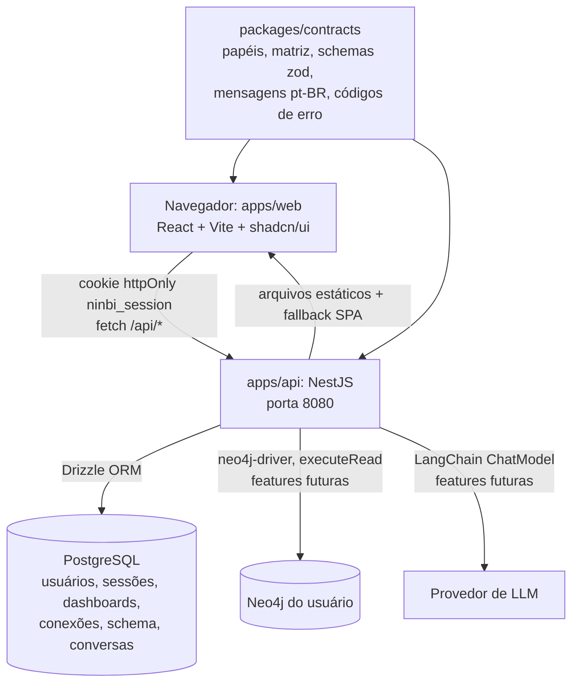

# Fundação e Autenticação Design

**Spec**: `.specs/features/fundacao-auth/spec.md`
**Context**: `.specs/features/fundacao-auth/context.md`
**Status**: Approved (o usuário dispensou a aprovação do design: "Não precisa da validação do design.")

Este documento fixa a arquitetura do produto inteiro (as oito features do MVP) e detalha os componentes desta feature. As decisões de alcance do projeto estão em `.specs/STATE.md`, de AD-024 a AD-037.

---

## Architecture Overview

Um monorepo pnpm com dois apps e um pacote compartilhado. Em produção, um único processo Node (o `apps/api`) serve a API em `/api` e os arquivos estáticos do `apps/web` na mesma porta `8080`. Os metadados ficam no PostgreSQL; o Neo4j do usuário é só fonte de dados, consultado em modo leitura.



### Estrutura de pastas (produto inteiro)

```text
.
├── apps/
│   ├── api/                      NestJS, CommonJS, compilado com tsc
│   │   ├── src/
│   │   │   ├── main.ts           sobe o app com configureApp()
│   │   │   ├── app.module.ts
│   │   │   ├── app.factory.ts    configureApp(app): prefixo /api, cookie-parser, filtro de erros, middleware de log
│   │   │   ├── config/           env.ts (zod): PORT, DATABASE_URL, NINBI_COOKIE_SECURE, WEB_DIST_DIR, ...
│   │   │   ├── common/           clock.ts, app-error.ts, error.filter.ts, zod.pipe.ts, http-logging.middleware.ts
│   │   │   ├── database/         schema.ts (Drizzle), database.module.ts (token DB), migrate.ts
│   │   │   ├── health/           GET /api/health
│   │   │   ├── auth/             hasher, sessões, throttle, login/logout/me, senhas, guards, decorators
│   │   │   ├── setup/            primeiro administrador
│   │   │   ├── users/            gestão de usuários (Admin)
│   │   │   ├── web/              ServeStatic do apps/web/dist com fallback SPA
│   │   │   │   --- features seguintes ---
│   │   │   ├── crypto/           CryptoService AES-256-GCM (conexoes-schema, ia-cypher)
│   │   │   ├── neo4j/            Neo4jGateway (interface) + driver real + fake de teste
│   │   │   ├── connections/  schema/  dashboards/  dashboard-access/  sidebar/
│   │   │   ├── teams/  sharing/  queries/  filters/  llm/  ai/
│   │   ├── drizzle/              migrações SQL geradas pelo drizzle-kit (versionadas)
│   │   ├── test/                 testes rápidos (PGlite, sem serviço externo) + harness.ts
│   │   └── test-int/             testes de integração contra o PostgreSQL e o Neo4j do docker-compose.dev.yml
│   └── web/                      Vite + React 19 + TS (ESM)
│       ├── index.html            script anti-flash de tema, favicon, lang="pt-BR"
│       ├── public/brand/         ninbi-symbol.png, favicon.png (recortados da logo)
│       └── src/
│           ├── main.tsx  app/ (router.tsx, providers.tsx)
│           ├── lib/              api.ts (apiFetch, ApiError), utils.ts (cn)
│           ├── theme/            ThemeProvider.tsx, contrast.ts
│           ├── styles/           theme.css (tokens), index.css (Tailwind)
│           ├── components/ui/    shadcn/ui
│           ├── features/
│           │   ├── auth/  shell/  settings/  users/  home/
│           │   │   --- features seguintes ---
│           │   ├── connections/  dashboards/  widgets/  sharing/  filters/  ai/
│           └── test/             setup.ts, server.ts (MSW), renderApp.tsx
├── packages/
│   └── contracts/                TS puro, build dual ESM+CJS com tsup
│       └── src/                  roles.ts, schemas.ts, messages.ts, errors.ts, index.ts
├── infra/
│   └── neo4j/seed.cypher         dataset de exemplo
├── scripts/
│   ├── brand/crop-symbol.mjs     recorta o símbolo da logo (sharp)
│   ├── docker.mjs                localiza o docker e executa `docker compose ...`
│   └── smoke-compose.mjs         sobe o docker-compose.yml de produção e confere FND-01/FND-02
├── Dockerfile                    multi-stage: build do monorepo, runtime node:24-alpine
├── docker-compose.yml            produção: app, postgres, neo4j, neo4j-seed
├── docker-compose.dev.yml        desenvolvimento: postgres e neo4j de vida longa, neo4j-seed
├── LICENSE                       AGPL-3.0
├── biome.json  tsconfig.base.json  pnpm-workspace.yaml  package.json
```

### Camadas do backend

| Camada | Responsabilidade | Testada por |
| ------ | ---------------- | ----------- |
| Controller | Rota HTTP, valida o corpo com o schema zod de `@ninbi/contracts`, chama o service, devolve o DTO | testes de rota (supertest + PGlite) |
| Guard | Sessão (`SessionGuard`, global) e papel (`PermissionGuard` + `@RequirePermission`) | testes de rota |
| Service | Regra de negócio (último Admin, senha provisória, throttle) | testes de rota e de service |
| Banco | Drizzle sobre `node-postgres` em produção e sobre PGlite nos testes rápidos | os mesmos testes |

Toda regra que muda o que o usuário vê (ordem da lista de usuários, situação, bloqueio) roda no backend. O frontend exibe o que recebe.

### Sessão e login

```mermaid
sequenceDiagram
    participant W as Web (LoginPage)
    participant A as AuthController
    participant T as LoginThrottleService
    participant S as AuthService
    participant SS as SessionService
    participant DB as PostgreSQL
    W->>A: POST /api/auth/login {email, password}
    A->>T: assertNotLocked(email)
    T->>DB: SELECT login_throttle
    alt bloqueado
        A-->>W: 429 TOO_MANY_ATTEMPTS
    end
    A->>S: verifyCredentials(email, password)
    S->>DB: SELECT users WHERE lower(email)
    alt senha errada, e-mail inexistente ou usuário desativado
        S->>T: registerFailure(email)
        A-->>W: 401 INVALID_CREDENTIALS "E-mail ou senha incorretos"
    end
    S->>T: reset(email)
    A->>SS: create(userId)
    SS->>DB: INSERT sessions (token_hash = sha256(token))
    A-->>W: 200 {user} + Set-Cookie ninbi_session=token; HttpOnly; SameSite=Lax; Max-Age=7d
```

- O token é 32 bytes aleatórios em base64url. O banco guarda só `sha256(token)`.
- `SessionGuard` (global) lê o cookie, busca sessão e usuário em uma consulta, recusa com 401 quando a sessão não existe, quando `last_used_at` tem mais de 7 dias ou quando o usuário está desativado. Papel e situação vêm do banco a cada requisição: uma troca de papel vale na próxima requisição (ROLE-05) e uma desativação derruba a sessão (USR-15).
- A cada requisição autenticada, `last_used_at` é atualizado e o cookie é reemitido com `Max-Age` de 7 dias (expiração deslizante).
- Redefinir senha e desativar apagam todas as sessões do usuário.
- Com `must_change_password = true`, o guard só deixa passar `GET /api/auth/me`, `POST /api/auth/initial-password` e `POST /api/auth/logout`; as demais rotas respondem 403 `PASSWORD_CHANGE_REQUIRED`.
- Rotas públicas usam o decorator `@Public()`: `GET /api/health`, `GET /api/setup/status`, `POST /api/setup/admin`, `POST /api/auth/login`.

### Senhas

`PasswordHasher` usa `scrypt` de `node:crypto` (N=16384, r=8, p=1, sal de 16 bytes, chave de 64 bytes) e grava `scrypt$16384$8$1$<sal base64>$<hash base64>`. A verificação usa `timingSafeEqual`. Não há dependência nativa, o que evita compilação no Windows e no Alpine.

### Papéis e permissões

A matriz da spec vira dados em `packages/contracts/src/roles.ts`:

```typescript
export const ROLES = ['ADMIN', 'EDITOR', 'VIEWER'] as const
export type Role = (typeof ROLES)[number]
export const ROLE_LABELS: Record<Role, string> = { ADMIN: 'Admin', EDITOR: 'Editor', VIEWER: 'Visualizador' }

export type Permission =
  | 'users.manage'        // gerenciar usuários e equipes
  | 'connections.manage'  // criar, editar e excluir conexões
  | 'llm.manage'          // configurar o LLM
  | 'connections.read'    // ver conexões e schema, atualizar o schema
  | 'dashboards.create'   // criar dashboards próprios
  | 'ai.use'              // usar a IA nos dashboards que pode editar
  | 'dashboards.all'      // abrir e editar qualquer dashboard
  | 'dashboards.shared'   // ver dashboards compartilhados, filtros, refresh, exportação
  | 'sidebar.own'         // organizar a própria sidebar

export const ROLE_PERMISSIONS: Record<Role, readonly Permission[]>
export function can(role: Role, permission: Permission): boolean
```

O backend aplica a matriz com `@RequirePermission('users.manage')` no controller e `PermissionGuard` global (sem o decorator, basta estar logado). O frontend usa o mesmo `can()` para a sidebar, as abas e as páginas. A permissão por dashboard ("pode ver", "pode editar") da feature `compartilhamento` fica em um `DashboardAccessService` que combina o papel global com os compartilhamentos; ele não substitui a matriz.

### Erros

Toda resposta de erro tem o corpo `{ code, message, fieldErrors? }`. `code` vem de `ERROR_CODES` em `@ninbi/contracts`; `message` é o texto em português já pronto para a tela, de `MESSAGES`. O `ZodValidationPipe` responde 400 `VALIDATION_ERROR` com `fieldErrors` por campo. O frontend mostra `message` ou `fieldErrors[campo]`; nunca traduz nada.

### Tema e tokens

Os tokens vivem em um só arquivo, `apps/web/src/styles/theme.css`, como variáveis CSS em hexadecimal: `:root` tem o tema claro e `.dark` o escuro. O Tailwind v4 os expõe por `@theme inline` (`bg-background`, `text-foreground`, `bg-card`, `rounded-card` ...), e os componentes do shadcn/ui usam os mesmos nomes. Nenhum `.tsx` escreve cor literal.

Paleta tirada da logo (`brand/ninbi-logo.jpg`). Os valores foram lidos a olho na imagem, sem ferramenta de amostragem; o implementador pode ajustar a tonalidade, mantendo os nomes:

| Token | Escuro | Claro | Uso |
| ----- | ------ | ----- | --- |
| `--brand-purple` | `#8B5CF6` | `#8B5CF6` | início do gradiente, série 2 |
| `--brand-cyan` | `#2EE6F0` | `#2EE6F0` | fim do gradiente, série 1 |
| `--brand-blue` | `#4C9EFF` | `#4C9EFF` | tom intermediário, série 5 |
| `--brand-magenta` | `#D946EF` | `#D946EF` | apoio, série 3 |
| `--gradient-brand` | `linear-gradient(90deg, var(--brand-purple), var(--brand-cyan))` | igual | botão de destaque, item ativo, brilhos |
| `--accent-text` | `#2EE6F0` | `#08717E` | texto, ícones e linhas finas em ciano; "BI" do logotipo |
| `--background` | `#0B0D12` | `#F4F6FA` | fundo do app |
| `--sidebar` | `#0F1218` | `#FFFFFF` | sidebar |
| `--card` | `#141821` | `#FFFFFF` | cards |
| `--card-elevated` | `#1A1F2A` | `#F0F2F7` | campos, blocos internos |
| `--border` | `#242A36` | `#E1E5EE` | bordas |
| `--foreground` | `#F3F5F9` | `#10131A` | texto |
| `--muted-foreground` | `#8B92A5` | `#596075` | texto secundário |
| `--primary` / `--primary-foreground` | `#2EE6F0` / `#0B0D12` | `#2EE6F0` / `#0B0D12` | cor sólida de destaque e texto sobre o gradiente |
| `--destructive` | `#F0506E` | `#D12E4C` | erros, queda |
| `--chart-1..5` | ciano, roxo, magenta, `#6F7CF7`, `#4C9EFF` | iguais | séries dos gráficos (widgets-graficos) |
| `--radius-card` / `--radius-control` | `20px` / `12px` | iguais | cards e controles, como na captura |

Fonte: Plus Jakarta Sans (OFL), empacotada com `@fontsource-variable/plus-jakarta-sans`, sem CDN, porque o produto é self-hosted e pode rodar sem internet.

Troca de tema: `ThemeProvider` lê e grava `localStorage['ninbi-theme']` (`'dark' | 'light'`) e põe ou tira a classe `dark` em `<html>`. Um script inline em `index.html` aplica a classe antes do primeiro paint, com `dark` quando não há escolha. O alternador "Escuro / Claro" fica no topo da sidebar, no lugar do "Market / Trades".

### Shell

```text
┌──────────────┬───────────────────────────────────────────────────────┐
│ ✶ NinBI      │ [bloco do usuário: iniciais, nome, papel ▾]  [ação]   │  TopBar
│ [Escuro|Claro]├───────────────────────────────────────────────────────┤
│              │                                                       │
│ (dashboards, │   área de conteúdo (rola na vertical)                 │
│  rolável)    │                                                       │
│              │                                                       │
│ Configurações│                                                       │  fixo no rodapé da sidebar
└──────────────┴───────────────────────────────────────────────────────┘
```

O layout é `h-screen overflow-hidden` com grade de duas colunas: a sidebar (`w-60`, coluna flex com a lista do meio em `overflow-y-auto` e "Configurações" fora dela) e a coluna principal (TopBar fixa, `main` com `overflow-y-auto overflow-x-hidden`). A página registra a sua ação principal na TopBar por `useTopBarAction()`.

### Rotas do frontend

| Caminho | Tela | Guarda |
| ------- | ---- | ------ |
| `/primeiro-acesso` | "Criar administrador" | só quando `needsSetup`; senão vai para `/entrar` |
| `/entrar?voltar=<caminho>` | "Entrar" | quando há sessão, vai para `voltar` ou `/` |
| `/definir-senha` | "Definir nova senha" | sessão com `mustChangePassword` |
| `/` | página inicial (estado vazio "Nenhum dashboard ainda") | sessão |
| `/configuracoes` | redireciona para a primeira aba que o papel vê | sessão + ao menos uma aba |
| `/configuracoes/:aba` | `conexoes`, `usuarios`, `llm` | sessão + papel da aba, senão a mensagem de permissão |

`RequireAuth` consulta `GET /api/auth/me` (TanStack Query, chave `['session']`). Qualquer 401 vindo de `apiFetch` (exceto do próprio login) limpa a sessão em cache e navega para `/entrar?voltar=<caminho atual>`. Depois do login, `voltar` só é aceito quando começa com `/` e não com `//`.

### Ambiente e Docker

| Arquivo | Serviços | Para quê |
| ------- | -------- | -------- |
| `docker-compose.yml` | `app` (build do `Dockerfile`, porta `${NINBI_PORT:-8080}:8080`), `postgres` (`postgres:17-alpine`), `neo4j` (`neo4j:5-community`, portas 7474 e 7687), `neo4j-seed` (mesma imagem do Neo4j, roda `cypher-shell -f /seed/seed.cypher` uma vez) | instalação do usuário: `docker compose up` |
| `docker-compose.dev.yml` | `postgres` (porta 55432), `neo4j` (portas 7475 e 7688), `neo4j-seed`; projeto `ninbi-dev`, volumes nomeados | desenvolvimento e testes de integração, containers de vida longa reaproveitados |

- Só três imagens: `postgres:17-alpine`, `neo4j:5-community` e a do app (base `node:24-alpine`). Não há Testcontainers nem container criado por execução de teste.
- A imagem do app só é construída pelo smoke test (`scripts/smoke-compose.mjs`), que termina com `docker compose down -v` do projeto de smoke e `docker image prune -f`. O disco C tem pouco espaço livre.
- `scripts/docker.mjs` acha o `docker` no `PATH` ou nos caminhos padrão do Docker Desktop no Windows (`%LOCALAPPDATA%\Programs\DockerDesktop\resources\bin`, `%ProgramFiles%\Docker\Docker\resources\bin`), porque shells abertos antes da instalação não têm o `docker` no `PATH`.
- `neo4j-seed` checa o nó marcador `(:NinbiSeed {versao: 1})`; se existe, sai sem alterar nada. Assim o dataset entra só no primeiro start do volume.
- No `app`, o entrypoint aplica as migrações do Drizzle antes de abrir a porta. `depends_on` espera o `postgres` saudável (`pg_isready`).

Dataset de exemplo "Varejo" (`infra/neo4j/seed.cypher`, determinístico, gerado com `UNWIND range(...)`):

| Label / relacionamento | Propriedades | Exercita |
| ---------------------- | ------------ | -------- |
| `(:Loja)` 12 nós | `nome`, `cidade`, `uf`, `latitude`, `longitude` | mapa |
| `(:Categoria)` 6 nós | `nome` | pizza, barras |
| `(:Produto)` 60 nós | `nome`, `preco` | KPI, tabela |
| `(:Cliente)` 200 nós | `nome`, `segmento`, `cidade` | listas |
| `(:Pedido)` 2.000 nós | `codigo`, `data` (tipo `date`, 24 meses), `valorTotal`, `status` | linha, área, filtros de data |
| `(:Cliente)-[:FEZ]->(:Pedido)-[:CONTEM {quantidade}]->(:Produto)-[:PERTENCE_A]->(:Categoria)`, `(:Pedido)-[:VENDIDO_EM]->(:Loja)` | | padrões de relacionamento do schema |

---

## Code Reuse Analysis

O repositório tem só as specs: não há código a reaproveitar.

### Existing Components to Leverage

| Component | Location | How to Use |
| --------- | -------- | ---------- |
| shadcn/ui | `apps/web/src/components/ui/` (gerado pelo CLI) | button, input, label, card, dialog, alert-dialog, dropdown-menu, tabs, table, skeleton, avatar, badge, select, sonner |
| Logo oficial | `brand/ninbi-logo.jpg` | origem do recorte do símbolo e do favicon |
| Captura LittleBee | `.specs/features/fundacao-auth/captures/littlebee-dashboard.webp` | referência de layout do shell (AD-008, AD-018, AD-020) |
| `@nestjs/serve-static` | dependência | servir `apps/web/dist` com fallback SPA |
| `drizzle-orm/pglite` | dependência | o mesmo schema e as mesmas migrações nos testes rápidos |

### Integration Points

| System | Integration Method |
| ------ | ------------------ |
| PostgreSQL | Drizzle ORM; `DATABASE_URL`; migrações em `apps/api/drizzle/` aplicadas no start |
| Neo4j | Só o contêiner e o seed nesta feature; a conexão é de `conexoes-schema` |
| Navegador | Cookie httpOnly `ninbi_session`; `localStorage['ninbi-theme']` |

---

## Components

### Backend

#### `configureApp`
- **Purpose**: Configura um `INestApplication` igual em produção e nos testes.
- **Location**: `apps/api/src/app.factory.ts`
- **Interfaces**: `configureApp(app: INestApplication): INestApplication` aplica `setGlobalPrefix('api', { exclude: [] })`, `cookie-parser`, `AppErrorFilter` e `HttpLoggingMiddleware`.
- **Dependencies**: `@nestjs/core`, `cookie-parser`.

#### `DatabaseModule`
- **Purpose**: Fornece o Drizzle no token `DB`.
- **Location**: `apps/api/src/database/`
- **Interfaces**:
  - `DB` (token) → `AppDatabase` (`NodePgDatabase<typeof schema> | PgliteDatabase<typeof schema>`)
  - `runMigrations(db): Promise<void>`
  - `createTestDb(): Promise<{ db, client: PGlite }>` em `apps/api/test/db.ts`, com as migrações aplicadas
- **Dependencies**: `drizzle-orm`, `pg`, `@electric-sql/pglite`, `drizzle-kit` (dev).

#### `HealthController`
- **Purpose**: `GET /api/health` → 200 `{ status: 'ok', postgres: 'up' }` ou 503 `{ status: 'error', postgres: 'down' }` (FND-03, FND-04).
- **Location**: `apps/api/src/health/`
- **Dependencies**: `DB` (executa `select 1`).

#### `HttpLoggingMiddleware`
- **Purpose**: Uma linha por requisição: `<método> <caminho sem query> <status> <duração>ms` (FND-05). Não lê corpo, cabeçalhos nem cookies.
- **Location**: `apps/api/src/common/http-logging.middleware.ts`
- **Interfaces**: usa `Logger('HTTP')`; o teste troca o logger por um que guarda as linhas.

#### `PasswordHasher`
- **Location**: `apps/api/src/auth/password-hasher.ts`
- **Interfaces**: `hash(plain): Promise<string>`, `verify(plain, stored): Promise<boolean>`.

#### `SessionService`
- **Location**: `apps/api/src/auth/session.service.ts`
- **Interfaces**:
  - `create(userId): Promise<{ token: string }>`
  - `resolve(token): Promise<SessionUser | null>` (null quando inexistente, ociosa há mais de 7 dias ou usuário desativado; atualiza `last_used_at`)
  - `revoke(token): Promise<void>`, `revokeAllForUser(userId): Promise<void>`
- **Dependencies**: `DB`, `Clock`.

#### `LoginThrottleService`
- **Location**: `apps/api/src/auth/login-throttle.service.ts`
- **Interfaces**: `isLocked(email): Promise<boolean>`, `registerFailure(email): Promise<void>`, `reset(email): Promise<void>`.
- **Regra**: falhas contam numa janela de 15 minutos a partir da primeira; a 5ª falha grava `locked_until = agora + 15 min` e zera a contagem. Enquanto `locked_until > agora`, todo login desse e-mail (minúsculo) responde 429, mesmo com a senha certa.

#### `AuthController` / `AuthService`
- **Location**: `apps/api/src/auth/`
- **Interfaces**:
  - `POST /api/auth/login` → 200 `SessionUserDto` + cookie | 401 `INVALID_CREDENTIALS` | 429 `TOO_MANY_ATTEMPTS`
  - `POST /api/auth/logout` → 204, apaga a sessão e o cookie
  - `GET /api/auth/me` → `SessionUserDto { id, name, email, role, mustChangePassword }`
  - `POST /api/auth/password` `{ currentPassword, newPassword }` → 204 | 400 `CURRENT_PASSWORD_INCORRECT` | 400 `VALIDATION_ERROR`
  - `POST /api/auth/initial-password` `{ newPassword, confirmPassword }` → 204 e `mustChangePassword = false` | 409 quando a senha não é provisória

#### `SessionGuard`, `PermissionGuard`, decorators
- **Location**: `apps/api/src/auth/session.guard.ts`, `permission.guard.ts`, `decorators.ts`
- **Interfaces**: `@Public()`, `@RequirePermission(p: Permission)`, `@CurrentUser()`. Registrados como `APP_GUARD` nesta ordem.

#### `SetupController` / `SetupService`
- **Location**: `apps/api/src/setup/`
- **Interfaces**: `GET /api/setup/status` → `{ needsSetup }`; `POST /api/setup/admin` `{ name, email, password, confirmPassword }` → 201 `SessionUserDto` + cookie | 409 `SETUP_ALREADY_DONE`.
- **Concorrência (SETUP-06)**: na mesma transação, insere a linha única de `installation (id = 1)` e o usuário. A chave primária garante que só um envio vence; o outro recebe a violação de unicidade e responde 409.

#### `UsersController` / `UsersService`
- **Location**: `apps/api/src/users/`
- **Interfaces** (todas com `@RequirePermission('users.manage')`):
  - `GET /api/users` → `UserDto[]` ordenado por `name` (collation do banco, sem diferenciar maiúsculas: `ORDER BY lower(name), name`)
  - `POST /api/users` `{ name, email, role, temporaryPassword }` → 201 `UserDto` | 409 `EMAIL_TAKEN`
  - `PATCH /api/users/:id/role` `{ role }` → 200 | 409 `LAST_ADMIN`
  - `POST /api/users/:id/reset-password` `{ temporaryPassword }` → 204, `mustChangePassword = true`, sessões apagadas
  - `POST /api/users/:id/deactivate` → 200 | 409 `LAST_ADMIN`; sessões apagadas
  - `POST /api/users/:id/reactivate` → 200
- **USR-11**: troca de papel e desativação travam as linhas de Admins ativos (`SELECT ... FOR UPDATE`) e contam os que sobram, na mesma transação.
- **USR-13**: o índice único `users_email_lower_uq` em `lower(email)` decide a corrida; a violação vira 409 `EMAIL_TAKEN`.

#### `WebModule`
- **Location**: `apps/api/src/web/web.module.ts`
- **Purpose**: `ServeStaticModule.forRoot({ rootPath: env.WEB_DIST_DIR, exclude: ['/api/{*path}'] })` com fallback para `index.html`. Sem `WEB_DIST_DIR` (desenvolvimento), o módulo não serve nada e o Vite atende em `5173` com proxy de `/api`.

### Frontend

| Componente | Location | Interfaces / comportamento |
| ---------- | -------- | -------------------------- |
| `apiFetch` | `src/lib/api.ts` | `apiFetch<T>(path, init?)`: `credentials: 'include'`, JSON; erro HTTP → `ApiError { status, code, message, fieldErrors }`; falha de rede → `ApiError { status: 0, message: MESSAGES.serverUnreachable }`; 401 chama `onUnauthorized` |
| `useSession` | `src/features/auth/useSession.ts` | `{ user, isLoading }` via `GET /api/auth/me` |
| guardas | `src/features/auth/guards.tsx` | `RequireSetupDone`, `RequireAuth`, `RequirePasswordChanged`, `RequirePermission({ permission })` |
| `ForbiddenPage` | `src/features/auth/ForbiddenPage.tsx` | "Você não tem permissão para acessar esta página" + link "Ir para a página inicial" |
| `SetupPage` | `src/features/auth/SetupPage.tsx` | react-hook-form + `setupAdminSchema` |
| `LoginPage` | `src/features/auth/LoginPage.tsx` | react-hook-form + `loginSchema`; botão desabilitado enquanto envia |
| `InitialPasswordPage` | `src/features/auth/InitialPasswordPage.tsx` | nova senha + confirmação |
| `ChangePasswordDialog` | `src/features/auth/ChangePasswordDialog.tsx` | senha atual + nova; "Senha alterada" via toast |
| `BrandMark` | `src/features/shell/BrandMark.tsx` | `` + `Nin<span class="text-accent-text">BI</span>` |
| `ThemeProvider` / `ThemeToggle` | `src/theme/ThemeProvider.tsx`, `src/features/shell/ThemeToggle.tsx` | `useTheme(): { theme, setTheme }`; alternador segmentado "Escuro" / "Claro" |
| `Sidebar` | `src/features/shell/Sidebar.tsx` | marca, alternador, lista rolável (vazia nesta feature), "Configurações" fixo no fim, só quando `visibleSettingsTabs(role).length > 0` |
| `TopBar` / `UserMenu` | `src/features/shell/TopBar.tsx`, `UserMenu.tsx` | bloco do usuário (iniciais, nome, `ROLE_LABELS[role]`), menu "Alterar senha" e "Sair"; slot da ação |
| `AppShell` | `src/features/shell/AppShell.tsx` | compõe Sidebar, TopBar e `<Outlet/>` |
| `HomePage` | `src/features/home/HomePage.tsx` | estado vazio "Nenhum dashboard ainda" |
| `SettingsPage` | `src/features/settings/SettingsPage.tsx` | abas a partir de `SETTINGS_TABS` |
| `SETTINGS_TABS` | `src/features/settings/settingsTabs.ts` | `[{ id: 'conexoes', label: 'Conexões', permission: 'connections.read', available: false }, { id: 'usuarios', label: 'Usuários', permission: 'users.manage', available: true }, { id: 'llm', label: 'LLM', permission: 'llm.manage', available: false }]`; cada feature futura liga a sua |
| `UsersTab` | `src/features/users/UsersTab.tsx` | tabela, esqueleto, erro com "Tentar novamente" |
| `NewUserDialog` | `src/features/users/NewUserDialog.tsx` | nome, e-mail, papel, senha provisória |
| `UserRowActions` | `src/features/users/UserRowActions.tsx` | "Alterar papel", "Redefinir senha", "Desativar" (com confirmação) / "Reativar" |

---

## Data Models

```typescript
// apps/api/src/database/schema.ts (Drizzle)
export const roleEnum = pgEnum('role', ['ADMIN', 'EDITOR', 'VIEWER'])
export const userStatusEnum = pgEnum('user_status', ['ACTIVE', 'DISABLED'])

users: {
  id: uuid pk default gen_random_uuid()
  name: varchar(120) not null
  email: varchar(120) not null          // guardado como digitado; unicidade por lower(email)
  passwordHash: text not null
  role: roleEnum not null
  status: userStatusEnum not null default 'ACTIVE'
  mustChangePassword: boolean not null default false
  createdAt, updatedAt: timestamptz not null default now()
}  uniqueIndex users_email_lower_uq on (lower(email))

sessions: {
  id: uuid pk
  tokenHash: text not null unique
  userId: uuid not null references users(id) on delete cascade
  createdAt, lastUsedAt: timestamptz not null
}  index on (user_id)

login_throttle: {
  email: text pk                        // minúsculo
  failedCount: integer not null
  windowStartedAt: timestamptz not null
  lockedUntil: timestamptz null
}

installation: {
  id: smallint pk check (id = 1)
  setupCompletedAt: timestamptz not null
}
```

**Relationships**: `sessions.user_id → users.id`. As features seguintes ligam `dashboards.owner_id`, compartilhamentos, equipes e conversas a `users.id`; desativar nunca apaga a linha.

```typescript
// packages/contracts
interface SessionUserDto { id: string; name: string; email: string; role: Role; mustChangePassword: boolean }
interface UserDto { id: string; name: string; email: string; role: Role; status: 'ACTIVE' | 'DISABLED' }
interface ApiErrorBody { code: ErrorCode; message: string; fieldErrors?: Record<string, string> }
```

---

## Error Handling Strategy

| Error Scenario | Handling | User Impact |
| -------------- | -------- | ----------- |
| Corpo inválido | `ZodValidationPipe` → 400 `VALIDATION_ERROR` + `fieldErrors` | Mensagem no campo |
| Credencial errada, e-mail inexistente ou usuário desativado | 401 `INVALID_CREDENTIALS` | "E-mail ou senha incorretos" |
| 5 falhas em 15 min | 429 `TOO_MANY_ATTEMPTS` | "Muitas tentativas. Tente novamente em 15 minutos." |
| Sem sessão válida | 401 `UNAUTHENTICATED` | Volta ao login com `voltar` |
| Papel sem permissão | 403 `FORBIDDEN` | Na tela: "Você não tem permissão para acessar esta página" |
| Senha provisória pendente | 403 `PASSWORD_CHANGE_REQUIRED` | Redireciona para `/definir-senha` |
| Setup repetido | 409 `SETUP_ALREADY_DONE` | Tela de login |
| E-mail repetido | 409 `EMAIL_TAKEN` | "Já existe um usuário com este e-mail" |
| Último Admin | 409 `LAST_ADMIN` | "É preciso existir ao menos um administrador ativo" |
| Senha atual errada | 400 `CURRENT_PASSWORD_INCORRECT` | "Senha atual incorreta" |
| PostgreSQL fora | `/api/health` 503; demais rotas 500 `INTERNAL_ERROR` sem detalhe | Mensagem genérica |
| Backend fora do ar | `fetch` rejeita → `ApiError` status 0 | "Não foi possível conectar ao servidor. Tente novamente." |
| Lista de usuários falha | Query em erro | "Não foi possível carregar os usuários" + "Tentar novamente" |

---

## Test Strategy

| Nível | Ferramenta | Serviços | Comando |
| ----- | ---------- | -------- | ------- |
| Contratos | Vitest | nenhum | `pnpm --filter @ninbi/contracts test` |
| API rápida | Vitest + `unplugin-swc` (metadados de decorators do Nest) + supertest + PGlite em memória, um banco por arquivo | nenhum | `pnpm --filter @ninbi/api test` |
| API integração | Vitest (`vitest.int.config.ts`) contra o `docker-compose.dev.yml`; cada arquivo cria e apaga um banco `ninbi_test_<aleatório>` no PostgreSQL real | PostgreSQL e Neo4j do compose de dev | `pnpm infra:up && pnpm --filter @ninbi/api test:int` |
| Web | Vitest + jsdom + Testing Library + user-event + MSW (`msw/node`) | nenhum | `pnpm --filter @ninbi/web test` |
| Smoke do compose de produção | `scripts/smoke-compose.mjs` (Node): `up -d --build --wait`, `fetch` em `:8080`, contagem no Neo4j, `down -v`, `docker image prune -f` | Docker | `pnpm smoke` |

- Todo `test` usa `--reporter=verbose`, e todo nome de teste começa com o ID do requisito (`it('AUTH-02 ...')`), para que cada check aponte a linha exata.
- O PGlite é uma conexão só: corridas (SETUP-06, USR-13) são provadas no PostgreSQL real, em `test-int/`.
- Neo4j nos testes rápidos das features seguintes: `FakeNeo4jGateway` implementa a mesma interface `Neo4jGateway`; o driver real só aparece em `test-int/`.
- LangChain nos testes das features seguintes: `FakeListChatModel` de `@langchain/core/utils/testing` atrás do `ChatModelFactory`.
- Testes de tela fazem o gesto (clicar, digitar, enviar) e conferem o texto que a tela mostra. A verificação de telas contra a captura está dispensada (AD-023).

---

## Arquitetura das features seguintes (o que esta fundação já prevê)

| Feature | Encaixe |
| ------- | ------- |
| `conexoes-schema` | `CryptoService` (AES-256-GCM, chave de 32 bytes em base64 de `NINBI_ENCRYPTION_KEY`; formato `v1:<iv>:<tag>:<cifra>`; o env schema passa a exigir a chave e os dois compose recebem um valor padrão de desenvolvimento). `Neo4jGateway { verify(cfg), read(cfg, cypher, params, { timeoutMs, maxRows }) }` sobre `neo4j-driver` com `session.executeRead`. Aba "Conexões" liga `available: true` em `SETTINGS_TABS`. |
| `dashboards-consultas` | Tabelas `dashboards`, `dashboard_tabs`, `widgets`, `sidebar_items`; `DashboardAccessService.assert(user, dashboardId, 'view' | 'edit')`; validador de Cypher somente leitura como função pura em `apps/api/src/queries/`. |
| `compartilhamento` | Tabelas `teams`, `team_members`, `dashboard_shares`; a permissão efetiva sai do `DashboardAccessService`. |
| `widgets-graficos` | Mapeamento resultado → gráfico como funções puras em `apps/web/src/features/widgets/mapping/` (testadas sem DOM); cores dos tokens `--chart-*`. |
| `ia-cypher` / `ia-dashboard` | `LlmModule` com `ChatModelFactory.create(config)` (`@langchain/openai`, `@langchain/anthropic`, `@langchain/google-genai`, `@langchain/ollama`); chave criptografada pelo `CryptoService`; chat por SSE. |
| `interatividade` | Exportação CSV gerada no backend (regra testável); PNG no navegador. |

---

## Risks & Concerns

| Concern | Location (file:line) | Impact | Mitigation |
| ------- | -------------------- | ------ | ---------- |
| Test gap: PGlite tem uma conexão só e não reproduz corrida | `apps/api/test/` | SETUP-06 e USR-13 passariam sem provar nada | Os dois são provados em `apps/api/test-int/` contra o PostgreSQL do compose de dev |
| Test gap: jsdom não calcula layout | `apps/web/src/features/shell/` | SHELL-10 (sem rolagem horizontal, só o conteúdo rola) não é medido de verdade | O teste confere a estrutura e as classes de overflow; a medição visual fica com o usuário (AD-023) |
| Security: cookie sem `Secure` em HTTP | `apps/api/src/auth/auth.controller.ts` | Em instalação exposta sem TLS, o cookie trafega em claro | `NINBI_COOKIE_SECURE=true` liga `Secure`; o README da instalação manda usar atrás de HTTPS |
| Security: enumeração de e-mail | `apps/api/src/auth/auth.service.ts` | Tempo de resposta diferente para e-mail inexistente | `verify` roda contra um hash fictício quando o e-mail não existe |
| Logo em JPG com fundo escuro | `brand/ninbi-logo.jpg` | Recorte do símbolo perde brilho e pode deixar halo no tema claro | `scripts/brand/crop-symbol.mjs` gera alfa pela luminância; um arquivo vetorial da logo resolve depois (Deferred Ideas do context.md) |
| Cores medidas a olho | `apps/web/src/styles/theme.css` | Tons podem diferir da logo | Os nomes dos tokens ficam; ajustar valor não muda nenhuma tela além da cor |
| Disco do Docker | disco C, ~46 GB livres | Builds repetidos do app enchem o disco | Só o smoke constrói a imagem do app; ele termina com `down -v` e `docker image prune -f`; o compose de dev reaproveita containers e volumes |
| `docker` fora do `PATH` | shells abertos antes da instalação | `docker compose` falha nos Run lines | Todos os comandos passam por `scripts/docker.mjs`, que acha o binário nos caminhos padrão do Docker Desktop |
| Portas ocupadas | 8080, 55432, 7475, 7688 | Smoke ou testes de integração falham com o app de dev rodando | O smoke usa `NINBI_PORT` (padrão 8080) e avisa se a porta estiver em uso; o compose de dev usa portas altas |

---

## Tech Decisions (only non-obvious ones)

| Decision | Choice | Rationale |
| -------- | ------ | --------- |
| ORM | Drizzle ORM + drizzle-kit | Tem driver oficial para PGlite: o mesmo schema e as mesmas migrações SQL rodam em memória nos testes e no PostgreSQL real (AD-025) |
| Runner da API | Vitest com `unplugin-swc` | Um runner só no monorepo; o SWC emite os metadados de decorators que o Nest precisa (AD-026) |
| Módulos | web ESM; api CommonJS (`module: nodenext`); contracts dual ESM+CJS via tsup | O Nest compila com `tsc` sem extensões `.js` nos imports; o Vite consome ESM (AD-024) |
| Contratos nos testes | Alias de `@ninbi/contracts` para `packages/contracts/src` nos configs do Vitest e do Vite | Testes não dependem do build do pacote |
| Hash de senha | `scrypt` de `node:crypto` | Sem dependência nativa (AD-028) |
| Sessão | Token opaco em cookie, hash no PostgreSQL | Revogável na hora (USR-07, USR-09), sem segredo de assinatura para configurar (AD-027) |
| Throttle | Tabela `login_throttle` | Sobrevive a restart sem Redis (AD-030) |
| Lint e formatação | Biome | Uma ferramenta, configuração mínima (AD-035) |
| Formulários | react-hook-form + `@hookform/resolvers/zod` com os schemas de `@ninbi/contracts` | Mesmas regras e mensagens no front e no back |
| Estado de servidor | TanStack Query | Cache da sessão, esqueleto e "Tentar novamente" sem código próprio |
| Roteamento | React Router 7 (modo biblioteca, `createBrowserRouter`) | Rotas em português, guardas por elemento (AD-036) |
| Toasts | `sonner` (shadcn) | "Senha alterada" |
