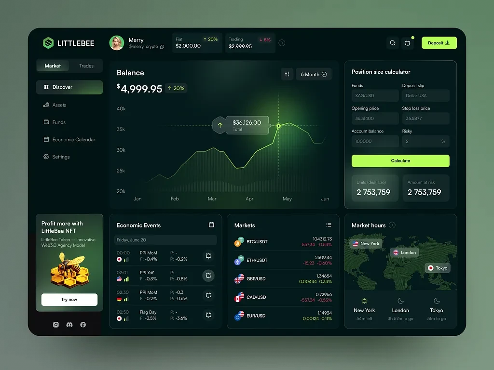
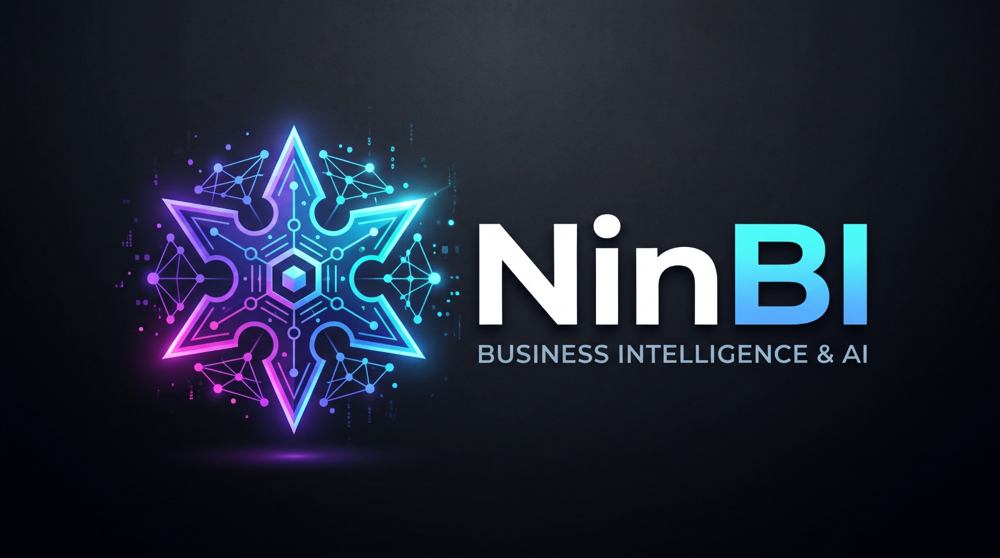

# Fundação e Autenticação Specification

**Approved**: 2026-11-16 - user: "Pode fazer todas features desse jeito, sem nem me perguntar."

## Problem Statement

O NinBI ainda não existe: não há repositório, ambiente, login nem tela. Toda feature seguinte depende de um ambiente que sobe com um comando, de saber quem é o usuário e o que o papel dele permite, e de um shell com o tema da referência visual. Esta feature entrega essa base, demonstrável sozinha: subir o ambiente, criar o primeiro administrador, entrar, gerenciar usuários na página "Configurações" e navegar no shell em tema dark e light.

## Goals

- [ ] `docker compose up` sobe app, PostgreSQL e Neo4j com dataset de exemplo, e a tela de login abre em `http://localhost:8080`.
- [ ] Um Admin entra, cria usuários com os papéis Admin, Editor e Visualizador, e cada papel só alcança o que a matriz de papéis permite, na interface e na API.
- [ ] Todo usuário logado vê o shell da referência visual (sidebar, barra superior, cards) em tema dark, e troca para o tema light equivalente.

## Out of Scope

| Feature | Reason |
| ------- | ------ |
| Multi-tenant (organizações, workspaces) | Feature futura (AD-001) |
| Login social, OAuth, SSO (SAML/OIDC) | O usuário escolheu e-mail e senha (AD-007) |
| Recuperação de senha por e-mail | Exige SMTP; o Admin redefine a senha |
| Compartilhamento de dashboards e equipes | Feature `compartilhamento` (AD-014) |
| Permissão por conexão | Não foi pedida |
| Dashboards e grupos na sidebar | Feature `dashboards-consultas` (AD-013); aqui a sidebar nasce vazia, só com "Configurações" |
| Auditoria de ações | Não foi pedida |
| Inglês ou outros idiomas (i18n) | Interface só em português (AD-010) |
| Uso em celular (larguras abaixo de 1024 px) | Não foi pedido; o MVP é desktop |
| Temas customizáveis pelo usuário | Só o tema padrão, dark e light (AD-008) |
| Exclusão definitiva de usuário | Desativar basta e preserva a autoria dos dashboards |
| Conexões, dashboards, IA | Features seguintes |

---

## Assumptions & Open Questions

| Assumption / decision | Chosen default | Rationale | Confirmed? |
| --------------------- | -------------- | --------- | ---------- |
| Modelo do produto e licença | Open source self-hosted, single-tenant, AGPL-3.0 | AD-001 | y |
| Stack | React no frontend, NestJS no backend, PostgreSQL para metadados | AD-003 | y |
| Login e papéis | E-mail e senha; Admin, Editor, Visualizador | AD-007 | y |
| Tema | A referência é o tema dark padrão, com versão light equivalente | AD-008 | y |
| Idioma | Só português | AD-010 | y |
| Ambiente de desenvolvimento | Neo4j com dataset de exemplo via Docker | Decisão do usuário | y |
| Ferramentas do frontend | Vite + React + Tailwind + shadcn/ui; TypeScript em todo o monorepo | Default do orquestrador; shadcn/ui é o que traz os gráficos pedidos | y - delegado |
| Deploy | Um `docker-compose.yml` com app, PostgreSQL e Neo4j | Default do orquestrador; é o caminho usual de um self-hosted | y - delegado |
| Porta do app | `8080`, alterável por variável de ambiente | Um valor concreto para o critério; não colide com as portas do Neo4j | y - delegado |
| Dataset de exemplo | Escolhido no Design; precisa ter categorias, números, datas e latitude/longitude para exercitar todos os widgets | O dataset Movies não tem coordenadas; o conjunto exato é detalhe de implementação | y - delegado |
| Regra de senha | Mínimo de 8 caracteres, sem outras exigências | Regra simples e defensável | y - delegado |
| Bloqueio por tentativas | 5 logins errados para o mesmo e-mail em 15 minutos bloqueiam novas tentativas por 15 minutos | Limite de força bruta sem serviço externo | y - delegado |
| Sessão | Cookie httpOnly; expira após 7 dias sem uso | O token não fica acessível a scripts da página; 7 dias evita login diário | y - delegado |
| Onde fica a escolha do tema | No navegador (localStorage); dark quando não há escolha | Vale também na tela de login, antes de existir sessão | y - delegado |
| Larguras suportadas | De 1024 px a 1920 px | A referência é uma tela de desktop | y - delegado |
| Fonte | Uma sem serifa geométrica de licença livre, o mais próxima possível da referência; a família exata sai no Design | Não consegui identificar com certeza a fonte da imagem | y - delegado |
| Lista de usuários | Sem paginação: rola dentro da área de conteúdo | Instalação self-hosted tem poucos usuários | y - delegado |
| Rótulos em inglês da referência | Substituídos por rótulos em português | AD-010 | y |
| Itens da sidebar | Os dashboards e grupos de cada usuário, mais um item "Configurações" | AD-013, AD-016; usuário: "Um item 'Configurações' só" | y |
| Página "Configurações" | Abas "Conexões", "Usuários" e "LLM" | AD-016 | y |
| Papéis globais | Admin gerencia a instalação e abre e edita qualquer dashboard; Editor cria os próprios e usa a IA; Visualizador só vê o que compartilham com ele | AD-015; usuário: "Editor cria; Visualizador só recebe" e "Vê e edita tudo" | y |
| Visibilidade dos dashboards | Privados, com compartilhamento | AD-014 | y |
| Marca | O símbolo (estrela) recortado da logo oficial, mais "NinBI" em texto real: "Nin" na cor do texto e "BI" em ciano; o subtítulo não aparece em lugar nenhum | AD-017; usuário: "essa é a logo.", "Símbolo recortado + 'NinBI' em texto", "Em lugar nenhum" | y |
| Paleta | O layout da referência com o gradiente roxo → ciano da logo no lugar do verde-limão, sobre fundo quase preto; vale para o tema claro equivalente | AD-018; usuário: "Paleta da logo" | y |
| Valores das cores | Tirados da logo no Design: roxo, ciano e o magenta do símbolo como cores de apoio | A logo é um JPG; os valores exatos saem da medição da imagem | y - delegado |
| Onde o gradiente não cabe | Texto, ícones e linhas finas usam o ciano; o gradiente fica em botões de destaque, item ativo e brilhos | Gradiente em traço fino perde leitura | y - delegado |
| Símbolo no tema claro | O mesmo símbolo, recortado com fundo transparente | A logo veio com fundo escuro embutido; um arquivo com transparência ou vetor daria recorte melhor | y - delegado |
| Logo nas telas sem shell | Login e primeiro acesso mostram o símbolo e "NinBI" | São as primeiras telas que a pessoa vê | y - delegado |
| Abas de "Configurações" nesta feature | Só "Usuários"; "Conexões" chega em `conexoes-schema` e "LLM" em `ia-cypher` | Cada aba nasce com a feature que lhe dá conteúdo | y - delegado |
| Primeiro Admin | Tela "Criar administrador" no primeiro acesso, enquanto não existe usuário | Delegado pelo usuário: "Pode fazer todas features desse jeito, sem nem me perguntar." | y - delegado |
| Entrada dos demais usuários | O Admin cria com senha provisória, trocada no primeiro login | Delegado pelo usuário: "Pode fazer todas features desse jeito, sem nem me perguntar." | y - delegado |
| Quem só pode ver enxerga o Cypher? | Não: Cypher e mensagem de erro do Neo4j só para quem pode editar o dashboard | Delegado pelo usuário: "Pode fazer todas features desse jeito, sem nem me perguntar." | y - delegado |
| Alternador "Market / Trades" da captura | Vira o alternador de tema "Escuro / Claro" (AD-020) | Delegado pelo usuário: "Pode fazer todas features desse jeito, sem nem me perguntar." | y - delegado |
| Cartão promocional e ícones sociais da captura | Removidos (AD-020) | Delegado pelo usuário: "Pode fazer todas features desse jeito, sem nem me perguntar." | y - delegado |
| Bloco do usuário da captura | Avatar com iniciais, nome e papel; abre o menu "Alterar senha" e "Sair" (AD-020) | Delegado pelo usuário: "Pode fazer todas features desse jeito, sem nem me perguntar." | y - delegado |
| Chips, busca, sino e botão de destaque da captura | Chips, busca e sino saem; o botão de destaque vira a ação principal da página; o espaço dos chips recebe os filtros globais dentro dos dashboards (AD-020) | Delegado pelo usuário: "Pode fazer todas features desse jeito, sem nem me perguntar." | y - delegado |
| Moldura e conteúdo da captura | O app ocupa a janela inteira; nesta feature a página inicial fica em estado vazio (AD-020) | Delegado pelo usuário: "Pode fazer todas features desse jeito, sem nem me perguntar." | y - delegado |
| O que abre depois do login | O primeiro dashboard da sidebar do usuário; sem nenhum, "Nenhum dashboard ainda" | Delegado pelo usuário: "Pode fazer todas features desse jeito, sem nem me perguntar." | y - delegado |
| O Editor vê "Configurações"? | Sim, só com a aba "Conexões", em leitura: lista, schema e "Atualizar schema" | Delegado pelo usuário: "Pode fazer todas features desse jeito, sem nem me perguntar." | y - delegado |
| Verificação de telas contra a captura | Dispensada; a captura segue como referência de layout para quem implementa (AD-023) | Delegado pelo usuário: "Pode fazer todas features desse jeito, sem nem me perguntar." | y - delegado |

**Open questions:** none - all resolved or logged above.

---

## User Stories

### P1: Subir o ambiente ⭐ MVP

**User Story**: As a pessoa que instala o NinBI, I want subir tudo com um comando so that eu use ou desenvolva o produto sem montar serviços à mão.

**Why P1**: Nada mais roda sem o ambiente.

**Acceptance Criteria**:

1. WHEN alguém executa `docker compose up` na raiz do repositório THEN o sistema SHALL iniciar o app, o PostgreSQL e o Neo4j e responder com a tela de login em `http://localhost:8080` [FND-01]
2. WHEN o contêiner do Neo4j inicia pela primeira vez THEN o sistema SHALL carregar nele o dataset de exemplo [FND-02]
3. WHEN alguém chama `GET /api/health` THEN o sistema SHALL responder 200 com o estado do PostgreSQL igual a `up` [FND-03]
4. IF o PostgreSQL está inacessível THEN o sistema SHALL responder 503 em `GET /api/health` com o estado do PostgreSQL igual a `down` [FND-04]
5. The system SHALL registrar em log cada requisição HTTP com método, caminho, status e duração, sem corpo, senha nem cookie [FND-05]
6. The system SHALL trazer na raiz do repositório um arquivo `LICENSE` com o texto da AGPL-3.0 [FND-06]

**Independent Test**: Em uma máquina só com Docker, clonar, rodar `docker compose up` e abrir `http://localhost:8080`: a tela de login aparece e `/api/health` responde 200.

---

### P1: Criar o primeiro administrador ⭐ MVP

**User Story**: As a pessoa que acabou de instalar, I want criar a conta de administrador no primeiro acesso so that eu entre sem editar arquivos de configuração.

**Why P1**: Sem um Admin não há como criar os outros usuários.

**Acceptance Criteria**:

1. WHILE não existe nenhum usuário, WHEN alguém abre o app THEN o sistema SHALL mostrar a tela "Criar administrador" com os campos "Nome", "E-mail", "Senha" e "Confirmar senha" [SETUP-01]
2. WHEN a tela "Criar administrador" é enviada com dados válidos THEN o sistema SHALL criar o usuário com papel Admin, iniciar a sessão dele e mostrar a página inicial [SETUP-02]
3. IF já existe algum usuário THEN o sistema SHALL recusar a criação pelo fluxo de primeiro acesso com 409 e mostrar a tela de login [SETUP-03]
4. IF a senha tem menos de 8 caracteres THEN o sistema SHALL manter o formulário aberto e mostrar "A senha precisa ter ao menos 8 caracteres" [SETUP-04]
5. IF "Senha" e "Confirmar senha" são diferentes THEN o sistema SHALL manter o formulário aberto e mostrar "As senhas não conferem" [SETUP-05]

**Independent Test**: Com o banco vazio, abrir o app, preencher o formulário e cair logado na página inicial; abrir de novo em outra janela anônima mostra o login, não o formulário.

---

### P1: Entrar e sair ⭐ MVP

**User Story**: As a usuário, I want entrar com e-mail e senha e sair quando quiser so that só pessoas autorizadas vejam os dashboards.

**Why P1**: Todo acesso ao produto exige login (AD-007).

**Acceptance Criteria**:

1. WHEN um usuário ativo envia e-mail e senha corretos em "Entrar" THEN o sistema SHALL iniciar a sessão e mostrar a página inicial [AUTH-01]
2. IF o e-mail ou a senha estão incorretos THEN o sistema SHALL manter a tela de login e mostrar "E-mail ou senha incorretos", sem indicar qual dos dois falhou [AUTH-02]
3. IF o e-mail está vazio ou fora do formato de e-mail, ou a senha está vazia THEN o sistema SHALL mostrar a mensagem no campo e não enviar o formulário [AUTH-03]
4. IF houve 5 tentativas erradas para o mesmo e-mail em 15 minutos THEN o sistema SHALL recusar novas tentativas para esse e-mail por 15 minutos com "Muitas tentativas. Tente novamente em 15 minutos." [AUTH-04]
5. WHILE o envio do login está em andamento o sistema SHALL manter o botão "Entrar" desabilitado [AUTH-05]
6. WHEN o usuário usa "Sair" no menu do usuário THEN o sistema SHALL encerrar a sessão e mostrar a tela de login [AUTH-06]
7. IF uma requisição a uma rota protegida chega sem sessão válida THEN o sistema SHALL responder 401 [AUTH-07]
8. WHEN o frontend recebe 401 THEN o sistema SHALL mostrar a tela de login e, após o login, abrir a página que o usuário tinha pedido [AUTH-08]
9. WHEN uma sessão fica 7 dias sem uso THEN o sistema SHALL tratá-la como inválida [AUTH-09]
10. The system SHALL guardar de cada senha apenas um hash com sal, nunca o texto [AUTH-10]
11. The system SHALL manter o identificador da sessão em um cookie httpOnly, fora do alcance de scripts da página [AUTH-11]
12. IF o usuário está desativado THEN o sistema SHALL recusar o login com "E-mail ou senha incorretos" [AUTH-12]

**Independent Test**: Entrar com um usuário válido, ver a página inicial, usar "Sair" e confirmar que abrir uma URL interna volta ao login.

---

### P1: Papéis ⭐ MVP

**User Story**: As a Admin, I want que cada papel só alcance o que lhe cabe so that Visualizadores não alterem dashboards e só Admins mexam em usuários e conexões.

**Why P1**: A matriz governa todas as features seguintes (AD-015).

Matriz de papéis globais (o que cada papel pode fazer no MVP inteiro). A permissão em cada dashboard ("pode ver", "pode editar") é da feature `compartilhamento`.

| Ação | Admin | Editor | Visualizador |
| ---- | ----- | ------ | ------------ |
| Gerenciar usuários e equipes; criar, editar e excluir conexões; configurar o LLM | sim | não | não |
| Ver a lista de conexões e o schema; atualizar o schema | sim | sim | não |
| Criar dashboards próprios; usar a IA nos dashboards que pode editar | sim | sim | não |
| Abrir e editar qualquer dashboard da instalação | sim | não | não |
| Ver os dashboards compartilhados com ele; usar filtros, auto-refresh e exportação neles | sim | sim | sim |
| Organizar a própria sidebar | sim | sim | sim |

**Acceptance Criteria**:

1. The system SHALL verificar o papel no backend em toda rota protegida, de acordo com a matriz acima [ROLE-01]
2. IF um usuário chama uma rota que o papel dele não permite THEN o sistema SHALL responder 403 [ROLE-02]
3. IF um usuário abre a URL de uma página que o papel dele não permite THEN o sistema SHALL mostrar "Você não tem permissão para acessar esta página" com um link para a página inicial [ROLE-03]
4. The system SHALL mostrar na sidebar só os itens que o papel do usuário permite [ROLE-04]
5. WHEN um Admin muda o papel de um usuário THEN o sistema SHALL aplicar o novo papel na próxima requisição desse usuário [ROLE-05]

**Independent Test**: Logado como Visualizador, "Configurações" não aparece na sidebar, a URL da página mostra a mensagem de permissão e a API de usuários responde 403.

---

### P1: Página "Configurações" ⭐ MVP

**User Story**: As a Admin, I want um único lugar para administrar a instalação so that a sidebar fique livre para os dashboards.

**Why P1**: Decisão do usuário (AD-016); é onde a gestão de usuários desta feature aparece.

**Acceptance Criteria**:

1. WHEN um Admin clica em "Configurações" na sidebar THEN o sistema SHALL mostrar a página "Configurações" com a aba "Usuários" [CFG-01]
2. The system SHALL mostrar as abas de "Configurações" na ordem "Conexões", "Usuários", "LLM", cada uma a partir da feature que lhe dá conteúdo [CFG-02]
3. WHEN o usuário clica em uma aba de "Configurações" THEN o sistema SHALL mostrar o conteúdo dela e manter a mesma aba aberta ao recarregar a página [CFG-03]
4. The system SHALL mostrar o item "Configurações" como último item da sidebar, visível enquanto a lista acima dele rola [CFG-04]

**Independent Test**: Como Admin, clicar em "Configurações", ver a aba "Usuários", recarregar e continuar nela.

---

### P1: Gerenciar usuários ⭐ MVP

**User Story**: As a Admin, I want criar usuários, definir papéis, redefinir senhas e desativar contas so that eu controle quem usa a instalação.

**Why P1**: É o único caminho de entrada de novos usuários.

**Acceptance Criteria**:

1. WHEN um Admin abre a aba "Usuários" de "Configurações" THEN o sistema SHALL mostrar a lista com nome, e-mail, papel e situação ("Ativo" ou "Desativado"), em ordem alfabética de nome [USR-01]
2. WHILE a lista de usuários carrega o sistema SHALL mostrar linhas de esqueleto no lugar dos dados [USR-02]
3. IF a lista de usuários não carrega THEN o sistema SHALL mostrar "Não foi possível carregar os usuários" com o botão "Tentar novamente" [USR-03]
4. WHEN um Admin envia "Novo usuário" com nome, e-mail, papel e senha provisória válidos THEN o sistema SHALL criar o usuário e mostrá-lo na lista [USR-04]
5. IF o e-mail já pertence a outro usuário, sem diferenciar maiúsculas de minúsculas THEN o sistema SHALL recusar com "Já existe um usuário com este e-mail" [USR-05]
6. WHEN um usuário entra com uma senha provisória THEN o sistema SHALL exigir a definição de uma nova senha antes de abrir qualquer outra página [USR-06]
7. WHEN um Admin usa "Redefinir senha" e informa uma senha provisória THEN o sistema SHALL trocar a senha do usuário e encerrar as sessões dele [USR-07]
8. WHEN um Admin usa "Desativar" THEN o sistema SHALL pedir confirmação com "Desativar <nome>? A pessoa não conseguirá mais entrar." [USR-08]
9. WHEN um Admin confirma a desativação THEN o sistema SHALL marcar o usuário como "Desativado" e encerrar as sessões dele [USR-09]
10. WHEN um Admin usa "Reativar" em um usuário desativado THEN o sistema SHALL marcá-lo como "Ativo" [USR-10]
11. IF uma ação deixaria a instalação sem nenhum Admin ativo THEN o sistema SHALL recusar com "É preciso existir ao menos um administrador ativo" [USR-11]
12. WHILE o envio de "Novo usuário" está em andamento o sistema SHALL manter o botão de salvar desabilitado [USR-12]

**Independent Test**: Como Admin, criar um Editor com senha provisória; sair; entrar como o Editor, ser obrigado a trocar a senha e chegar à página inicial.

---

### P1: Shell e tema ⭐ MVP

**User Story**: As a usuário logado, I want navegar em um shell com o visual da referência, em tema escuro ou claro so that o produto tenha a aparência que escolhi desde a primeira tela.

**Why P1**: O tema da referência é decisão do usuário (AD-008), e todas as telas seguintes herdam shell e tokens.

**Acceptance Criteria**:

1. WHEN um usuário logado abre qualquer página THEN o sistema SHALL mostrar o shell (sidebar à esquerda, barra superior, área de conteúdo e estilo de card) de `.specs/features/fundacao-auth/captures/littlebee-dashboard.webp`, em tema escuro, com a paleta da logo no lugar dos verdes [SHELL-01]
2. WHEN o usuário escolhe "Claro" no alternador de tema THEN o sistema SHALL aplicar o tema claro: mesmo layout, raios, espaçamentos, tipografia e gradiente roxo → ciano de destaque, com superfícies claras e contraste de texto de ao menos 4,5:1 [SHELL-02]
3. WHEN o usuário escolhe "Escuro" no alternador de tema THEN o sistema SHALL voltar ao tema escuro da captura [SHELL-03]
4. WHEN o usuário reabre o app no mesmo navegador THEN o sistema SHALL aplicar o último tema escolhido, e o escuro quando não há escolha [SHELL-04]
5. WHEN o usuário clica em um item da sidebar THEN o sistema SHALL abrir a página do item e marcá-lo como ativo, com o destaque que "Discover" tem na captura [SHELL-05]
6. WHEN o usuário clica no bloco do usuário na barra superior THEN o sistema SHALL abrir um menu com "Alterar senha" e "Sair" [SHELL-06]
7. WHEN um usuário logado sem nenhum dashboard na sidebar abre a página inicial THEN o sistema SHALL mostrar o estado vazio "Nenhum dashboard ainda" [SHELL-07]
8. The system SHALL expor cores, raios e tipografia do tema como tokens únicos, usados pelas telas de login, de primeiro acesso e por todas as páginas do shell [SHELL-08]
9. The system SHALL mostrar todos os textos da interface em português [SHELL-09]
10. WHILE a janela tem de 1024 px a 1920 px de largura o sistema SHALL manter a sidebar fixa, rolar só a área de conteúdo na vertical e não gerar rolagem horizontal na página [SHELL-10]
11. The system SHALL mostrar no topo da sidebar o símbolo em estrela recortado de `.specs/features/fundacao-auth/captures/ninbi-logo.jpg`, seguido de "NinBI" em texto, com "Nin" na cor de texto do tema e "BI" em ciano, nos temas escuro e claro [SHELL-11]
12. The system SHALL usar o símbolo em estrela da logo como ícone da aba do navegador [SHELL-12]
13. The system SHALL não mostrar o subtítulo "BUSINESS INTELLIGENCE & AI" em nenhuma tela [SHELL-13]
14. The system SHALL mostrar o símbolo e "NinBI" nas telas de login e de primeiro acesso [SHELL-14]
15. The system SHALL usar como cor de destaque o gradiente roxo → ciano da logo, sobre fundo quase preto no tema escuro, no lugar do verde-limão e do fundo verde-escuro da captura [SHELL-15]

**Independent Test**: Logado, comparar a tela com a captura (shell, sidebar, cards, cores), alternar para "Claro", recarregar e ver o tema claro mantido.

---

### P2: Alterar a própria senha

**User Story**: As a usuário, I want trocar minha senha so that eu não dependa do Admin para isso.

**Why P2**: O Admin já consegue redefinir senhas; isto é conveniência.

**Acceptance Criteria**:

1. WHEN o usuário envia "Alterar senha" com a senha atual correta e uma nova senha válida THEN o sistema SHALL trocar a senha e mostrar "Senha alterada" [PWD-01]
2. IF a senha atual informada está incorreta THEN o sistema SHALL recusar com "Senha atual incorreta" [PWD-02]
3. IF a nova senha tem menos de 8 caracteres THEN o sistema SHALL recusar com "A senha precisa ter ao menos 8 caracteres" [PWD-03]

**Independent Test**: Trocar a senha, sair e entrar com a nova.

---

## Edge Cases

- IF dois envios de "Criar administrador" chegam ao mesmo tempo THEN o sistema SHALL criar um único Admin e responder 409 ao outro [SETUP-06]
- IF dois Admins criam ao mesmo tempo um usuário com o mesmo e-mail THEN o sistema SHALL criar um só e recusar o outro com "Já existe um usuário com este e-mail" [USR-13]
- IF o nome ou o e-mail de um novo usuário passa de 120 caracteres THEN o sistema SHALL recusar com a mensagem no campo [USR-14]
- WHEN um usuário é desativado enquanto está logado THEN o sistema SHALL responder 401 à próxima requisição dele [USR-15]
- IF o backend está fora do ar quando o usuário envia o login THEN o sistema SHALL mostrar "Não foi possível conectar ao servidor. Tente novamente." [AUTH-13]

---

## Implicit-Requirement Dimensions

| Dimension | Resolution |
| --------- | ---------- |
| Input validation & bounds | AUTH-03, SETUP-04, SETUP-05, USR-05, USR-14, PWD-03 |
| Failure / partial-failure states | FND-04, USR-03, AUTH-13 |
| Idempotency / retry / duplicate handling | SETUP-03, SETUP-06, USR-05, USR-12, USR-13 |
| Auth boundaries & rate limits | ROLE-01 a ROLE-05, CFG-01, AUTH-04, AUTH-07 |
| Concurrency / ordering | SETUP-06, USR-13, USR-15 |
| Data lifecycle / expiry | AUTH-09 (sessão), USR-09 (desativar em vez de excluir) |
| Observability | FND-03, FND-05 |
| External-dependency failure | FND-04 (PostgreSQL). N/A para o Neo4j because esta feature só sobe o contêiner; a conexão é da feature `conexoes-schema` |
| State-transition integrity | USR-06 (provisória → definitiva), USR-09 e USR-10 (Ativo ↔ Desativado), USR-11 |

---

## Requirement Traceability

<!-- TRACE:START -->

| Requirement ID | Story | Phase | Status |
| -------------- | ----- | ----- | ------ |
| FND-01 | P1: Subir o ambiente | - | Pending |
| FND-02 | P1: Subir o ambiente | - | Pending |
| FND-03 | P1: Subir o ambiente | - | Pending |
| FND-04 | P1: Subir o ambiente | - | Pending |
| FND-05 | P1: Subir o ambiente | - | Pending |
| FND-06 | P1: Subir o ambiente | - | Pending |
| SETUP-01 | P1: Criar o primeiro administrador | - | Pending |
| SETUP-02 | P1: Criar o primeiro administrador | - | Pending |
| SETUP-03 | P1: Criar o primeiro administrador | - | Pending |
| SETUP-04 | P1: Criar o primeiro administrador | - | Pending |
| SETUP-05 | P1: Criar o primeiro administrador | - | Pending |
| AUTH-01 | P1: Entrar e sair | - | Pending |
| AUTH-02 | P1: Entrar e sair | - | Pending |
| AUTH-03 | P1: Entrar e sair | - | Pending |
| AUTH-04 | P1: Entrar e sair | - | Pending |
| AUTH-05 | P1: Entrar e sair | - | Pending |
| AUTH-06 | P1: Entrar e sair | - | Pending |
| AUTH-07 | P1: Entrar e sair | - | Pending |
| AUTH-08 | P1: Entrar e sair | - | Pending |
| AUTH-09 | P1: Entrar e sair | - | Pending |
| AUTH-10 | P1: Entrar e sair | - | Pending |
| AUTH-11 | P1: Entrar e sair | - | Pending |
| AUTH-12 | P1: Entrar e sair | - | Pending |
| ROLE-01 | P1: Papéis | - | Pending |
| ROLE-02 | P1: Papéis | - | Pending |
| ROLE-03 | P1: Papéis | - | Pending |
| ROLE-04 | P1: Papéis | - | Pending |
| ROLE-05 | P1: Papéis | - | Pending |
| CFG-01 | P1: Página "Configurações" | - | Pending |
| CFG-02 | P1: Página "Configurações" | - | Pending |
| CFG-03 | P1: Página "Configurações" | - | Pending |
| CFG-04 | P1: Página "Configurações" | - | Pending |
| USR-01 | P1: Gerenciar usuários | - | Pending |
| USR-02 | P1: Gerenciar usuários | - | Pending |
| USR-03 | P1: Gerenciar usuários | - | Pending |
| USR-04 | P1: Gerenciar usuários | - | Pending |
| USR-05 | P1: Gerenciar usuários | - | Pending |
| USR-06 | P1: Gerenciar usuários | - | Pending |
| USR-07 | P1: Gerenciar usuários | - | Pending |
| USR-08 | P1: Gerenciar usuários | - | Pending |
| USR-09 | P1: Gerenciar usuários | - | Pending |
| USR-10 | P1: Gerenciar usuários | - | Pending |
| USR-11 | P1: Gerenciar usuários | - | Pending |
| USR-12 | P1: Gerenciar usuários | - | Pending |
| SHELL-01 | P1: Shell e tema | - | Pending |
| SHELL-02 | P1: Shell e tema | - | Pending |
| SHELL-03 | P1: Shell e tema | - | Pending |
| SHELL-04 | P1: Shell e tema | - | Pending |
| SHELL-05 | P1: Shell e tema | - | Pending |
| SHELL-06 | P1: Shell e tema | - | Pending |
| SHELL-07 | P1: Shell e tema | - | Pending |
| SHELL-08 | P1: Shell e tema | - | Pending |
| SHELL-09 | P1: Shell e tema | - | Pending |
| SHELL-10 | P1: Shell e tema | - | Pending |
| SHELL-11 | P1: Shell e tema | - | Pending |
| SHELL-12 | P1: Shell e tema | - | Pending |
| SHELL-13 | P1: Shell e tema | - | Pending |
| SHELL-14 | P1: Shell e tema | - | Pending |
| SHELL-15 | P1: Shell e tema | - | Pending |
| PWD-01 | P2: Alterar a própria senha | - | Pending |
| PWD-02 | P2: Alterar a própria senha | - | Pending |
| PWD-03 | P2: Alterar a própria senha | - | Pending |
| SETUP-06 | Edge Cases | - | Pending |
| USR-13 | Edge Cases | - | Pending |
| USR-14 | Edge Cases | - | Pending |
| USR-15 | Edge Cases | - | Pending |
| AUTH-13 | Edge Cases | - | Pending |

<!-- TRACE:END -->

**Coverage:** 67 total, 0 mapped to tasks, 67 unmapped ⚠️

---

## Differences from the source

A captura é de um app de trading. Só o visual vincula: shell, sidebar, cards, cores e tipografia. Todas as linhas estão aprovadas.

| Source shows | Product shows | Confirmed |
| ------------ | ------------- | --------- |
| Rótulos em inglês | Rótulos em português | y - AD-010 |
| Logotipo "LITTLEBEE" com ícone hexagonal | O símbolo em estrela da logo do NinBI e "NinBI" em texto | y - AD-017 |
| Verde-limão de destaque e fundo verde-escuro | Gradiente roxo → ciano da logo sobre fundo quase preto | y - AD-018 |
| Logo do NinBI: subtítulo "BUSINESS INTELLIGENCE & AI" | Nada | y - AD-017 |
| Logo do NinBI: palavra "NinBI" desenhada na imagem, com "BI" em gradiente ciano/azul | "NinBI" em texto real, com "BI" em ciano | y - AD-017 |
| "BI" em ciano nos dois temas | "BI" em ciano no tema escuro e em teal escuro (`#08717e`) no claro, por contraste | y - AD-130 |
| Logo do NinBI: fundo escuro, brilho e partículas em volta do símbolo | Só o símbolo recortado | y - AD-017 |
| Itens da sidebar "Discover", "Assets", "Funds", "Economic Calendar", "Settings" | Os dashboards e grupos do usuário, e um item "Configurações" que abre a página com as abas "Conexões", "Usuários" e "LLM" | y - AD-013, AD-016 |
| Alternador "Market / Trades" no topo da sidebar | Alternador de tema "Escuro / Claro" | y - AD-020 |
| Cartão promocional "Profit more with LittleBee NFT" com botão "Try now" | Nada | y - AD-020 |
| Ícones de Instagram, Discord e Facebook no rodapé da sidebar | Nada | y - AD-020 |
| Bloco do usuário com foto, nome e "@merry_crypto" com ícone de copiar | Avatar com iniciais, nome e papel; abre o menu "Alterar senha" e "Sair" | y - AD-020 |
| Chips de saldo "Fiat" e "Trading" com seta | Nada nesta feature; o espaço recebe os filtros globais em `interatividade` | y - AD-020 |
| Botões de busca e de notificações | Nada | y - AD-020 |
| Botão de destaque "Deposit" | Ação principal da página, no mesmo estilo | y - AD-020 |
| App dentro de uma janela arredondada sobre fundo verde desfocado | App ocupa a janela inteira do navegador | y - AD-020 |
| Área de conteúdo com cards de widgets | Página inicial em estado vazio; os cards chegam em `dashboards-consultas` e `widgets-graficos` | y - AD-020 |

## Sources

- Pedido original do usuário - "Esse será meu gerador de dashboard integrado ao Neo4j, com cypher queries e integração à qualquer tipo de banco de dados. Teremos os gráficos todos do shadcn."
- `REQUISITOS.md` - questionário original; as respostas estão em `.specs/STATE.md` (AD-001 a AD-012) e nas tabelas de Assumptions.
-  - binding - o shell do app: sidebar à esquerda com navegação, barra superior com bloco do usuário e ação de destaque, cards arredondados em fundo verde-escuro, verde-limão de destaque, tipografia. O conteúdo de trading não é o produto, e os verdes dão lugar à paleta da logo (AD-018).
-  - binding - a logo oficial do NinBI: estrela de seis pontas em neon, do magenta ao roxo e ao ciano, ao lado de "NinBI" e do subtítulo. Dela vêm o símbolo e a paleta.

---

## Success Criteria

- [ ] Do clone ao login funcionando em um comando, sem editar arquivo.
- [ ] Nenhuma rota protegida responde a um papel que a matriz não permite.
- [ ] A tela logada, lado a lado com a captura, tem o mesmo shell, salvo as diferenças aprovadas.
