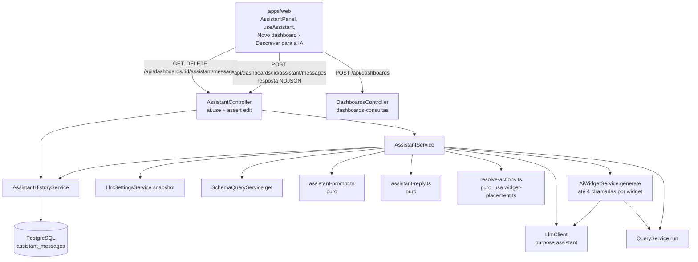

# IA para Dashboards Design

**Spec**: `.specs/features/ia-dashboard/spec.md`
**Status**: Approved (o usuário dispensou a aprovação do design: "Não precisa da validação do design.")

Segue a arquitetura de `.specs/features/fundacao-auth/design.md` e usa as interfaces de `dashboards-consultas` (`DashboardAccessService.assert`, `POST /api/dashboards`, `PUT /api/dashboards/:id` com `version`, `QueryService.run`, `validateReadOnlyCypher`, `draft.ts`, `useDashboardEditor`, `DashboardPage`, `DashboardGrid`, `NewDashboardDialog`, AD-042 a AD-046), `compartilhamento` (`DbShareResolver`, Visualizador limitado a "pode ver", 403 `DASHBOARD_EDIT_FORBIDDEN`, AD-048), `widgets-graficos` (`WIDGET_VISUALIZATIONS`, `widgetMappingSchemas`, `validateMapping`, AD-060 a AD-063), `ia-cypher` (`LlmSettingsService.snapshot`, `LlmClient`, `ScriptedChatModel`, `FakeChatModelFactory`, `serializeSchema`, `buildWidgetMessages`, `AiWidgetService`, protocolo NDJSON, `streamAiWidget`, `resolveAiMapping`, `useAiGenerations`, `useAiStatus`, AD-080 a AD-087) e `interatividade` (`DashboardFilter`, `dashboardFilterSchema`, `dashboardFiltersSchema`, `filtersForPrompt`, `FILTER_TYPES`, `draft.addFilter`/`updateFilter`/`removeFilter`, chave da prévia com `params`, AD-100 a AD-109). As decisões novas desta feature são AD-120 a AD-129 em `.specs/STATE.md`.

**Estado do código no momento deste design:** o repositório tem o scaffolding de `fundacao-auth` e a API de autenticação (schema inicial, health, hasher, sessões, throttle, login, guards, primeiro acesso, troca de senha). `conexoes-schema`, `dashboards-consultas`, `compartilhamento`, `widgets-graficos`, `ia-cypher` e `interatividade` ainda não foram implementadas; `apps/web/src/features/` não existe. Este design parte do que os design.md e tasks.md delas definem. Quem implementar segue o código real quando ele divergir daqui e marca a diferença com `SPEC_DEVIATION`.

---

## Architecture Overview

O backend ganha o módulo `assistant`: guarda a conversa de cada usuário em cada dashboard, monta o pedido ao LLM (schema, estrutura do rascunho, 20 mensagens recentes, mensagem nova), interpreta o plano que o LLM devolve (resposta em texto e uma lista fechada de ações), valida cada ação contra o rascunho e gera o Cypher de cada widget novo ou alterado com o laço de `ia-cypher` (até 4 chamadas por widget). Tudo sai numa única resposta NDJSON; o rascunho só muda no navegador, de uma vez, no evento final. A geração do dashboard inteiro é o mesmo pedido, enviado num dashboard recém-criado com a descrição como primeira mensagem.



### Um pedido ao assistente

```mermaid
sequenceDiagram
    participant W as Web (useAssistant)
    participant C as AssistantController
    participant S as AssistantService
    participant L as LlmClient
    participant G as AiWidgetService.generate
    participant H as AssistantHistoryService
    W->>C: POST .../assistant/messages { message, retryOf?, draft }
    C->>C: @RequirePermission('ai.use'), assert(user, id, 'edit'), assistantRequestSchema
    C->>S: prepare(): snapshot, schema da conexão do rascunho
    alt sem provedor / sem schema / corpo inválido
        C-->>W: 409 LLM_NOT_CONFIGURED | 409 SCHEMA_NOT_READ | 400 VALIDATION_ERROR (JSON)
    end
    C-->>W: 200 application/x-ndjson
    S->>H: grava a mensagem do usuário (ou reaproveita retryOf)
    S-->>W: {"type":"accepted","userMessage":...}
    S->>H: 20 mensagens anteriores
    S->>L: call(plano: sistema + schema + rascunho com refs + conversa + mensagem)
    alt erro do provedor
        S-->>W: {"type":"provider_error",...} e fim (nada aplicado, nada gravado)
    end
    S->>S: parseAssistantReply → resolveActions (refs, lista fechada, inexistentes, última aba, 20 widgets, posição)
    S-->>W: {"type":"planned","widgetsTotal":M}
    loop cada widget a gerar (i = 1..M)
        S->>G: generate({ prompt, widget, filters, signal, onAttempt })
        G-->>S: done | failed | stopped | provider_error
        S-->>W: {"type":"widget","index":i,"total":M,"attempt":n} a cada tentativa
        alt provider_error
            S-->>W: {"type":"provider_error",...} e fim (nada aplicado, nada gravado)
        end
    end
    S->>H: grava a resposta (texto + mudanças + criados + com erro + descartados)
    S-->>W: {"type":"done","reply":...,"actions":[...]}
    W->>W: guarda o rascunho anterior (Desfazer) e aplica todas as ações de uma vez
    Note over W,C: Cancelar ou sair aborta o fetch; o 'close' aborta o signal: nada é gravado nem aplicado
```

### Onde as regras rodam

| Regra | Camada | Testada por |
| ----- | ------ | ----------- |
| Tamanho da mensagem e da descrição; contexto do rascunho só com os campos de CHAT-05 (valores de filtro descartados) | `packages/contracts/src/assistant.ts` (zod) | testes de contrato |
| Conversa por usuário e dashboard, ordem, limpar, cascata ao excluir | `AssistantHistoryService` + chave estrangeira | testes de rota (PGlite) |
| Posição e tamanho na grade de 12 colunas, sem sobreposição, mínimo 2×2 | `apps/api/src/assistant/widget-placement.ts` (puro) | testes unitários da API |
| Estrutura do rascunho com refs curtas, schema, conversa, regras do plano | `apps/api/src/assistant/assistant-prompt.ts` (puro) | testes unitários da API |
| Plano em JSON ou texto livre; ação desconhecida | `apps/api/src/assistant/assistant-reply.ts` (puro) | testes unitários da API |
| Lista fechada, refs inexistentes, última aba, limite de 20 widgets, filtros válidos, ids novos, descrição de cada mudança | `apps/api/src/assistant/resolve-actions.ts` (puro) | testes unitários da API |
| Geração por widget com validação, execução e autocorreção; widget com erro segue; erro do provedor para tudo; resumo da resposta; gravação; log | `AssistantService` | testes de service e de rota (PGlite + `FakeNeo4jGateway` + `FakeChatModelFactory`) |
| Aplicar as ações no rascunho, ignorando o que sumiu | `apps/web/src/features/assistant/apply-actions.ts` (puro) | testes unitários do web |
| Um pedido por vez, aplicar só em `done`, Desfazer, cancelar, sair, falha com "Tentar novamente" | `apps/web/src/features/assistant/useAssistant.ts` | testes do hook com MSW |
| Painel aberto ou fechado no navegador, controle só para quem edita | `DashboardPage`, `AssistantPanel` | testes de tela com MSW |

---

## Code Reuse Analysis

### Existing Components to Leverage

| Component | Location | How to Use |
| --------- | -------- | ---------- |
| `DashboardAccessService.assert(user, id, 'edit')` | `apps/api/src/dashboard-access/` | As três rotas do assistente (CHAT-17); o Visualizador nunca edita (AD-048) |
| `@RequirePermission('ai.use')` | `apps/api/src/auth/`, `packages/contracts/src/roles.ts` | Admin e Editor; o Visualizador recebe 403 |
| `LlmSettingsService.snapshot`, `LlmClient.call` | `apps/api/src/llm/` (ia-cypher) | Configuração fixada no início do pedido; chamada do plano com `purpose: 'assistant'` |
| `AiWidgetService` | `apps/api/src/ai/ai-widget.service.ts` (ia-cypher) | Ganha `generate(...)`, o laço de até 4 chamadas sem HTTP; `run` passa a usá-lo (T8) |
| `serializeSchema`, `buildWidgetMessages` (com `filters`) | `apps/api/src/ai/widget-prompt.ts` (ia-cypher, interatividade) | Schema no plano; pedido de cada widget |
| `SchemaQueryService.get`, regra "schema lido" (AD-085) | `apps/api/src/schema/` | CHAT-27 |
| `QueryService.run` (`signal`) | `apps/api/src/queries/` | Resultado do widget alterado sem novo Cypher |
| `dashboardFilterSchema`, `dashboardFiltersSchema`, `filtersForPrompt`, `FILTER_TYPES` | `packages/contracts/src/filters.ts` (interatividade) | Validar filtros criados pela IA; filtros no pedido |
| `widgetMappingSchemas`, `WIDGET_VISUALIZATIONS` | `packages/contracts/src/widget-config.ts` | Visualização e mapeamento das ações |
| `createTestApp` (`neo4j`, `shares`, `chatModels`), `FakeNeo4jGateway`, `FakeChatModelFactory`, `ScriptedChatModel`, `FakeClock`, fixtures de schema e dashboards | `apps/api/test/` | Todos os testes da API; nenhum chama provedor real |
| `streamAiWidget` (leitura NDJSON), `useAiStatus`, `resolveAiMapping`, `useAiGenerations` | `apps/web/src/features/ai/` (ia-cypher) | Leitor de NDJSON reaproveitado; mapeamento resolvido contra o resultado; "Pedir à IA" bloqueado (CHAT-25) |
| `draft.ts`, `useDashboardEditor`, `DashboardPage`, `DashboardGrid` (`useContainerWidth`), `DashboardTabsBar`, `WidgetCard` | `apps/web/src/features/dashboards/`, `features/widgets/` | Rascunho, modo de edição, grade com a largura restante |
| `NewDashboardDialog`, `useCreateDashboard` | `apps/web/src/features/dashboards/` | Opção "Descrever para a IA" |
| `renderApp`, MSW `server`, fixtures, `mockElementSize` | `apps/web/src/test/` | Testes de tela |
| shadcn `button`, `textarea`, `alert-dialog`, `skeleton`, `dialog`, `select`, `form`, `tabs` | `apps/web/src/components/ui/` | Painel e diálogo |

### Integration Points

| System | Integration Method |
| ------ | ------------------ |
| PostgreSQL | Tabela `assistant_messages`, migração do drizzle-kit; `dashboard_id` com `ON DELETE CASCADE` (HIST-06) |
| Provedor de LLM | Só pelo `LlmClient` (AD-081); `maxRetries: 0`, 60 s por chamada |
| Neo4j do usuário | Só pelo `QueryService.run` (AD-045), dentro do `AiWidgetService.generate` ou na execução do widget alterado |
| `ia-cypher` | `AiWidgetService.run` passa a delegar a `generate`; os testes de `ia-cypher` continuam verdes |
| `dashboards-consultas` | `PUT /api/dashboards/:id` continua sendo a única gravação do dashboard (GEN-13) |

---

## Components

### Contratos: `packages/contracts/src/assistant.ts`

```typescript
export const ASSISTANT_MESSAGE_MAX = 4000
export const ASSISTANT_HISTORY_LIMIT = 20          // CHAT-05
export const ASSISTANT_MAX_NEW_WIDGETS = 20        // GEN-12

export const assistantDescriptionSchema            // trim; vazio → "Informe a descrição"; > 4.000 → "A descrição passa de 4.000 caracteres" (GEN-10)
export const assistantMessageSchema                // trim; 1 a 4.000; > 4.000 → "A mensagem passa de 4.000 caracteres" (CHAT-16)

export const assistantDraftSchema = z.object({     // z.object descarta chaves extras (CHAT-06)
  name: z.string().max(80),
  connectionId: z.string().uuid(),
  tabs: z.array(z.object({ id: uuid, name: ≤ 40,
    widgets: z.array(z.object({ id: uuid, title: ≤ 80, cypher: ≤ 20.000 | null,
      visualization: z.string(), mapping: z.record(z.unknown()).nullable(),
      layout: { x, y, w, h: int } })).max(200) })).min(1).max(50),
  filters: z.array(z.object({ id: uuid, label: ≤ 40, parameter: ≤ 40, type: z.enum(FILTER_TYPES) })).max(30),
})
export const assistantRequestSchema = z.object({ message: assistantMessageSchema, retryOf: uuid.optional(), draft: assistantDraftSchema })

export type AssistantRole = 'USER' | 'ASSISTANT'
export interface AssistantReplyDetails {
  changes: string[]              // CHAT-09
  notApplied: string[]           // CHAT-23, CHAT-24, ação fora da lista
  createdWidgets: number         // GEN-07
  failedWidgets: string[]        // títulos (GEN-07)
  discardedWidgets: number       // GEN-12
}
export interface AssistantMessageDto { id: string; role: AssistantRole; text: string; details: AssistantReplyDetails | null; createdAt: string }

export type WidgetLayoutDto = { x: number; y: number; w: number; h: number }
export type AssistantAction =                      // já resolvida no servidor, com ids reais
  | { type: 'create_tab'; tabId: string; name: string }
  | { type: 'rename_tab'; tabId: string; name: string }
  | { type: 'remove_tab'; tabId: string }
  | { type: 'create_widget'; tabId: string; widgetId: string; title: string; cypher: string | null;
      visualization: WidgetVisualization; mapping: Record<string, unknown> | null; layout: WidgetLayoutDto;
      result: QueryResultDto | null; error: string | null }
  | { type: 'update_widget'; widgetId: string; title?: string; cypher?: string | null;
      visualization?: WidgetVisualization; mapping?: Record<string, unknown> | null;
      result: QueryResultDto | null; error: string | null }
  | { type: 'remove_widget'; widgetId: string }
  | { type: 'set_layout'; widgetId: string; layout: WidgetLayoutDto }        // mover e redimensionar
  | { type: 'create_filter'; filter: DashboardFilter }
  | { type: 'update_filter'; filter: DashboardFilter }
  | { type: 'remove_filter'; filterId: string }
  | { type: 'rename_dashboard'; name: string }

export type AssistantEvent =
  | { type: 'accepted'; userMessage: AssistantMessageDto }
  | { type: 'planned'; widgetsTotal: number }
  | { type: 'widget'; index: number; total: number; attempt: number }   // GEN-08
  | { type: 'done'; reply: AssistantMessageDto; actions: AssistantAction[] }
  | { type: 'provider_error'; code: AiProviderErrorCode; message: string }
  | { type: 'error'; message: string }
```

#### Mensagens (acréscimos em `MESSAGES`)

| Chave | Texto |
| ----- | ----- |
| `assistantToggle` | "Assistente" |
| `assistantEmpty` | "Descreva o que você quer ver ou mudar neste dashboard" |
| `assistantPlaceholder` | "Escreva uma mensagem" |
| `assistantMessageTooLong` | "A mensagem passa de 4.000 caracteres" |
| `assistantDescribeOption` | "Descrever para a IA" |
| `assistantBlankOption` | "Em branco" |
| `assistantDescriptionLabel` | "Descrição" |
| `assistantDescriptionRequired` | "Informe a descrição" |
| `assistantDescriptionTooLong` | "A descrição passa de 4.000 caracteres" |
| `assistantThinking` | "Pensando..." |
| `assistantGeneratingWidget(n, m)` | "Gerando widget <n> de <m>" |
| `assistantUndo` | "Desfazer" |
| `assistantClear` | "Limpar conversa" |
| `assistantClearConfirm` | "Apagar toda a conversa deste dashboard?" |
| `assistantLoadFailed` | "Não foi possível carregar a conversa" |
| `assistantWidgetsCreated(n)` | "1 widget criado" / "<n> widgets criados" |
| `assistantWidgetsFailed(títulos)` | "Widgets com erro: <t1>, <t2>" |
| `assistantWidgetsDiscarded(n)` | "<n> widgets descartados: o limite é 20 por pedido" |
| `assistantTabCreated(nome)` / `assistantTabRenamed(de, para)` / `assistantTabRemoved(nome)` | "Aba criada: <nome>" / "Aba renomeada: <de> → <para>" / "Aba removida: <nome>" |
| `assistantWidgetCreated(t)` / `assistantWidgetUpdated(t)` / `assistantWidgetRemoved(t)` / `assistantWidgetMoved(t)` | "Widget criado: <t>" / "Widget alterado: <t>" / "Widget removido: <t>" / "Widget movido ou redimensionado: <t>" |
| `assistantFilterCreated(r)` / `assistantFilterUpdated(r)` / `assistantFilterRemoved(r)` | "Filtro criado: <r>" / "Filtro alterado: <r>" / "Filtro removido: <r>" |
| `assistantDashboardRenamed(n)` | "Dashboard renomeado: <n>" |
| `assistantMissingTarget(ref)` | "Não aplicado: <ref> não existe" |
| `assistantLastTab` | "Não aplicado: o dashboard precisa de ao menos uma aba" |
| `assistantUnknownAction(tipo)` | "Não aplicado: a ação <tipo> não é permitida" |
| `assistantInvalidAction(tipo)` | "Não aplicado: a ação <tipo> veio com dados inválidos" |

Mensagens de erro do provedor, "Nenhum provedor de IA configurado" e "Leia o schema da conexão antes de usar a IA" são as de `ia-cypher`. "Tentar novamente" já existe.

### Backend: `apps/api/src/assistant/`

#### Tabela `assistant_messages` e `AssistantHistoryService`
- `list(userId, dashboardId): AssistantMessageDto[]` por `seq` crescente (HIST-02); `recent(userId, dashboardId, limit)` as últimas `limit` em ordem cronológica (CHAT-05); `appendUser(...)`, `appendAssistant(...)`; `clear(userId, dashboardId)` apaga só as do usuário nesse dashboard (HIST-05).
- Nenhuma consulta lê mensagem de outro usuário (HIST-03). A conversa de quem perde o acesso fica no banco; as rotas a escondem pelo `assert('edit')`.

#### `AssistantController`
Todas com `@RequirePermission('ai.use')` e `assert(user, id, 'edit')` (CHAT-17):

| Rota | Resposta |
| ---- | -------- |
| `GET /api/dashboards/:id/assistant/messages` | `AssistantMessageDto[]` do usuário, em ordem |
| `DELETE /api/dashboards/:id/assistant/messages` | 204 |
| `POST /api/dashboards/:id/assistant/messages` `assistantRequestSchema` | 400 (`fieldErrors.message`), 403, 404, 409 `LLM_NOT_CONFIGURED`, 409 `SCHEMA_NOT_READ` em JSON antes de qualquer byte; depois 200 `application/x-ndjson` com `X-Accel-Buffering: no`, `flushHeaders`, uma linha por `AssistantEvent`; `req.on('close')` aborta o pedido (AD-083) |

`retryOf`: se é o id da mensagem mais recente do usuário nesse dashboard e ela é `USER`, o pedido a reaproveita sem gravar outra; senão grava uma nova (CHAT-21).

#### `widget-placement.ts` (puro)
`placeWidget(occupied: WidgetLayoutDto[], wanted: Partial<WidgetLayoutDto>): WidgetLayoutDto` (GEN-04): `w` arredondado e limitado a 2..12 (padrão 4); `h` a 2..12 (padrão 4); `x` a 0..12−w (padrão 0); `y` ≥ 0 (padrão: abaixo do último ocupado); enquanto sobrepõe algum ocupado, `y + 1`. `placeWidgets` aplica em sequência, cada um entrando nos ocupados do seguinte.

#### `assistant-prompt.ts` (puro)
- `serializeDraft(draft): { text: string; refs: DraftRefs }`: refs curtas na ordem do rascunho, `t1..`, `w1..`, `f1..`. Texto: nome do dashboard; por aba `t1 "Vendas"`; por widget `w3 "Total por mês" visualização=BAR posição x,y tamanho w×h`, o Cypher entre cercas e o mapeamento em JSON; por filtro `f1 "Categoria" $categoria SINGLE_SELECT`. Nada além disso (CHAT-05, CHAT-06).
- `buildAssistantMessages({ schema, draft, history, message })`: `SystemMessage` com as regras: responder só um objeto JSON `{ "reply": texto em português, "actions": [...] }`; as 12 ações com o formato de cada uma (`create_tab {ref,name}`, `rename_tab {tab,name}`, `remove_tab {tab}`, `create_widget {tab,title,prompt,layout?}`, `update_widget {widget,title?,visualization?,mapping?,prompt?}`, `remove_widget {widget}`, `move_widget {widget,x,y}`, `resize_widget {widget,w,h}`, `create_filter {label,parameter,type,options?,defaultValue?}`, `update_filter {filter,...}`, `remove_filter {filter}`, `rename_dashboard {name}`); `prompt` descreve o widget para o gerador de Cypher e é obrigatório para mudar a consulta; um widget novo ocupa no mínimo 2×2 na grade de 12 colunas; um dashboard novo já tem uma aba vazia `t1`, que deve ser renomeada e usada; no máximo 20 widgets novos; nunca responder dados (a IA não vê resultados); as 10 visualizações e o formato do mapeamento (mesmo texto de `buildWidgetMessages`); e o schema por `serializeSchema`. Depois as mensagens de `history` (as 20 mais recentes, `HumanMessage` e `AIMessage` com o texto e as mudanças da resposta) e uma `HumanMessage` final com o rascunho serializado e a mensagem nova.

#### `assistant-reply.ts` (puro)
`parseAssistantReply(text): { reply: string; actions: unknown[] }`: tira cercas, pega o primeiro objeto JSON balanceado; com `reply` texto e/ou `actions` lista, usa os dois (ausentes viram `''` e `[]`); sem JSON válido, `{ reply: text.trim(), actions: [] }` (CHAT-12). Resposta vazia vira `reply` vazio, e o service usa as mudanças como texto.

#### `resolve-actions.ts` (puro)
`resolveActions(draft, refs, rawActions, newId: () => string): ResolvedPlan`

```typescript
interface ResolvedPlan {
  actions: PendingAction[]       // AssistantAction sem result/error; widgets a gerar levam { prompt }
  changes: string[]              // uma descrição por ação aceita, na ordem
  notApplied: string[]
  discardedWidgets: number
}
```

- Simula as ações em ordem sobre uma cópia da estrutura (abas, widgets, filtros, nome). Cada ação passa por um schema zod do seu tipo; tipo fora das 12 aceitas → `assistantUnknownAction` (CHAT-07); dados fora do schema → `assistantInvalidAction`.
- Refs: `t*`, `w*`, `f*` do rascunho, ou a `ref` de um `create_tab` anterior do mesmo plano. Ref que não existe (ou já removida) → ação ignorada com `assistantMissingTarget(ref)` (CHAT-23). `create_widget` sem `tab` usa a primeira aba.
- `remove_tab` da única aba restante → `assistantLastTab` (CHAT-24). Remover aba remove os widgets dela.
- `create_widget` além do 20º é descartado e contado (GEN-12). Os aceitos ganham `widgetId = newId()` e `layout = placeWidget(ocupados da aba, layout pedido)` (GEN-04). `create_tab` e `create_filter` ganham ids de `newId()` (AD-123).
- `move_widget` e `resize_widget` viram `set_layout` com `placeWidget` sobre os demais widgets da aba.
- `update_widget` com `prompt` vira geração com o widget atual como contexto; sem `prompt`, aplica título, visualização e mapeamento e marca que precisa do resultado do Cypher atual.
- `create_filter`/`update_filter` passam em `dashboardFilterSchema` e, junto com os demais filtros simulados, em `dashboardFiltersSchema` (parâmetro repetido → `assistantInvalidAction`); a consulta de opções `QUERY` passa em `validateReadOnlyCypher`, sem execução.
- Visualização fora de `WIDGET_VISUALIZATIONS` vira `TABLE`; título com `trim` até 80; nome de aba até 40; nome do dashboard até 80.

#### `AiWidgetService.generate` (refatoração de `ia-cypher`)
```typescript
generate(input: { userId: string; snapshot: LlmSnapshot; schema: ConnectionSchemaDto; connectionId: string;
                  widget: { title: string; cypher: string | null; visualization: string; config: Record<string, unknown> };
                  prompt: string; filters: FilterPromptInfo[]; purpose: 'widget' | 'assistant';
                  signal: AbortSignal; onAttempt?: (n: number) => void }): Promise<WidgetGenerationOutcome>
type WidgetGenerationOutcome =
  | { kind: 'done'; attempts; cypher; visualization; mapping; title; result }
  | { kind: 'failed'; attempts; cypher: string | null; message: string }
  | { kind: 'stopped'; message: string }
  | { kind: 'provider_error'; code: AiProviderErrorCode; message: string }
```
É o laço de AD-084 sem HTTP nem `emit`; `run` passa a chamar `generate` e traduzir o resultado em eventos, sem mudar o comportamento de `ia-cypher`. Cancelamento lança `LlmCancelledError` (ou o `AbortError` do `QueryService`), que sobe.

#### `AssistantService`
- **prepare(user, dashboardId, body)**: `snapshot()` nulo → 409 `LLM_NOT_CONFIGURED`; schema da conexão `body.draft.connectionId` sem documento → 409 `SCHEMA_NOT_READ` (CHAT-27, AD-085).
- **run(prepared, emit, signal)**:
  1. grava ou reaproveita a mensagem do usuário (HIST-01) e emite `accepted`;
  2. `recent(..., 20)` sem a mensagem nova; `serializeDraft`; `buildAssistantMessages`; `llm.call(..., { purpose: 'assistant', attempt: null })` (CHAT-05);
  3. `parseAssistantReply` → `resolveActions`; emite `planned` com M = widgets a gerar;
  4. para cada widget a gerar, em ordem: `generate` com `onAttempt` emitindo `widget { index, total: M, attempt }` (GEN-05, GEN-08, CHAT-08). `done` → ação com Cypher, visualização, mapeamento, título e `result`. `failed` ou `stopped` → widget com o último Cypher (ou `null`), `TABLE`, mapeamento `null`, `error` com a mensagem, e o título entra em `failedWidgets` (GEN-06). `provider_error` → emite `provider_error` e termina sem gravar resposta nem devolver ações (CHAT-21, CHAT-22);
  5. `update_widget` sem `prompt` com Cypher: `QueryService.run` uma vez para devolver `result` (erro → `result: null`, `error` com a mensagem);
  6. monta `details` (`changes`, `notApplied`, `createdWidgets`, `failedWidgets`, `discardedWidgets`) e o texto (`reply` do LLM; vazio → as mudanças); confere o `signal`; grava a resposta (HIST-01) e emite `done` (CHAT-09, GEN-07).
  - Cancelado em qualquer ponto: para sem emitir, sem gravar a resposta (GEN-09, CHAT-14, CHAT-28). A mensagem do usuário fica.
  - Erro inesperado: emite `error` com "Ocorreu um erro inesperado. Tente novamente." e registra a exceção.
  - Nunca grava o dashboard (GEN-13).
- **Log (CHAT-29)**: `Logger('Assistant')`, uma linha por pedido: `assistant request user=<id> dashboard=<id> actions=<n> widgetErrors=<n> durationMs=<n> result=<ok|provider_error|cancelled|error>`. Nunca o texto das mensagens, o Cypher nem o schema.

### Frontend

| Componente | Location | Interfaces / comportamento |
| ---------- | -------- | -------------------------- |
| `assistantApi` | `src/features/assistant/api.ts` | `useAssistantMessages(dashboardId, enabled)` (chave `['assistant', dashboardId]`), `useClearAssistant(dashboardId)`, `streamAssistant(dashboardId, body, signal, onEvent): Promise<AssistantEvent>` com o mesmo leitor de NDJSON de `streamAiWidget` (extraído para `src/lib/ndjson.ts` se estiver dentro de `features/ai/api.ts`) |
| `apply-actions.ts` | `src/features/assistant/apply-actions.ts` | `applyAssistantActions(draft, actions): DashboardDraft` puro: cada ação pelas funções de `draft.ts` (`renameTab`, `removeTab`, `updateWidget`, `removeWidget`, `setName`, `addFilter`, `updateFilter`, `removeFilter`), mais `insertTab(draft, { id, name })` e `insertWidget(draft, tabId, widget)` acrescentadas a `draft.ts`; widget e aba que não existem mais no rascunho são ignorados; o mapeamento vem de `resolveAiMapping(visualization, mapping, result)` quando há `result`, e sem `result` fica o mapeamento que passa em `validateMapping`, senão `TABLE` com `{}` |
| `useAssistant` | `src/features/assistant/useAssistant.ts` | `useAssistant({ dashboardId, draft, setDraft, ensureEditing, editing })` → `{ send(text), retry(), cancel(), undo(), running, progress, failure, undoMessageId }`. Um pedido por vez. `send` chama `ensureEditing()` antes de tudo (CHAT-04), monta o corpo com o rascunho atual e abre o stream; `accepted` acrescenta a mensagem ao cache; `widget` atualiza `progress`; `done` guarda `before = draft`, aplica `applyAssistantActions` de uma vez, semeia a prévia de cada widget com `result` como `useAiGenerations` (AD-086, AD-109), acrescenta a resposta ao cache e, se houve ações, guarda `{ messageId, before, after }` (CHAT-10); `provider_error`, `error` e erro HTTP (409, 400) viram `failure { userMessageId, message }` sem tocar no rascunho (CHAT-21, CHAT-22, CHAT-27); `retry` reenvia o mesmo texto com `retryOf`; `cancel`, `editing` falso e desmontar abortam (GEN-09, CHAT-14, CHAT-28); `undo` faz `setDraft(before)` (CHAT-11); `undoMessageId` só existe enquanto `draft === after` (Descartar, Salvar ou mudança manual o tiram: CHAT-26, AD-126) |
| `AssistantMessageList` | `src/features/assistant/AssistantMessageList.tsx` | esqueleto ao carregar (HIST-07); erro "Não foi possível carregar a conversa" + "Tentar novamente" (HIST-08); vazia: "Descreva o que você quer ver ou mudar neste dashboard" (CHAT-20); mensagens em ordem, a do usuário à direita; resposta com o texto, a lista `changes`, `notApplied`, "<n> widgets criados", "Widgets com erro: ...", "... descartados" (CHAT-09, GEN-07, GEN-12); "Desfazer" só na mensagem `undoMessageId` (CHAT-10, HIST-09); `failure` mostra a mensagem e "Tentar novamente" sob a mensagem do usuário (CHAT-21) |
| `AssistantComposer` | `src/features/assistant/AssistantComposer.tsx` | `textarea` com `aria-label="Mensagem"` e placeholder "Escreva uma mensagem", contador `n/4.000`, "Enviar" desabilitado vazio (CHAT-15) e acima de 4.000 com "A mensagem passa de 4.000 caracteres" (CHAT-16); Enter envia, Shift+Enter quebra linha; rodando: `textarea` desabilitado, "Pensando..." ou "Gerando widget N de M", e "Cancelar" (CHAT-13, GEN-08); sem provedor: desabilitado com "Nenhum provedor de IA configurado" |
| `AssistantPanel` | `src/features/assistant/AssistantPanel.tsx` | `aside` `aria-label="Assistente"` com largura fixa `w-96 shrink-0`, altura da área de conteúdo e `flex flex-col`; cabeçalho "Assistente" com "Limpar conversa" (alert-dialog "Apagar toda a conversa deste dashboard?", "Apagar" e "Cancelar": HIST-04, HIST-05) e fechar; lista `flex-1 overflow-y-auto` que rola até a última mensagem a cada mensagem nova; composer fixo embaixo (CHAT-19) |
| `DashboardPage` (modify) | `src/features/dashboards/DashboardPage.tsx` | botão "Assistente" (`aria-pressed`) no cabeçalho do dashboard só com `can(role, 'ai.use')` e `permissions.edit` (CHAT-01, CHAT-18); conteúdo em `flex` com a grade em `min-w-0 flex-1` e o painel ao lado, sem posição absoluta (CHAT-02); aberto ou fechado em `localStorage['ninbi-assistant-open']` com try/catch (CHAT-03); o painel fica fora da área das abas, então trocar de aba não o desmonta (CHAT-30); cria `useAssistant` com `ensureEditing` do `useDashboardEditor`; enquanto `running`, passa `assistantBusy` ao `useAiGenerations`/`WidgetCard`, que deixam "Pedir à IA" desabilitado (CHAT-25); lê `location.state.assistantPrompt` uma vez, abre o painel, envia e limpa o estado com `navigate(..., { replace: true, state: null })` (GEN-02) |
| `NewDashboardDialog` (modify) | `src/features/dashboards/NewDashboardDialog.tsx` | para `ai.use`, escolha "Em branco" ou "Descrever para a IA" (GEN-01); a segunda mostra "Nome", "Conexão" e "Descrição" (`textarea`, `assistantDescriptionSchema`, mensagem no campo: GEN-10); sem provedor (`useAiStatus`) fica desabilitada com "Nenhum provedor de IA configurado" (GEN-11); "Criar" chama `POST /api/dashboards` e navega para `/dashboards/<id>?editar=1` com `state: { assistantPrompt }` (GEN-02) |

---

## Data Models

```typescript
// apps/api/src/database/schema.ts (acréscimos)
export const assistantRoleEnum = pgEnum('assistant_role', ['USER', 'ASSISTANT'])

assistant_messages: {
  id: uuid pk default gen_random_uuid()
  seq: bigint generated always as identity      // ordem estável mesmo com created_at igual
  dashboardId: uuid not null references dashboards(id) on delete cascade   // HIST-06
  userId: uuid not null references users(id) on delete cascade
  role: assistantRoleEnum not null
  text: text not null                            // até 4.000 no USER; o texto da resposta no ASSISTANT
  details: jsonb null                            // AssistantReplyDetails, só no ASSISTANT
  createdAt: timestamptz not null
}  index on (dashboard_id, user_id, seq)
```

**Relationships**: a conversa pertence ao par dashboard e usuário. Nada guarda resultado de consulta, Cypher gerado nem ações: a resposta guarda só o texto e as descrições das mudanças. As conversas não expiram.

---

## Error Handling Strategy

| Error Scenario | Handling | User Impact |
| -------------- | -------- | ----------- |
| Visualizador, ou quem só vê o dashboard | 403 (`ai.use` ou `assert('edit')`) | O controle "Assistente" não aparece |
| Dashboard fora do alcance | 404 `DASHBOARD_NOT_FOUND` | "Dashboard não encontrado" |
| Mensagem vazia ou longa | 400 `VALIDATION_ERROR` (`fieldErrors.message`) | Envio desabilitado / "A mensagem passa de 4.000 caracteres" |
| Sem provedor | 409 `LLM_NOT_CONFIGURED` | Composer e "Descrever para a IA" desabilitados com "Nenhum provedor de IA configurado" |
| Conexão sem schema | 409 `SCHEMA_NOT_READ` | "Leia o schema da conexão antes de usar a IA" na conversa, com "Tentar novamente" |
| Erro do provedor no plano ou num widget | evento `provider_error`; nada aplicado nem gravado | Mensagem de `ia-cypher` na conversa e "Tentar novamente" (CHAT-21, CHAT-22) |
| Ação fora da lista, com ref inexistente ou dados inválidos | ignorada | "Não aplicado: ..." na resposta (CHAT-07, CHAT-23) |
| Remover a última aba | ignorada | "Não aplicado: o dashboard precisa de ao menos uma aba" (CHAT-24) |
| Mais de 20 widgets novos | os 20 primeiros | "<n> widgets descartados: o limite é 20 por pedido" (GEN-12) |
| Widget que esgota as correções ou com o Neo4j inacessível | criado com o último Cypher, `TABLE` | Card mostra o erro da consulta; título em "Widgets com erro" (GEN-06) |
| Cancelar, sair do dashboard ou da edição | `fetch` abortado → `close` → `signal` | Rascunho como estava; a mensagem do usuário fica na conversa |
| Erro inesperado no servidor | evento `error` | "Ocorreu um erro inesperado. Tente novamente." com "Tentar novamente" |
| Conversa não carrega | query em erro | "Não foi possível carregar a conversa" + "Tentar novamente" |

---

## Test Strategy

| Nível | O que cobre | Onde |
| ----- | ----------- | ---- |
| Contratos | tamanhos, contexto do rascunho sem valores, mensagens | `packages/contracts/src/assistant.spec.ts` |
| API pura | posição na grade, prompt, leitura do plano, resolução das ações | `apps/api/test/assistant/*.spec.ts` |
| API rápida (PGlite + `FakeNeo4jGateway` + `FakeShareResolver` ou resolver real + `FakeChatModelFactory`) | histórico, rotas, pedido inteiro, cancelamento, log | `apps/api/test/assistant/*.spec.ts`, `apps/api/test/ai/ai-widget.generate.spec.ts` |
| Web puro | aplicar ações | `apps/web/src/features/assistant/apply-actions.test.ts` |
| Web hook e telas | gesto + texto visível, NDJSON por `ReadableStream` no MSW | `apps/web/src/features/assistant/*.test.tsx`, `features/dashboards/*.test.tsx` |

- **Nunca há chamada a provedor real.** O roteiro do `ScriptedChatModel` tem, na ordem, a resposta do plano e as respostas de cada widget.
- **CHAT-06**: o `FakeNeo4jGateway` devolve linhas com `VALOR-DE-LINHA-5b2e`; o corpo do pedido traz filtros com `defaultValue: 'VALOR-DE-FILTRO-c41d'` e `options` estáticas `['OPCAO-77aa']`; nenhuma mensagem de `ScriptedChatModel.calls` contém esses textos, inclusive no segundo pedido, que leva a conversa anterior.
- **Cancelamento** no servidor é provado no `AssistantService` com `AbortController` e `'hang'`; no web, por `request.signal.aborted` no handler MSW.
- **Largura da grade** (CHAT-02): o jsdom não calcula layout; o teste confere a estrutura (painel e grade irmãos num contêiner `flex`, grade com `min-w-0 flex-1`, painel sem `absolute`/`fixed`) e, com `mockElementSize`, que a grade mede o próprio contêiner.

---

## Risks & Concerns

| Concern | Location (file:line) | Impact | Mitigation |
| ------- | -------------------- | ------ | ---------- |
| Seis features anteriores ainda não implementadas | `apps/api/src/{ai,llm,dashboards,queries,schema}/`, `apps/web/src/features/` | Nomes reais podem diferir do design | Pré-requisito declarado em tasks.md; `SPEC_DEVIATION` onde diferirem |
| `AiWidgetService` sem `generate` em `ia-cypher` | `apps/api/src/ai/ai-widget.service.ts` | Reaproveitar o laço exigiria copiar código | A T8 extrai `generate` sem mudar o comportamento; os testes de `ia-cypher` ficam verdes |
| Custo: 1 + 4 × 20 chamadas no pior caso | `AssistantService` | Pedido longo e caro | Limite de 20 widgets (GEN-12); 60 s por chamada; o usuário vê "Gerando widget N de M" e pode cancelar |
| Pedido longo atrás de proxy | instalação com nginx | Progresso só no fim; prazo de proxy pode cortar | `X-Accel-Buffering: no`; o resultado inteiro chega no `done` |
| Cancelar entre a gravação da resposta e o `done` | `AssistantService` | A conversa guarda uma resposta cujas ações o web não aplicou | O service confere o `signal` imediatamente antes de gravar; a janela é de uma escrita no banco; aceito |
| Modelo fraco devolve plano fora do formato | `assistant-reply.ts` | Nenhuma mudança | Texto livre vira resposta sem ações (CHAT-12); ações inválidas são listadas como não aplicadas |
| Ids de abas, widgets e filtros gerados no servidor | `resolve-actions.ts` | AD-043 diz que os ids nascem no navegador | Continuam UUIDs novos e únicos; o `PUT` só exige UUID que não pertença a outro dashboard (AD-123) |
| Rascunho mudado pelo usuário durante o pedido | `apply-actions.ts` | Ação aponta para widget removido | A aplicação ignora o que sumiu, como AIQ-29 |
| Desfazer some com qualquer mudança manual | `useAssistant` | O usuário perde o Desfazer ao arrastar um widget | Regra previsível (AD-126); a spec só pede desfazer a alteração mais recente |
| Testes existentes mudam | `NewDashboardDialog`, `DashboardPage`, `WidgetCard`, `AiWidgetService` | Novos controles e a refatoração | Os testes de `dashboards-consultas`, `ia-cypher` e `interatividade` continuam verdes sem afrouxar asserções |
| Test gap: jsdom não mede a largura | CHAT-02, CHAT-19 | Medição visual não é provada | Estrutura e classes conferidas; a verificação visual fica com o usuário (AD-023) |

---

## Tech Decisions (only non-obvious ones)

| Decision | Choice | Rationale |
| -------- | ------ | --------- |
| Conversa | Tabela `assistant_messages` por dashboard e usuário, ordem por `seq` (AD-120) | HIST-01 a HIST-06; o provedor não guarda nada |
| Protocolo | Uma resposta NDJSON por mensagem, aplicação inteira no `done` (AD-121) | Cancelar e falhar não deixam nada aplicado (GEN-09, CHAT-14, CHAT-22) sem lógica de desfazer parcial |
| Plano | Uma chamada devolve `{ reply, actions }`; o Cypher de cada widget sai do laço de `ia-cypher` (AD-122) | Reaproveita validação, execução e autocorreção (GEN-05, CHAT-08) |
| Refs e ids | Refs curtas no prompt; ids reais criados no servidor (AD-123) | O LLM erra menos com `w3` que com UUID; CHAT-23 vira uma busca no mapa |
| Contexto | Só os campos de CHAT-05, recortados pelo zod (AD-124) | CHAT-06 garantido pelo schema, não pela tela |
| Geração | "Novo dashboard" cria o dashboard e o chat envia a descrição (AD-125) | Um só caminho para gerar e conversar |
| Desfazer | Foto do rascunho anterior, válida enquanto o rascunho é o que a resposta produziu (AD-126) | Resultado sempre previsível |
| Painel | À direita, `w-96`, estado em `localStorage` (AD-127) | CHAT-02, CHAT-03 |
| Log | `Logger('Assistant')` chave=valor (AD-128) | CHAT-29 no formato dos demais logs |
| Laço por widget | `AiWidgetService.generate` e `purpose: 'assistant'` no `LlmClient` (AD-129) | Uma implementação do laço de AD-084 |
