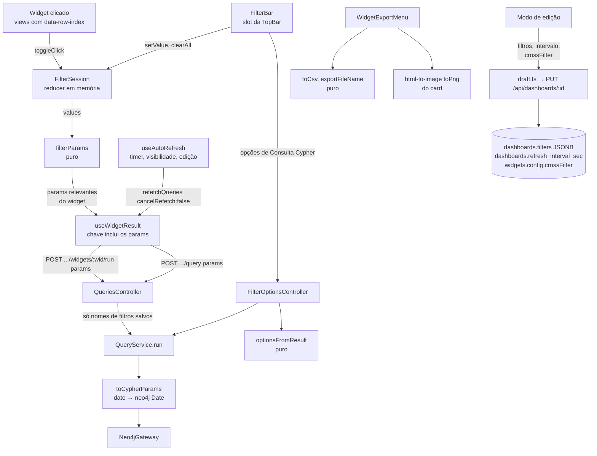
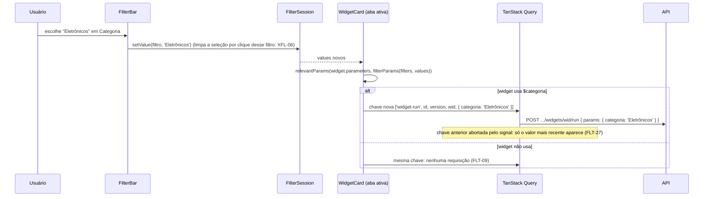

# Interatividade Design

**Spec**: `.specs/features/interatividade/spec.md`
**Status**: Approved (o usuário dispensou a aprovação do design: "Não precisa da validação do design.")

Segue a arquitetura de `.specs/features/fundacao-auth/design.md` e parte das interfaces de `.specs/features/dashboards-consultas/design.md` (`PUT /api/dashboards/:id` com `version`, `DashboardDto`, `QueryService.run`, `extractParameterNames`, as rotas `.../query` e `.../widgets/:widgetId/run`, `useWidgetResult`, `WidgetCard`, `draft.ts`, `WidgetEditorDialog`), de `.specs/features/compartilhamento/design.md` (`DashboardAccessService.assert`, 403 `DASHBOARD_EDIT_FORBIDDEN`), de `.specs/features/widgets-graficos/design.md` (`widget-config.ts`, `mapping/*`, `WidgetVisualization`, as views, `formatValue`/`formatDate`) e de `.specs/features/ia-cypher/design.md` (`aiWidgetRequestSchema`, `buildWidgetMessages`, `useAiGenerations`). As decisões novas desta feature são AD-100 a AD-109 em `.specs/STATE.md`.

**Estado do código no momento deste design:** o repositório tem o scaffolding de `fundacao-auth` e parte da API dela (contratos de papéis, schemas e mensagens; schema inicial; sessões, login e matriz de permissões). `conexoes-schema`, `dashboards-consultas`, `compartilhamento`, `widgets-graficos` e `ia-cypher` ainda não foram implementadas. Este design parte do que os design.md e tasks.md delas definem. Quem implementar segue o código real quando ele divergir daqui e marca a diferença com `SPEC_DEVIATION`.

---

## Architecture Overview

O backend muda pouco: o dashboard passa a gravar os filtros e o intervalo padrão de atualização no mesmo `PUT` (AD-043); a execução aceita valores tipados de parâmetro e os converte para o driver; a execução de widget salvo descarta parâmetros que não são de um filtro; duas rotas carregam as opções de filtros "Consulta Cypher"; e o pedido à IA passa a descrever os filtros. O resto mora no navegador, em funções puras testadas e num estado de sessão por página: valores dos filtros, seleção por clique, intervalo escolhido, timer de atualização, exportação.



### Mudar um filtro



### Atualização automática

```mermaid
sequenceDiagram
    participant T as useAutoRefresh
    participant D as document
    participant Q as QueryClient
    T->>T: setTimeout(intervalo) (reinicia quando os params mudam: RFR-12)
    alt página em edição ou intervalo "Desligada"
        T->>T: sem timer (RFR-07)
    end
    T->>D: venceu: document.hidden?
    alt oculta
        T->>T: marca "vencido" e não executa (RFR-05)
        D-->>T: visibilitychange → visível
        T->>Q: executa uma vez e reinicia o timer (RFR-06)
    else visível
        T->>Q: refetchQueries(chave de cada widget da aba ativa, { cancelRefetch: false }) (RFR-02)
        Note over Q: execução em andamento não é repetida (RFR-08); os dados anteriores ficam (RFR-09)
    end
```

### Onde as regras rodam

| Regra | Camada | Testada por |
| ----- | ------ | ----------- |
| Tipos de filtro, rótulo, parâmetro (formato, 40, repetido inclusive `_inicio`/`_fim`), origem das opções, valor padrão por tipo, intervalos aceitos, `crossFilter` válido | `packages/contracts/src/filters.ts` (zod), aplicado no `PUT` do dashboard e no formulário | testes de contrato e de rota |
| `$parametros` de um Cypher | `packages/contracts/src/cypher-tokens.ts` (movido da API) | testes de contrato e os da API que já existem |
| Parâmetros do widget salvo restritos aos filtros do dashboard | `QueriesController` (rota `.../run`) | testes de rota |
| Valor do fio para o driver (data, inteiro, lista) | `apps/api/src/queries/cypher-params.ts` (puro) | testes unitários da API |
| Opções de "Consulta Cypher": primeira coluna, sem nulos, sem repetição, 1.000 | `apps/api/src/filters/filter-options.ts` (puro) | testes unitários da API |
| Valor vazio, lista, intervalo, data, número inválido, intervalo invertido, parâmetros relevantes do widget, contagem de widgets que usam o filtro | `apps/web/src/features/filters/filter-values.ts` (puro) | testes unitários do web |
| Valor do clique, linhas destacadas | `apps/web/src/features/filters/cross-filter.ts` (puro) | testes unitários do web |
| Estado da sessão: valores, seleção, limpar, clique de novo, intervalo da sessão | `apps/web/src/features/filters/filter-session.tsx` (reducer puro) | testes unitários do web |
| Rascunho: criar, editar e remover filtro (com a limpeza de "Ao clicar"), intervalo padrão, "Ao clicar" | `apps/web/src/features/dashboards/draft.ts` | testes unitários do web |
| Quando atualizar, pular execução em andamento, pausar | `apps/web/src/features/refresh/useAutoRefresh.ts` | testes do hook com timers falsos |
| CSV e nome do arquivo | `apps/web/src/features/export/csv.ts` (puro) | testes unitários do web |
| Conteúdo do pedido à IA | `apps/api/src/ai/widget-prompt.ts` (de `ia-cypher`) | testes unitários da API |

---

## Code Reuse Analysis

### Existing Components to Leverage

| Component | Location | How to Use |
| --------- | -------- | ---------- |
| `dashboardSaveSchema`, `DashboardDto`, `WidgetDto`, `queryRunSchema`, `widgetRunSchema`, `MESSAGES`, `ERROR_CODES` | `packages/contracts/src/dashboards.ts`, `messages.ts`, `errors.ts` | Ganham `filters`, `refreshIntervalSec`, `WidgetDto.parameters` e o tipo dos `params` |
| `widgetConfigSchema`, `WIDGET_VISUALIZATIONS` | `packages/contracts/src/widget-config.ts` (widgets-graficos) | `config` ganha `crossFilter` opcional (AD-104) |
| `validateReadOnlyCypher`, `extractParameterNames` e o tokenizador | `apps/api/src/queries/read-only-cypher.ts` (dashboards-consultas T8) | Tokenizador e `extractParameterNames` vão para `@ninbi/contracts` (AD-102); a API importa de lá |
| `QueryService.run` (`params`, `maskErrors`, `signal`) | `apps/api/src/queries/query.service.ts` | Execução dos widgets e das opções; passa os `params` por `toCypherParams` |
| `QueriesController` | `apps/api/src/queries/queries.controller.ts` | A rota do widget salvo filtra os `params` |
| `DashboardsService.save`/`get`, tabela `dashboards` | `apps/api/src/dashboards/`, `apps/api/src/database/schema.ts` | Duas colunas novas; `parameters` em cada `WidgetDto` |
| `DashboardAccessService.assert` | `apps/api/src/dashboard-access/` | `view` nas opções salvas; `edit` nas opções do rascunho e no `PUT` |
| `createTestApp` com `neo4j` e `shares`, `FakeNeo4jGateway`, `FakeShareResolver`, `FakeChatModelFactory` | `apps/api/test/` | Testes de rota |
| `buildWidgetMessages`, `aiWidgetRequestSchema`, `useAiGenerations` | `apps/api/src/ai/widget-prompt.ts`, `packages/contracts/src/ai.ts`, `apps/web/src/features/ai/useAiGenerations.ts` (ia-cypher) | O parâmetro opcional `filters` que `ia-cypher` deixou previsto |
| `useWidgetResult`, `WidgetCard`, `runWidget`, `runQuery` | `apps/web/src/features/widgets/`, `features/dashboards/api.ts` | A chave e o corpo levam os `params`; o card mantém dados durante a atualização |
| `WidgetVisualization`, `CartesianChartView`, `PieChartView`, `PolarChartViews`, `ListView`, `MapView`, `ResultTable` | `apps/web/src/features/widgets/` | Recebem `onRowClick` e `selectedRows` |
| `buildCartesian`, `buildCategories`, `buildRadar`, `buildList`, `buildMapPoints`, `sortRows` | `mapping/chart-data.ts`, `mapping/simple-data.ts`, `table-rules.ts` | Cada item passa a levar o `rowIndex` da linha de origem |
| `formatValue`, `formatDate`, `formatNumber` | `apps/web/src/lib/format.ts` (widgets-graficos T4) | CSV, chips da barra; ganha `formatClock` |
| `draft.ts`, `useDashboardEditor`, `DashboardPage`, `useTopBarAction` | `apps/web/src/features/dashboards/`, `features/shell/` | Filtros e intervalo no rascunho; a TopBar ganha o slot dos filtros |
| `renderApp`, MSW `server`, fixtures de dashboards, `mockElementSize` | `apps/web/src/test/` | Testes de tela |
| shadcn `select`, `popover`/`dropdown-menu`, `dialog`, `alert-dialog`, `input`, `badge`, `checkbox`, `form`, `sonner` | `apps/web/src/components/ui/` | Controles da barra, formulário do filtro, menu de exportação. `popover` e `calendar` não são usados: as datas usam `<input type="date">` |

### Integration Points

| System | Integration Method |
| ------ | ------------------ |
| PostgreSQL | Migração do drizzle-kit: `dashboards.filters jsonb not null default '[]'`, `dashboards.refresh_interval_sec integer not null default 0` |
| Neo4j do usuário | Mesma `QueryService.run`; `params` convertidos por `toCypherParams` |
| `ia-cypher` | `aiWidgetRequestSchema.filters` e `buildWidgetMessages({ ..., filters })` |
| `ia-dashboard` | Reusa `filtersForPrompt` e o formato `DashboardFilter` para criar filtros no rascunho (GEN-03, CHAT-07) |
| `html-to-image` (nova dependência do web) | `toPng(card, { pixelRatio, filter })` |

---

## Components

### Contratos

#### `filters.ts`
- **Location**: `packages/contracts/src/filters.ts`
- **Interfaces**:
  ```typescript
  export const FILTER_TYPES = ['SINGLE_SELECT', 'MULTI_SELECT', 'TEXT', 'NUMBER', 'DATE', 'DATE_RANGE'] as const
  export type FilterType = (typeof FILTER_TYPES)[number]
  export const FILTER_TYPE_LABELS: Record<FilterType, string>
  //  "Seleção única", "Seleção múltipla", "Texto", "Número", "Data", "Intervalo de datas" (ordem de FLT-02)
  export const CROSS_FILTER_TYPES: FilterType[] = ['SINGLE_SELECT', 'TEXT', 'NUMBER', 'DATE']   // XFL-01
  export const OPTION_SOURCE_LABELS = { STATIC: 'Lista fixa', QUERY: 'Consulta Cypher' }         // FLT-05
  export const FILTER_OPTIONS_MAX = 1000                                                          // FLT-24

  export type FilterScalar = string | number | boolean
  export type DateText = string                      // 'AAAA-MM-DD'
  export type FilterValue =
    | FilterScalar | null                            // SINGLE_SELECT
    | FilterScalar[]                                 // MULTI_SELECT ([] é vazio)
    | string | null                                  // TEXT
    | number | null                                  // NUMBER
    | DateText | null                                // DATE
    | { start: DateText | null; end: DateText | null }   // DATE_RANGE

  export type FilterOptions =
    | { source: 'STATIC'; values: string[] }         // 1 a 1.000, cada uma 1 a 200 caracteres
    | { source: 'QUERY'; cypher: string | null }     // 1 a 20.000; null só no DTO de quem não edita

  export interface DashboardFilter {
    id: string                                       // UUID gerado no navegador
    label: string                                    // trim, 1 a 40
    parameter: string                                // /^[A-Za-z][A-Za-z0-9_]*$/, até 40
    type: FilterType
    options: FilterOptions | null                    // obrigatório nos dois tipos de seleção, null nos demais
    defaultValue: FilterValue                        // formato do tipo
  }

  export const REFRESH_INTERVALS = [0, 10, 30, 60, 300, 900, 3600] as const   // segundos; 0 = desligada
  export const REFRESH_INTERVAL_LABELS  // "Desligada", "10 s", "30 s", "1 min", "5 min", "15 min", "1 h" (RFR-01)

  export function filterParameterNames(f: Pick<DashboardFilter, 'parameter' | 'type'>): string[]
  //  DATE_RANGE → [`${p}_inicio`, `${p}_fim`]; os demais → [p]
  export const dashboardFilterSchema: z.ZodType<DashboardFilter>
  export const dashboardFiltersSchema   // array até 30 filtros; superRefine: nomes de filterParameterNames
                                        // repetidos entre filtros → fieldErrors `filters.<i>.parameter`
                                        // "Este parâmetro já é usado por outro filtro" (FLT-03)

  // valores de parâmetro no fio (AD-101)
  export type QueryParamScalar = FilterScalar | { kind: 'date'; value: DateText }
  export type QueryParamValue = QueryParamScalar | QueryParamScalar[] | null
  export const queryParamsSchema         // z.record(nome, QueryParamValue), listas até 1.000

  export interface CrossFilterConfig { filterId: string; column: string }   // AD-104
  export interface FilterOptionsDto { options: FilterScalar[]; truncated: boolean }
  export const filterOptionsDraftSchema  // { cypher (1-20.000), connectionId?: uuid }
  export interface FilterPromptInfo { label: string; parameter: string; type: FilterType }
  export function filtersForPrompt(filters: DashboardFilter[]): FilterPromptInfo[]   // só os três campos
  ```
- **Valor padrão por tipo** (validado no `superRefine` do filtro, erro em `defaultValue` com "Valor padrão inválido"): `SINGLE_SELECT` escalar ou `null`; `MULTI_SELECT` lista de escalares; `TEXT` texto (vazio vira `null`); `NUMBER` número finito ou `null`; `DATE` `AAAA-MM-DD` válido ou `null`; `DATE_RANGE` `{ start, end }` com datas ou `null` e `start ≤ end` quando as duas existem ("A data inicial é maior que a final").
- **Acréscimos em `dashboards.ts`**: `dashboardSaveSchema` ganha `filters: dashboardFiltersSchema` (padrão `[]`) e `refreshIntervalSec: z.union(REFRESH_INTERVALS)` (padrão `0`); `DashboardDto` ganha `filters: DashboardFilter[]` e `refreshIntervalSec`; `WidgetDto` ganha `parameters: string[]`; `queryRunSchema.params` e `widgetRunSchema.params` passam a ser `queryParamsSchema`.
- **Acréscimo em `widget-config.ts`** (AD-104): o `config` de toda visualização, menos `KPI`, aceita `crossFilter?: CrossFilterConfig` ao lado do `mapping` (`TABLE` aceita `{}` ou `{ crossFilter }`). O `superRefine` do dashboard recusa `crossFilter` cujo `filterId` não é de um filtro do dashboard ou cujo filtro não é de `CROSS_FILTER_TYPES`, e `crossFilter` em `KPI`, com "Filtro do clique inválido".

#### `cypher-tokens.ts`
- **Location**: `packages/contracts/src/cypher-tokens.ts`
- `tokenizeCypher(text)` e `extractParameterNames(text): string[]` saem de `apps/api/src/queries/read-only-cypher.ts` sem mudar o comportamento (pula strings, comentários e crases; nomes sem repetição, na ordem). `validateReadOnlyCypher` continua na API e importa o tokenizador do pacote (AD-102).

#### Mensagens (acréscimos em `MESSAGES`)

| Chave | Texto |
| ----- | ----- |
| `filterLabelRequired` | "Informe o rótulo" |
| `filterLabelTooLong` | "O rótulo pode ter até 40 caracteres" |
| `filterParameterRequired` | "Informe o parâmetro" |
| `filterParameterInvalid` | "O parâmetro começa com uma letra e usa só letras, dígitos e _" |
| `filterParameterTooLong` | "O parâmetro pode ter até 40 caracteres" |
| `filterParameterTaken` | "Este parâmetro já é usado por outro filtro" |
| `filterOptionsRequired` | "Informe ao menos uma opção" |
| `filterOptionsTooMany` | "A lista pode ter até 1.000 opções" |
| `filterOptionsQueryRequired` | "Informe a consulta das opções" |
| `filterDefaultInvalid` | "Valor padrão inválido" |
| `filterOptionsFailed` | "Não foi possível carregar as opções" |
| `filterDateRangeInverted` | "A data inicial é maior que a final" |
| `filterNumberInvalid` | "Digite um número" |
| `filterRemoveConfirm(label, n)` | "Remover o filtro <rótulo>? <n> widgets usam o parâmetro." |
| `crossFilterInvalid` | "Filtro do clique inválido" |
| `refreshFailedAt(hhmm)` | "Não foi possível atualizar às <HH:mm>" |
| `updatedAt(hhmmss)` | "Atualizado às <HH:mm:ss>" |
| `exportImageFailed` | "Não foi possível exportar a imagem" |

"Tentar novamente" já existe. A mensagem de FLT-16 segue o texto da spec, inclusive com `n` igual a 1 ("1 widgets"), porque a spec fixa a frase; ver Risks.

### Backend

#### Colunas novas e `DashboardsService`
- **Location**: `apps/api/src/dashboards/dashboards.service.ts`, `apps/api/src/database/schema.ts`
- `dashboards.filters jsonb not null default '[]'` e `dashboards.refresh_interval_sec integer not null default 0`, numa migração gerada pelo drizzle-kit.
- `save` grava `filters` e `refreshIntervalSec` junto com o resto, na mesma transação e na mesma checagem de `version` (FLT-17, RFR-03). O `PUT` continua com `assert('edit')`: quem só vê recebe 403 `DASHBOARD_EDIT_FORBIDDEN` e os filtros não mudam (FLT-30).
- `get` devolve `filters` e `refreshIntervalSec`; para quem não pode editar, `options.cypher` dos filtros "Consulta Cypher" sai `null`, como o Cypher dos widgets (AD-043). Cada `WidgetDto.parameters` é `extractParameterNames(cypher)` (vazio sem Cypher), calculado para todos os usuários: quem só vê não recebe o Cypher, e o web precisa saber quais widgets usam cada parâmetro (AD-102).

#### `toCypherParams`
- **Location**: `apps/api/src/queries/cypher-params.ts`
- `toCypherParams(params: Record<string, QueryParamValue>): Record<string, unknown>`: `{ kind: 'date', value }` → `new neo4j.types.Date(ano, mês, dia)`; número inteiro seguro → `neo4j.int(n)`; outro número fica (vira `Float` no driver); texto, booleano e `null` ficam; lista converte cada item (FLT-11, FLT-12, FLT-13).
- `QueryService.run` aplica `toCypherParams` depois de preencher com `null` os nomes de `extractParameterNames` sem valor (QRY-10). O `FakeNeo4jGateway` recebe os valores já convertidos.

#### `QueriesController` (rota do widget salvo)
- `POST /api/dashboards/:id/widgets/:widgetId/run` lê os filtros salvos do dashboard e mantém em `params` só os nomes de `filterParameterNames` de cada um; o resto é descartado antes do `QueryService` (FLT-28). A rota `.../query` (texto, só quem edita) aceita qualquer nome: o rascunho pode ter filtros ainda não salvos.

#### `FilterOptionsController` / `optionsFromResult`
- **Location**: `apps/api/src/filters/filter-options.controller.ts`, `apps/api/src/filters/filter-options.ts`
- **Rotas**:

| Rota | Guarda | Resposta |
| ---- | ------ | -------- |
| `POST /api/dashboards/:id/filters/:filterId/options` | `assert('view')` | 200 `FilterOptionsDto` com a consulta salva do filtro (`maskErrors` para quem não edita: FLT-29); filtro `STATIC` devolve os `values` sem consulta; filtro inexistente ou que não é de seleção → 404 `FILTER_NOT_FOUND`; erro da consulta → o mesmo 400/422 de `QueryService` |
| `POST /api/dashboards/:id/filter-options` `filterOptionsDraftSchema` | `assert('edit')` | 200 `FilterOptionsDto` com o Cypher do rascunho, na conexão do corpo ou do dashboard; quem só vê recebe 403 (FLT-30) |

- **`optionsFromResult(result: QueryResultDto): FilterOptionsDto`** (FLT-06, FLT-24): valores da primeira coluna, na ordem; `null` descartado; `bigint` e `json` viram o texto do `value`; repetidos (mesmo tipo e valor) descartados; os primeiros `FILTER_OPTIONS_MAX`; `truncated` quando sobrou. Resultado sem colunas → `{ options: [], truncated: false }`. Os parâmetros da consulta de opções vão todos como `null`.
- `ERROR_CODES` ganha `FILTER_NOT_FOUND` ("Filtro não encontrado").

#### Pedido à IA (`ia-cypher`)
- `aiWidgetRequestSchema` ganha `filters: FilterPromptInfo[]` (padrão `[]`, até 30); o zod descarta qualquer outra chave, inclusive valores (AD-109).
- `buildWidgetMessages({ schema, widget, prompt, filters })` acrescenta à `HumanMessage` uma seção "Filtros do dashboard" com uma linha por filtro, `- <rótulo>: $<parâmetro> (<tipo>)`, e para `DATE_RANGE` `$<p>_inicio` e `$<p>_fim`; sem filtros, "nenhum". A mensagem de sistema ganha a regra "use os parâmetros dos filtros quando o pedido falar deles; um parâmetro vazio chega como null" (FLT-20).

### Frontend: funções puras

#### `filter-values.ts`
- **Location**: `apps/web/src/features/filters/filter-values.ts`
- `isEmptyValue(type, v)`: `null`, texto vazio, `[]`, intervalo sem as duas datas.
- `defaultValues(filters): Record<id, FilterValue>`.
- `filterParams(filters, values): Record<string, QueryParamValue>` (FLT-11 a FLT-13): vazio → `null` em cada nome; `MULTI_SELECT` → a lista; `DATE` → `{ kind: 'date', value }`; `DATE_RANGE` → `<p>_inicio` e `<p>_fim`, cada um `{ kind: 'date' }` ou `null`; os demais, o valor.
- `relevantParams(widgetParameters, params)`: só as entradas cujo nome o widget usa, em ordem alfabética de nome (chave estável da query: FLT-09).
- `widgetsUsingFilter(filter, widgets: { parameters: string[] }[]): number` (FLT-16): widgets de todas as abas que usam ao menos um nome de `filterParameterNames(filter)`.
- `parseNumberInput(text): { ok: true; value: number | null } | { ok: false; message }`: vazio → `null`; aceita `1234,5`, `1.234,5` e `1234.5`; o resto → "Digite um número" (FLT-26).
- `checkDateRange(v): string | null`: `start > end` → "A data inicial é maior que a final" (FLT-25).

#### `cross-filter.ts`
- **Location**: `apps/web/src/features/filters/cross-filter.ts`
- `clickValue(result, column, rowIndex, type): FilterValue | undefined` (XFL-02): célula da coluna configurada na linha clicada; `TEXT` → texto (`formatValue` sem formatar número: `String(n)`); `SINGLE_SELECT` → escalar como veio (número fica número; `bigint`/`json` → texto); `NUMBER` → `toNumber`; `DATE` → os 10 primeiros caracteres quando começa com `AAAA-MM-DD`. `null` ou coluna ausente → `undefined` (o clique não muda nada).
- `selectedRows(result, column, type, value): Set<number>` (XFL-04): linhas cuja célula, pela mesma conversão, é igual ao valor selecionado.

#### `filter-session.tsx`
- **Location**: `apps/web/src/features/filters/filter-session.tsx`
- Estado por página do dashboard, só em memória (FLT-31; AD-105): `{ values: Record<filterId, FilterValue>; selection: { widgetId; filterId; value } | null; intervalSec: number; paramsVersion: number }`.
- `filterSessionReducer` (puro) com as ações: `setValue(filterId, value)` (pela barra: troca o valor e, se a seleção é desse filtro, a remove: XFL-06); `clearAll(filters)` (todos ao padrão e sem seleção: FLT-15); `toggleClick(widgetId, filterId, value)` (XFL-02; a mesma seleção de novo → filtro `null` e sem seleção: XFL-05); `setInterval(sec)` (RFR-04); `syncFilters(filters)` (filtro novo entra no padrão, removido sai). Toda mudança de valor incrementa `paramsVersion`.
- `FilterSessionProvider` e `useFilterSession()`; o provider nasce com `defaultValues(dashboard.filters)` e `dashboard.refreshIntervalSec`, e é recriado ao abrir outro dashboard.

#### `csv.ts`
- **Location**: `apps/web/src/features/export/csv.ts`
- `toCsv(result: QueryResultDto): string` (EXP-02 a EXP-05; AD-107): `` + cabeçalho + uma linha por linha do resultado, todas, `;` entre campos, `\r\n` entre linhas. Célula: `null` → vazio; número → `String(n)` com `.` trocado por `,`, sem separador de milhar; `bigint` → os dígitos; booleano → "Sim"/"Não"; texto que começa com `AAAA-MM-DD` → `DD/MM/AAAA`; outro texto e `json` → o texto. Texto (inclusive cabeçalho) que começa com `=`, `+`, `-` ou `@` ganha `'` na frente (EXP-05); depois, campo com `;`, `"`, `\r` ou `\n` vai entre aspas com as aspas internas dobradas (EXP-04). Números negativos não ganham `'`: só texto.
- `exportFileName(title, date: Date, ext: 'csv' | 'png')` (EXP-07): cada caractere que não é letra Unicode (`\p{L}`), dígito ou `-` vira `-`; data local `aaaa-mm-dd`; `Vendas por mês` em 16/11/2026 → `Vendas-por-mês-2026-11-16.csv`.

### Frontend: componentes

| Componente | Location | Interfaces / comportamento |
| ---------- | -------- | -------------------------- |
| `draft.ts` (modify) | `src/features/dashboards/draft.ts` | `DashboardDraft` ganha `filters` e `refreshIntervalSec`; `addFilter`, `updateFilter`, `removeFilter` (tira o `crossFilter` dos widgets que apontavam para ele: XFL-09), `setRefreshInterval`, `setCrossFilter(widgetId, cfg \| null)`; `fromDto` e `toSavePayload` levam tudo (FLT-17, RFR-03) |
| `useAutoRefresh` | `src/features/refresh/useAutoRefresh.ts` | `useAutoRefresh({ intervalSec, paused, resetKey, queryKeys })`: `setTimeout` de `intervalSec`; `paused` (edição) ou `0` sem timer (RFR-07); ao vencer com `document.hidden`, marca vencido e espera o `visibilitychange` para executar uma vez (RFR-05, RFR-06); ao vencer visível, `queryClient.refetchQueries({ queryKey, exact: true }, { cancelRefetch: false })` para cada chave da aba ativa (RFR-02, RFR-08) e reagenda; `resetKey` (o `paramsVersion`) reinicia a contagem (RFR-12) |
| `WidgetCard` (modify) | `src/features/widgets/WidgetCard.tsx` | esqueleto só quando não há dados (`isPending`); durante uma nova execução com dados, os dados ficam, sem esqueleto (RFR-09); erro com dados anteriores mostra os dados e, no rodapé, "Não foi possível atualizar às HH:mm" (hora do `errorUpdatedAt`: RFR-10); erro sem dados continua o estado de erro de `dashboards-consultas` |
| `formatClock` | `src/lib/format.ts` (modify) | `formatClock(date, { seconds })`: `HH:mm` ou `HH:mm:ss` em `pt-BR`, 24 h |
| `RefreshControl` | `src/features/refresh/RefreshControl.tsx` | no cabeçalho do dashboard, ao lado de "Atualizar": select "Atualização automática" com `REFRESH_INTERVAL_LABELS` (RFR-01); em visualização grava no `FilterSession` (RFR-04); em edição grava no rascunho por `setRefreshInterval` (RFR-03); texto "Atualizado às HH:mm:ss" quando o número de execuções da aba ativa (`useIsFetching` com o prefixo das chaves dela) volta a zero (RFR-11) |
| `FilterControl` | `src/features/filters/FilterControl.tsx` | chip no estilo dos chips da captura (`rounded-full bg-card-elevated border border-border`) com o rótulo e o controle do tipo: `SINGLE_SELECT` select com as opções (valor fora das opções aparece como uma opção a mais: XFL-10) e "Nenhum"; `MULTI_SELECT` menu com caixas; `TEXT` e `NUMBER` `input` com o valor aplicado 500 ms depois da última tecla (FLT-14), `NUMBER` inválido mostra "Digite um número" e não aplica (FLT-26); `DATE` `input type="date"`; `DATE_RANGE` dois `input type="date"`, invertido mostra "A data inicial é maior que a final" e não aplica (FLT-25). Opções de "Consulta Cypher" por `useFilterOptions` (rota salva em visualização, rota do rascunho em edição); falha mostra "Não foi possível carregar as opções" e "Tentar novamente" só nesse chip (FLT-23) |
| `useFilterOptions` | `src/features/filters/api.ts` | TanStack Query `['filter-options', dashboardId, version, filterId]` (salvo) ou `['filter-options-draft', dashboardId, connectionId, cypher]` (rascunho), `staleTime: Infinity` |
| `FilterBar` | `src/features/filters/FilterBar.tsx` | renderizada no slot de filtros da TopBar (`useTopBarFilters`, novo, no espaço dos chips de AD-020) em todas as abas (FLT-08); contêiner `flex flex-wrap gap-2` (FLT-21); um `FilterControl` por filtro, na ordem, com o valor da sessão (FLT-07); "Limpar filtros" (FLT-15); sem filtros e em visualização, não aparece (FLT-22); em edição, para quem pode editar: "Novo filtro" e, no menu de cada chip, "Editar filtro" e "Remover filtro" (FLT-18) |
| `FilterEditorDialog` | `src/features/filters/FilterEditorDialog.tsx` | "Rótulo", "Parâmetro", "Tipo" (`FILTER_TYPE_LABELS` na ordem: FLT-02) e "Valor padrão" com o controle do tipo (FLT-01); nos tipos de seleção, "Origem das opções" com "Lista fixa" (um valor por linha) ou "Consulta Cypher" (`CypherEditor` + "Carregar opções", que mostra a contagem e as primeiras opções: FLT-05, FLT-06); valida com `dashboardFilterSchema` e com os parâmetros dos outros filtros do rascunho, mensagens no campo (FLT-03, FLT-04); "Aplicar" grava no rascunho |
| `RemoveFilterDialog` | `src/features/filters/RemoveFilterDialog.tsx` | `filterRemoveConfirm(rótulo, widgetsUsingFilter(...))` (FLT-16); confirmar chama `removeFilter` no rascunho (XFL-09) |
| `useWidgetResult` (modify) | `src/features/widgets/useWidgetResult.ts` | `params = relevantParams(parametros do widget, filterParams(filtros, values))`; chave de visualização `['widget-run', dashboardId, version, widgetId, params]` e corpo `{ params }`; em edição `['query', dashboardId, connectionId, cypher, params]` com os parâmetros de `extractParameterNames(cypher)` e os filtros do rascunho. Chave sem mudança não executa (FLT-09); aba aberta depois monta com os valores atuais (FLT-10); a chave anterior é cancelada pelo `signal` e só a atual aparece (FLT-27) |
| `useAiGenerations` (modify) | `src/features/ai/useAiGenerations.ts` | o corpo do pedido leva `filters: filtersForPrompt(rascunho.filters)` (FLT-20); o resultado da IA só semeia o cache quando o Cypher gerado não usa nenhum parâmetro de filtro; senão o widget executa com os valores atuais (AD-109) |
| `WidgetEditorDialog` (modify) | `src/features/widgets/WidgetEditorDialog.tsx` | "Executar" envia `params` com os valores atuais dos filtros do rascunho (FLT-19); seção "Ao clicar" para visualização que não é KPI: select "Filtro" com os filtros de `CROSS_FILTER_TYPES` e "Nenhum", select "Coluna" com as colunas do último resultado (desabilitado sem resultado); "Aplicar" grava `config.crossFilter` (XFL-01) |
| views clicáveis (modify) | `src/features/widgets/WidgetVisualization.tsx` e as views | `WidgetVisualization` recebe `crossFilter` (do `config`), `interactive` (visualização e não edição: XFL-08) e a sessão; calcula `selectedRows` e passa `onRowClick(rowIndex)` e `selectedRows` às views só quando há `crossFilter` (XFL-07). Cada elemento clicável tem `data-row-index` e `role="button"`: barra (`Cell`), ponto de área e linha (`dot` próprio), fatia, rótulo de eixo do radar (`tick` próprio), barra radial, linha da lista, linha da tabela, marcador do mapa. Com seleção, o elemento das linhas selecionadas fica com `data-selected="true"` e opacidade 1, e os demais com `data-dimmed="true"` e opacidade `0.3` (XFL-04). Os construtores de `mapping/` e `sortRows` passam a levar `rowIndex` em cada item |
| `WidgetExportMenu` | `src/features/export/WidgetExportMenu.tsx` | menu do card em visualização, para todo usuário que vê o dashboard, com "Exportar CSV" e "Exportar PNG" (EXP-01); desabilitados enquanto carrega, sem linhas, em erro sem dados ou sem consulta (EXP-08); CSV: `toCsv` do resultado inteiro em cache (não só a página da tabela: EXP-02) baixado como `Blob` `text/csv;charset=utf-8`; PNG: `toPng(card, { pixelRatio: 2 * (devicePixelRatio \|\| 1), filter: sem os elementos com data-export-ignore })` e download do data URL (EXP-06); falha do PNG mostra o toast "Não foi possível exportar a imagem"; nomes por `exportFileName` (EXP-07) |
| `download.ts` | `src/features/export/download.ts` | `downloadBlob(blob, name)` e `downloadDataUrl(url, name)` com um `<a download>` temporário e `URL.revokeObjectURL` |

### Slot de filtros na TopBar
`useTopBarFilters(node)` segue o mecanismo de `useTopBarAction` de `fundacao-auth` (contexto do shell que a página preenche e limpa ao desmontar). A TopBar renderiza o slot à esquerda do bloco do usuário, com `min-w-0 flex-1`. Fora do dashboard o slot fica vazio.

---

## Data Models

```typescript
// apps/api/src/database/schema.ts (acréscimos em dashboards)
filters: jsonb not null default '[]'               // DashboardFilter[]
refreshIntervalSec: integer not null default 0     // um de REFRESH_INTERVALS
```

```jsonc
// dashboards.filters
[
  { "id": "6b0c…", "label": "Categoria", "parameter": "categoria", "type": "SINGLE_SELECT",
    "options": { "source": "QUERY", "cypher": "MATCH (c:Categoria) RETURN c.nome ORDER BY c.nome" },
    "defaultValue": null },
  { "id": "9d1e…", "label": "Período", "parameter": "periodo", "type": "DATE_RANGE",
    "options": null, "defaultValue": { "start": "2025-01-01", "end": null } }
]
// widgets.config com "Ao clicar"
{ "mapping": { "x": "categoria", "series": ["total"], "stacked": false, "horizontal": false },
  "crossFilter": { "filterId": "6b0c…", "column": "categoria" } }
// corpo de POST .../widgets/:wid/run
{ "params": { "categoria": "Eletrônicos", "periodo_inicio": { "kind": "date", "value": "2025-01-01" }, "periodo_fim": null } }
```

**Relationships**: os filtros vivem e morrem com o dashboard (FLT-17); `crossFilter.filterId` aponta para um filtro do mesmo dashboard e é removido com ele (XFL-09). Valores de filtro, seleção e intervalo da sessão nunca são gravados (FLT-31, RFR-04).

---

## Error Handling Strategy

| Error Scenario | Handling | User Impact |
| -------------- | -------- | ----------- |
| Filtro inválido no `PUT` (rótulo, parâmetro, repetido, opções, padrão, `crossFilter`) | 400 `VALIDATION_ERROR` com `fieldErrors` | Não acontece pela tela (o formulário valida antes); protege contra cliente e IA |
| Quem só vê grava filtros ou pede opções do rascunho | 403 `DASHBOARD_EDIT_FORBIDDEN` | Botões não aparecem (FLT-18, FLT-30) |
| Filtro de opções inexistente | 404 `FILTER_NOT_FOUND` | "Não foi possível carregar as opções" no chip |
| Consulta de opções falha | 400/422 do `QueryService` | "Não foi possível carregar as opções" e "Tentar novamente" no chip; os demais filtros e widgets seguem (FLT-23) |
| Mais de 1.000 opções | `truncated: true` | As primeiras 1.000 (FLT-24) |
| Parâmetro desconhecido na execução de widget salvo | descartado | Nenhum (FLT-28) |
| Número inválido / intervalo invertido | não aplica | "Digite um número" / "A data inicial é maior que a final" no chip |
| Atualização automática falha | dados anteriores mantidos | "Não foi possível atualizar às HH:mm" no card (RFR-10) |
| PNG falha (canvas contaminado por tile sem CORS, erro do `html-to-image`) | `catch` | Toast "Não foi possível exportar a imagem" |

---

## Test Strategy

| Nível | O que cobre | Onde |
| ----- | ----------- | ---- |
| Contratos | filtros, parâmetros, intervalos, `crossFilter`, `params`, `extractParameterNames` | `packages/contracts/src/filters.spec.ts`, `cypher-tokens.spec.ts` |
| API pura | `toCypherParams`, `optionsFromResult`, `buildWidgetMessages` com filtros | `apps/api/test/queries/cypher-params.spec.ts`, `apps/api/test/filters/filter-options.spec.ts`, `apps/api/test/ai/widget-prompt.spec.ts` |
| API rápida (PGlite + `FakeNeo4jGateway` + `FakeShareResolver`) | gravar e ler filtros e intervalo, `parameters`, 403 de quem só vê, `params` descartados, rotas de opções | `apps/api/test/dashboards/filters.spec.ts`, `apps/api/test/queries/widget-params.spec.ts`, `apps/api/test/filters/filter-options.routes.spec.ts` |
| Web puro | valores e parâmetros, clique, sessão, rascunho, CSV | `apps/web/src/features/{filters,export,dashboards}/*.test.ts` |
| Web componentes e páginas | gesto + o que a tela mostra, com MSW contando as requisições por widget | `apps/web/src/features/**/*.test.tsx` |

- **Quais widgets executam**: o handler MSW de `.../widgets/:wid/run` grava `widgetId` e `params` de cada chamada; o teste confere a lista depois do gesto.
- **Timers**: `useAutoRefresh` e a digitação com 500 ms usam `vi.useFakeTimers({ shouldAdvanceTime: true })` e `user-event` com `advanceTimers: vi.advanceTimersByTime`; a visibilidade é simulada com `Object.defineProperty(document, 'hidden')` e `document.dispatchEvent(new Event('visibilitychange'))`.
- **Clique em gráfico**: os elementos clicáveis têm `data-row-index`; o teste clica neles com `user.click`, sem depender da posição do mouse que o jsdom não calcula (AD-061).
- **CSV**: `URL.createObjectURL` é trocado por um espião que guarda o `Blob`; o teste lê `await blob.text()` e confere bytes do BOM, linhas e separadores.
- **PNG**: `html-to-image` é simulado com `vi.mock`; o teste confere que `toPng` recebeu o elemento do card (com título e visualização), `pixelRatio` 2 com `devicePixelRatio` 1, e o nome do arquivo. A fidelidade da imagem não é medida no jsdom (AD-023).
- **Data no Cypher**: `toCypherParams` é provado com `neo4j.isDate` e `toString()`; a comparação `n.data >= $periodo_inicio` no Neo4j real fica coberta pelo tipo, sem teste de integração nesta feature.

---

## Risks & Concerns

| Concern | Location (file:line) | Impact | Mitigation |
| ------- | -------------------- | ------ | ---------- |
| Features anteriores ainda não implementadas | `apps/api/src/{dashboards,queries,ai}/`, `apps/web/src/features/{widgets,dashboards,ai}/` | As tasks dependem de nomes que só existem nos design.md delas | Pré-requisito declarado em tasks.md; quem executa confere os nomes reais e marca `SPEC_DEVIATION` |
| Viewer sem Cypher não sabe quais parâmetros o widget usa | `DashboardDto` (AD-043) | FLT-09 seria impossível para quem só vê | `WidgetDto.parameters` calculado no servidor (AD-102) |
| Mover o tokenizador para `@ninbi/contracts` | `apps/api/src/queries/read-only-cypher.ts` | Testes de QRY-02 a QRY-05 e QRY-15 de `dashboards-consultas` dependem dele | A T2 só move; os testes existentes continuam verdes sem mudança |
| Chave do cache de `ia-cypher` muda | `useAiGenerations` semeia `['query', id, conn, cypher]` | Com `params` na chave, a semente não seria lida | A T19 semeia com a chave nova e só quando o Cypher gerado não usa parâmetro de filtro (AD-109) |
| Número inteiro vira `Integer`, decimal vira `Float` | `toCypherParams` | `n.preco = $p` com 10 e 10.0 é igual em Cypher; `LIMIT $p` exige inteiro | Inteiros seguros vão como `Integer` (AD-101) |
| Filtro "Data" contra propriedade `DateTime` | Cypher do usuário | `date >= datetime` não compara como o usuário espera | O usuário escreve `date(n.data) >= $p`; a IA recebe o tipo do filtro (FLT-20) |
| Mensagem de FLT-16 com "1 widgets" | `MESSAGES.filterRemoveConfirm` | Plural errado com um widget | A spec fixa a frase com "N widgets"; mantida como está para provar o critério literal |
| Timers falsos com MSW e TanStack Query | testes de `useAutoRefresh`, `FilterControl` | Testes presos ou instáveis | `shouldAdvanceTime: true`; o hook é testado com `QueryClient` e `queryFn` falsos, sem MSW |
| `refetchQueries` com `cancelRefetch: false` | TanStack Query v5 | Se a opção mudar de semântica, RFR-08 quebra | O teste de RFR-08 segura uma execução e confere que o `queryFn` não é chamado de novo |
| PNG do mapa com tiles sem CORS | `MapView` | O canvas fica contaminado e `toPng` falha | O `TileLayer` já usa `crossOrigin: 'anonymous'` (AD-062); a falha vira toast (AD-108) |
| `html-to-image` e `foreignObject` | navegadores | Fontes e gradientes SVG podem sair diferentes | Verificação visual com o usuário (AD-023) |
| Test gap: jsdom não renderiza a imagem | `WidgetExportMenu` | EXP-06 prova a chamada, não o pixel | Registrado; a imagem é do `html-to-image` |
| Test gap: quebra de linha da barra | `FilterBar` | FLT-21 não é medido no jsdom | O teste confere `flex-wrap` no contêiner |
| Security: valores de filtro como parâmetros | `QueryService` | Valor do usuário poderia virar Cypher | Valores só entram como parâmetros do driver, nunca concatenados; a rota do widget salvo aceita só os nomes dos filtros (FLT-28) |
| Security: valores de filtro para a IA | `aiWidgetRequestSchema` | Valores poderiam sair para o provedor | O schema só tem rótulo, parâmetro e tipo; o zod descarta o resto (AD-109) |

---

## Tech Decisions (only non-obvious ones)

| Decision | Choice | Rationale |
| -------- | ------ | --------- |
| Onde gravar os filtros | `dashboards.filters` JSONB e `refresh_interval_sec`, no `PUT` inteiro (AD-100) | Filtros são lidos e escritos com o dashboard; nenhuma consulta isolada a um filtro |
| Valores no fio | JSON com `{ kind: 'date' }` convertido no servidor (AD-101) | JSON não tem tipo de data; o driver precisa de `neo4j.types.Date` para comparar com datas do Cypher |
| Quais widgets executam | Só os parâmetros relevantes do widget na chave do TanStack Query (AD-102) | FLT-09, FLT-10 e FLT-27 saem do cache e do cancelamento que já existem |
| Opções de "Consulta Cypher" | Duas rotas, salva (ver) e rascunho (editar), com a regra pura no servidor (AD-103) | Quem só vê não recebe o Cypher; o rascunho tem filtros ainda não salvos |
| "Ao clicar" | `config.crossFilter` por id do filtro; seleção por valor (AD-104) | Renomear o parâmetro não quebra o vínculo; o destaque sobrevive a uma nova execução |
| Estado da sessão | Reducer em memória por página (AD-105) | Nada é guardado entre sessões (FLT-31, Out of Scope) |
| Auto-refresh | `setTimeout` por página + `refetchQueries` com `cancelRefetch: false` (AD-106) | Pular execução em andamento e manter dados vêm do TanStack Query |
| CSV | Formato fechado em AD-107 | Abre no Excel em português sem ajuste |
| PNG | `html-to-image` do card, `pixelRatio` 2 × `devicePixelRatio` (AD-108) | Imagem "como está na tela", inclusive o mapa |
| Datas nos filtros | `<input type="date">` nativo | Testável no jsdom; sem `calendar` do shadcn |
