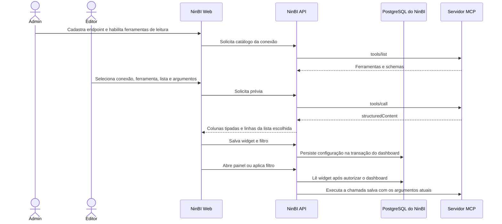

# MCP Client Design

**Spec** — [MCP Client Specification](spec.md)

**Status** — Em execução.

## Architecture Overview

O NinBI consulta servidores MCP por Streamable HTTP a partir do backend. O catálogo de conexões MCP é registrado em Configurações e cada widget MCP referencia uma entrada desse catálogo. O painel pode ter exclusivamente widgets MCP ou combinar widgets MCP com widgets da conexão de banco padrão.

| Approach | Consequence |
| --- | --- |
| **Catálogo MCP próprio e fonte por widget** | Recomendado. Mantém `ConnectionType` e `connectionLanguage` limitados a bancos, preserva o caminho do assistente e permite criar um painel sem cadastrar um banco. |
| Mesmo cadastro de conexões com `type = MCP` e fonte por widget | Unifica a listagem. Exige distinguir fonte tabular de linguagem de consulta nos leitores de esquema, prompts, drivers e formulários que hoje tratam todos os tipos como bancos. |

## Code Reuse Analysis

| Existing component | Location | Use |
| --- | --- | --- |
| Papéis, sessão e validação de entrada | `apps/api/src/auth` e `apps/api/src/common` | `connections.manage` para cadastro e habilitação, `connections.read` para descoberta e `DashboardAccessService` para prévia e execução. |
| Salvamento por versão | `apps/api/src/dashboards/dashboards.service.ts` | Persistir fontes por widget na transação existente e respeitar a versão em edições concorrentes. |
| Execução de widget | `apps/api/src/queries/queries.controller.ts` | Manter o endpoint salvo que o `WidgetCard` já usa. Despachar conforme a fonte persistida e verificar a associação do widget com o painel. |
| Resultado e visualizações | `packages/contracts/src/dashboards.ts` e `apps/web/src/features/widgets` | Usar `QueryResultDto` com metadados opcionais de coluna. Reutilizar tabela, gráfico e mapeamento. |
| Filtros e cache | `packages/contracts/src/filters.ts` e `apps/web/src/features/dashboards` | Publicar os parâmetros vinculados em `WidgetDto.parameters`. A chave de consulta muda somente para os widgets afetados. |

## Components

| Component | Location | Interface and behavior |
| --- | --- | --- |
| Cadastro MCP | `apps/api/src/mcp` | `GET/POST /api/mcp/connections`, `PATCH /api/mcp/connections/:id`, `GET /api/mcp/connections/:id/tools`. A lista para Editor expõe ID e nome. O Admin configura o endpoint e as ferramentas habilitadas após inspecionar o catálogo. |
| Cliente de transporte | `apps/api/src/mcp` | Descobre com `tools/list` e executa com `tools/call`. Usa o SDK oficial TypeScript, encerra a sessão após a operação e aplica prazo de rede inclusive à descoberta. |
| Seleção e validação tabular | `apps/api/src/mcp` | Valida argumentos e saída com JSON Schema. Identifica listas de objetos planos com colunas escalares declaradas e expõe seu caminho como segmentos. Valida a resposta antes de projetar a lista selecionada na ordem das colunas. |
| Prévia e execução salva | `apps/api/src/queries` | `POST /api/dashboards/:id/mcp/preview` exige edição do painel e `connections.read`. O endpoint salvo exige acesso de visualização e lê a configuração persistida. Vínculos aceitam apenas parâmetros dos filtros salvos e argumentos da ferramenta. |
| Cadastro e editor manual | `apps/web/src/features/connections` e `apps/web/src/features/widgets` | O Admin cadastra, descobre e habilita ferramentas. O Editor seleciona fonte, ferramenta, lista, argumentos e vínculos e testa a prévia no editor existente. Os estados de carregamento, catálogo vazio e falha usam os padrões atuais. |

## Data Models

- `mcp_connections` guarda UUID, nome, endpoint e as ferramentas habilitadas. O endpoint fica no backend. O cadastro rejeita credenciais embutidas na URL.
- `widgets.mcp_connection_id` é uma FK nullable para a conexão MCP, com exclusão restrita. `widgets.mcp_call` guarda `{ tool, listPath, arguments, filterBindings }`. A configuração visual continua em `config`. Uma configuração MCP válida exige a FK e a chamada juntas e deixa `cypher` nulo.
- `dashboards.connection_id` aceita nulo para painéis MCP sem banco padrão. Os painéis antigos mantêm seus IDs. A listagem e o detalhe usam junção à esquerda, e as rotas de SQL, Cypher e IA exigem uma conexão de banco antes de executar.
- O resultado MCP reaproveita `columns`, `rows`, `rowLimit` e `truncated`. O metadado opcional `columnTypes` acompanha a ordem de `columns` e permite exibir um resultado vazio com seus tipos. Argumentos, nomes de ferramentas e URLs ficam fora da resposta para Visualizadores, que recebem `hasQuery` e `parameters` para executar o painel.

## Error Handling Strategy

| Scenario | Handling | User impact |
| --- | --- | --- |
| Endpoint inacessível ou excede o prazo | Traduzir o erro do transporte em falha de conexão ou de prazo. | Cadastro e prévia mostram a falha. No dashboard, somente o widget afetado exibe erro. |
| Endpoint retorna 401 ou 403 | Retornar um erro de autorização do endpoint MCP. | Exibe a necessidade de acesso ao servidor. O piloto usa endpoints acessíveis ao backend. |
| Argumentos fora do esquema ou ferramenta desabilitada | Rejeitar antes de `tools/call`. | O Editor pode rever argumentos ou solicitar habilitação ao Admin. |
| Lista ausente, incompatível ou vazia | Tratar ausência e incompatibilidade como erro. Preservar colunas para listas vazias válidas. | Distingue ausência de dados de erro da ferramenta. |
| Resultado acima do limite | Aplicar o limite de linhas do NinBI e devolver `truncated: true`. | O card sinaliza que a visualização usa dados parciais. |

## Risks & Concerns

| Concern | Location | Mitigation |
| --- | --- | --- |
| Conexão do painel obrigatória e junções internas | `apps/api/src/database/schema.ts:174` e `apps/api/src/dashboards/dashboards.service.ts:197` | Migrar a nulabilidade junto com os caminhos que a consomem. Cobrir criação, sidebar e carregamento com e sem banco. |
| Catálogo remoto pode incluir ferramentas de escrita | `apps/api/src/mcp` | Só executar ferramentas habilitadas pelo Admin para leitura. Revalidar a seleção na hora da chamada. Uma anotação vinda do MCP serve como informação para o Admin. |
| Endpoint remoto e payload são entradas externas | `apps/api/src/mcp` | Conectar somente aos endpoints cadastrados por Admin. Restringir o esquema a HTTP(S), desabilitar redirecionamentos e limitar prazo e volume recebido. Aplicar a política de rede da instalação aos destinos internos. |
| Resposta antiga de filtro em trânsito | `apps/web/src/features/dashboards` | Reutilizar as chaves e o cancelamento do fluxo atual. O card renderiza a resposta da chave do filtro vigente. |
| Verificação inicial do repositório | `pnpm lint` | A execução anterior às mudanças encontrou dois arquivos de consultas com formatação divergente no working tree e um SVG existente sem título. Resolver o gate inicial antes de iniciar o plano de execução. |

## Tech Decisions

| Decision | Choice |
| --- | --- |
| Transporte inicial | Streamable HTTP para servidores alcançáveis pelo backend, inclusive na rede local onde o backend roda. |
| Autenticação | A ferramenta no servidor MCP gerencia o serviço de origem. O piloto informa quando o endpoint MCP em si exige autorização. |
| Lista tipada | Escolha explícita de uma lista declarada em `outputSchema` e leitura em `structuredContent`. O caminho é persistido com a chamada. |
| Teste de interoperabilidade | Subir dois endpoints HTTP de teste independentes, com nomes de lista distintos. Montar e reabrir um painel com ambos, aplicar filtro e provocar a falha de uma fonte. |

## Sources

- [Conexão pelo SDK oficial](https://ts.sdk.modelcontextprotocol.io/v2/clients/connect) e [descoberta e execução de ferramentas](https://ts.sdk.modelcontextprotocol.io/v2/clients/calling).
- [Contexto do piloto](context.md) e decisões AD-005, AD-043, AD-058, AD-134 e AD-137 em [STATE.md](../../STATE.md).
