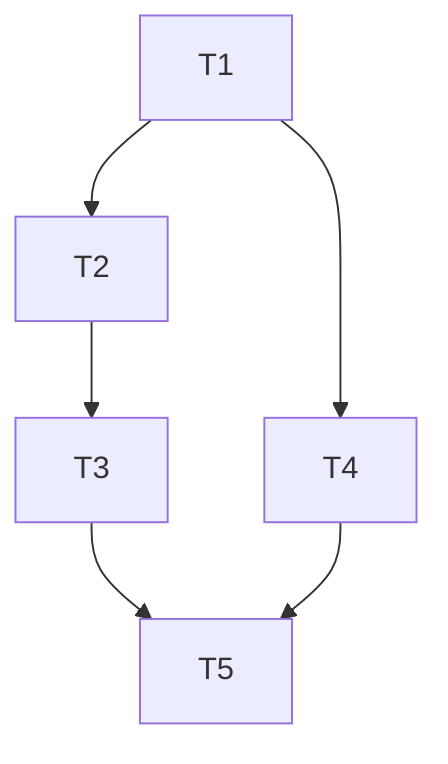
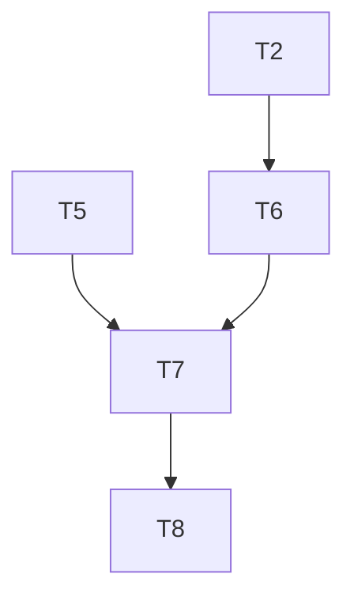

# MCP Client Tasks

**Design**: [MCP Client Design](design.md)
**Status**: In Progress
**Approved**: 2026-11-20 - user: "pode implementar"
**Build**: `pnpm build; pnpm typecheck; pnpm lint`
**Run api**: `pnpm --filter @ninbi/api test test/mcp/`
**Run web**: `pnpm --filter @ninbi/web test McpClient.test.tsx`

## Test Coverage Matrix

A matriz segue as configurações Vitest da API e do web, os testes de dashboards e conexões e a spec aprovada.

| Code Layer | Required Test Type | Coverage Expectation | Location Pattern | Run Command |
| --- | --- | --- | --- | --- |
| Normalização de tabelas | unit | Argumentos inválidos, saída incompatível, lista vazia, seleção e truncamento | `apps/api/test/mcp/` | Run api |
| Transporte, cadastro e execução salva | integration | Dois endpoints HTTP de teste, respostas de autorização, permissões, falha, prazo e chamadas isoladas por widget | `apps/api/test/mcp/` | Run api |
| Persistência e migração | integration | Criar painel sem banco, salvar fontes diferentes e reabrir. Regressão de SQL e Neo4j | `apps/api/test/mcp/` e suítes atuais | Run api e gate full |
| Conexões, editor e painel | component | Campos, prévia, reabertura, atualização de filtro e falha isolada | `apps/web/src/features/**/Mcp*.test.tsx` | Run web |

## Gate Check Commands

| Gate Level | When to Use | Command |
| --- | --- | --- |
| quick | Validação da chamada e projeção tabular | `pnpm --filter @ninbi/api test test/mcp/` |
| full | Cadastro, transporte, persistência e execução | `pnpm --filter @ninbi/api test` |
| web | Cadastro e editor no navegador | `pnpm --filter @ninbi/web test` |
| build | Antes da primeira task e no fechamento | Comandos de Build e `pnpm test` |

O lint inicial voltou a passar após a formatação de dois arquivos de consultas e a inclusão de um título acessível em `brand/ninbi-compass.svg`.

## Execution Plan

### Phase 1: Cliente e execução

### Phase 2: Fluxo manual no NinBI

## Task Breakdown

### T1: Cadastro de servidores MCP

**What**: Persistir e servir o cadastro e as permissões para gerenciar endpoints e habilitar ferramentas.
**Where**: `apps/api/src/mcp/mcp-connections.service.ts`
**Depends on**: None
**Reuses**: ConnectionsService, RequirePermission e ZodValidationPipe
**Requirement**: MCP-01, MCP-04

**Done when**:

- [x] O Admin consegue salvar dois cadastros independentes. Um Editor recebe os campos de seleção e não consegue alterar os cadastros.

**Tests**: integration
**Gate**: full

### T2: Descoberta e transporte MCP

**What**: Conectar ao endpoint salvo e listar tools pelo SDK com prazo e encerramento de sessão.
**Where**: `apps/api/src/mcp/mcp-client.service.ts`
**Depends on**: T1
**Reuses**: Padrão de erros de conexão e logger da API
**Requirement**: MCP-02, MCP-03, MCP-10, MCP-18

**Done when**:

- [x] A descoberta identifica a conexão selecionada e classifica indisponibilidade, autorização e prazos acima do limite.

**Tests**: integration
**Gate**: full

### T3: Execução da chamada tabular

**What**: Validar ferramenta, argumentos e seleção e entregar o resultado tipado normalizado.
**Where**: `apps/api/src/mcp/mcp-table.service.ts`
**Depends on**: T2
**Reuses**: QueryResultDto e limites de QueryService
**Requirement**: MCP-05, MCP-06, MCP-07, MCP-08, MCP-09, MCP-11, MCP-23

**Done when**:

- [ ] Uma resposta com duas listas retorna somente a lista escolhida. Saída vazia preserva os tipos. Argumentos inválidos e ferramenta desabilitada não geram chamadas.

**Tests**: unit
**Gate**: quick

### T4: Persistência da configuração por widget

**What**: Persistir a configuração MCP na transação do painel e permitir painel sem banco padrão com migração compatível.
**Where**: `apps/api/src/dashboards/dashboards.service.ts`
**Depends on**: T1
**Reuses**: DashboardSaveSchema e salvamento com controle de versão
**Requirement**: MCP-12

**Done when**:

- [ ] Um painel sem banco pode ser salvo e listado. Os widgets mantêm configurações de fontes distintas após releitura. Fixtures SQL e Neo4j mantêm seus comportamentos.

**Tests**: integration
**Gate**: full

### T5: Execução pelo dashboard

**What**: Expor a prévia para edição e executar a chamada persistida pelo endpoint existente após validar a permissão.
**Where**: `apps/api/src/queries/queries.controller.ts`
**Depends on**: T3, T4
**Reuses**: DashboardAccessService e filtragem de parâmetros do widget salvo
**Requirement**: MCP-16, MCP-17, MCP-20, MCP-21

**Done when**:

- [ ] Dois servidores recebem somente as chamadas correspondentes ao widget e aos filtros. Uma requisição sem acesso não chega ao transporte.

**Tests**: integration
**Gate**: full

### T6: Cadastro MCP na interface

**What**: Expor cadastro, descoberta, habilitação de ferramentas de leitura e falhas de conexão na tela de Conexões.
**Where**: `apps/web/src/features/connections/McpConnectionsPanel.tsx`
**Depends on**: T2
**Reuses**: ConnectionsTab e padrões de formulários e feedback
**Requirement**: MCP-01, MCP-02, MCP-03, MCP-04

**Done when**:

- [ ] O Admin cadastra um endpoint, consulta seu catálogo e habilita uma ferramenta. Para Editor, a edição do cadastro fica indisponível.

**Tests**: component
**Gate**: web

### T7: Configuração manual do widget

**What**: Integrar a escolha de conexão, ferramenta, lista e argumentos ao editor e reutilizar mapeamento e prévia.
**Where**: `apps/web/src/features/widgets/McpWidgetSourceFields.tsx`
**Depends on**: T5, T6
**Reuses**: WidgetEditorDialog, VisualizationPanel e Zod
**Requirement**: MCP-19, MCP-22

**Done when**:

- [ ] O Editor escolhe uma lista declarada e visualiza seu resultado. O formulário permite criar um painel sem conexão de banco e usa os vínculos selecionados no widget.

**Tests**: component
**Gate**: web

### T8: Reabertura e filtros no dashboard

**What**: Integrar widget MCP ao cache e à execução do painel nos modos edição e visualização.
**Where**: `apps/web/src/features/widgets/useWidgetResult.ts`
**Depends on**: T7
**Reuses**: WidgetCard, relevantParams, DashboardPage e useAutoRefresh
**Requirement**: MCP-13, MCP-14, MCP-15

**Done when**:

- [ ] Reabrir o painel consulta os widgets salvos. Filtro atualiza apenas quem o usa e falha de uma conexão preserva a outra.

**Tests**: component
**Gate**: web

## Checks

Os títulos abaixo correspondem a testes executados com o relatório detalhado do Vitest.

**C1** - cadastro mantém dois servidores independentes (MCP-01, AC 1)
Proof: run api | ✓ MCP-01 cadastro mantém dois servidores independentes

**C2** - catálogo vem da conexão escolhida (MCP-02, AC 2)
Proof: run api | ✓ MCP-02 catálogo vem da conexão escolhida

**C3** - queda do endpoint é indicada na descoberta (MCP-03, AC 3)
Proof: run api | ✓ MCP-03 queda do endpoint é indicada na descoberta

**C4** - cadastro sem permissão é recusado (MCP-04, AC 4)
Proof: run api | ✓ MCP-04 cadastro sem permissão é recusado

**C5** - chamada retorna linhas e tipos das colunas (MCP-05, AC 1)
Proof: run api | ✓ MCP-05 chamada retorna linhas e tipos das colunas

**C6** - argumentos inválidos são recusados antes da chamada (MCP-06, AC 2)
Proof: run api | ✓ MCP-06 argumentos inválidos são recusados antes da chamada

**C7** - ferramenta desabilitada não é chamada (MCP-07, AC 3)
Proof: run api | ✓ MCP-07 ferramenta desabilitada não é chamada

**C8** - resposta incompatível é recusada (MCP-08, AC 4)
Proof: run api | ✓ MCP-08 resposta incompatível é recusada

**C9** - lista vazia preserva suas colunas tipadas (MCP-09, AC 5)
Proof: run api | ✓ MCP-09 lista vazia preserva suas colunas tipadas

**C10** - chamada acima do prazo retorna erro de tempo limite (MCP-10, AC 6)
Proof: run api | ✓ MCP-10 chamada acima do prazo retorna erro de tempo limite

**C11** - resposta acima do limite é sinalizada como parcial (MCP-11, AC 7)
Proof: run api | ✓ MCP-11 resposta acima do limite é sinalizada como parcial

**C12** - configuração da chamada é persistida no widget (MCP-12, AC 1)
Proof: run api | ✓ MCP-12 configuração da chamada é persistida no widget

**C13** - reabrir painel executa configuração persistida (MCP-13, AC 2)
Proof: run web | ✓ MCP-13 reabrir painel executa configuração persistida

**C14** - filtro reexecuta apenas widget vinculado com o novo valor (MCP-14, AC 3)
Proof: run web | ✓ MCP-14 filtro reexecuta apenas widget vinculado com o novo valor

**C15** - falha de uma fonte mantém outro widget disponível (MCP-15, AC 4)
Proof: run web | ✓ MCP-15 falha de uma fonte mantém outro widget disponível

**C16** - painel sem acesso não despacha chamada (MCP-16, AC 5)
Proof: run api | ✓ MCP-16 painel sem acesso não despacha chamada

**C17** - rota salva executa MCP sem chamar o provedor de IA (MCP-17, AC 6)
Proof: run api | ✓ MCP-17 rota salva executa MCP sem chamar o provedor de IA

**C18** - endpoint protegido retorna erro de autorização (MCP-18, AC 5)
Proof: run api | ✓ MCP-18 endpoint protegido retorna erro de autorização

**C19** - editor configura manualmente conexão ferramenta e argumentos (MCP-19, AC 8)
Proof: run web | ✓ MCP-19 editor configura manualmente conexão ferramenta e argumentos

**C20** - prévia faz chamadas somente ao endpoint MCP cadastrado (MCP-20, AC 9)
Proof: run api | ✓ MCP-20 prévia faz chamadas somente ao endpoint MCP cadastrado

**C21** - widgets salvos executam em seus respectivos servidores (MCP-21, AC 7)
Proof: run api | ✓ MCP-21 widgets salvos executam em seus respectivos servidores

**C22** - editor oferece as listas tipadas declaradas pela ferramenta (MCP-22, AC 10)
Proof: run web | ✓ MCP-22 editor oferece as listas tipadas declaradas pela ferramenta

**C23** - somente a lista selecionada abastece o resultado (MCP-23, AC 11)
Proof: run api | ✓ MCP-23 somente a lista selecionada abastece o resultado

## Handoff

**Walked:** No NinBI compilado, com PostgreSQL em memória e dois servidores MCP HTTP locais, o Admin cadastrou Chamados e Projetos e habilitou suas ferramentas. No dashboard Piloto MCP, selecionou as listas `chamados` e `projetos` e conferiu as prévias. Após salvar e recarregar, os dois widgets retornaram seus dados. O filtro Equipe com valor `Plataforma` atualizou Chamados e manteve Projetos em `Todas`.

O build, a checagem de tipos e o lint passaram. A execução focada de regressão passou com 123 testes de API e 83 de web. A verificação independente ainda está pendente.

