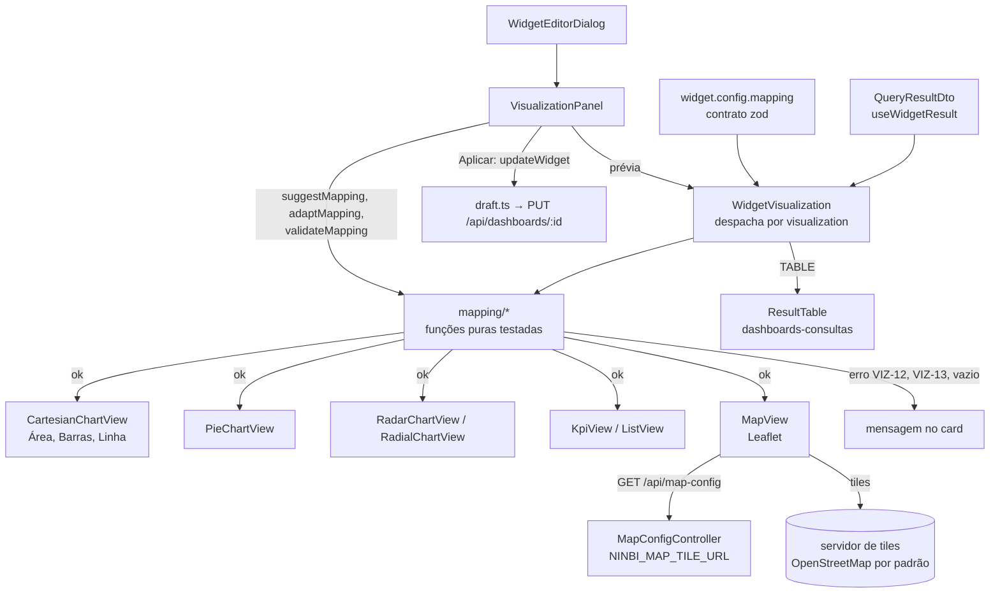
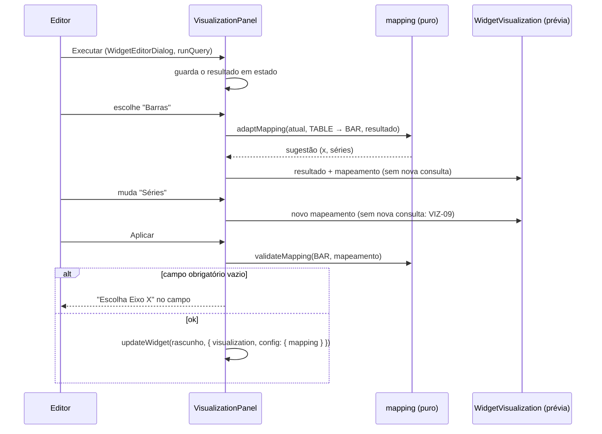

# Widgets e Gráficos Design

**Spec**: `.specs/features/widgets-graficos/spec.md`
**Status**: Approved (o usuário dispensou a aprovação do design: "Não precisa da validação do design.")

Segue a arquitetura de `.specs/features/fundacao-auth/design.md` (tema em `theme.css`, `--chart-1..5`, mapeamento como funções puras em `apps/web/src/features/widgets/mapping/`) e parte das interfaces de `.specs/features/dashboards-consultas/design.md`: `widgets.visualization` (texto, padrão `'TABLE'`), `widgets.config` (JSONB), `WIDGET_VISUALIZATIONS`, `QueryResultDto`/`ResultValue`, `WidgetCard`, `useWidgetResult`, `WidgetEditorDialog`, `draft.ts`. As decisões novas desta feature são AD-060 a AD-063 em `.specs/STATE.md`.

**Estado do código no momento deste design:** o repositório tem o scaffolding de `fundacao-auth` e parte da API dela (schema inicial, health, hasher, sessões). `conexoes-schema`, `dashboards-consultas` e `compartilhamento` ainda não foram implementadas. Este design parte do que os tasks.md delas definem. Quem implementar segue o código real quando ele divergir daqui e marca a diferença com `SPEC_DEVIATION`.

Divergências já visíveis: `apps/web/package.json` tem `react-router` 8 (AD-036 fala em 7) e ainda não tem `components/ui/chart.tsx` nem `checkbox.tsx`; a T8 e a T15 os acrescentam pelo CLI do shadcn.

---

## Architecture Overview

Nenhuma consulta nova sai para o Neo4j. O widget continua recebendo o `QueryResultDto` de `dashboards-consultas`; esta feature acrescenta, no navegador, a regra que transforma esse resultado nos dados de cada visualização, os componentes que desenham cada uma e o painel em que o Editor escolhe a visualização e as colunas. No backend, só o contrato do `config` (validado no `PUT` do dashboard) e uma rota que entrega o endereço dos tiles do mapa.



### Fluxo do painel de visualização



### Onde as regras rodam

| Regra | Camada | Testada por |
| ----- | ------ | ----------- |
| Formato de cada `config` por visualização; visualizações aceitas | `packages/contracts/src/widget-config.ts` (zod), aplicado no `PUT` do dashboard | testes de contrato e de rota |
| Tipo de cada coluna (numérica ou não), valor numérico de uma célula | `apps/web/src/features/widgets/mapping/columns.ts` | testes unitários do web |
| Sugestão de mapeamento, troca de visualização, campos obrigatórios | `mapping/suggest.ts` | testes unitários do web |
| Dados de área, barras, linha, pizza, radar e radial; corte em 12; negativos e zeros da pizza; colunas ausentes e sem números; cores por série; intervalo dos rótulos do eixo X | `mapping/chart-data.ts` | testes unitários do web |
| Dados do KPI, da lista e do mapa; coordenadas inválidas; marcadores na mesma coordenada; enquadramento | `mapping/simple-data.ts` | testes unitários do web |
| Formato `1.234,56` e `dd/MM/aaaa` | `apps/web/src/lib/format.ts` | testes unitários do web |
| Endereço dos tiles | `apps/api/src/config/env.ts` + `MapConfigController` | testes de rota |

Nenhum componente decide ordem, corte, contagem ou validade: ele desenha o que a função pura devolve.

---

## Code Reuse Analysis

### Existing Components to Leverage

| Component | Location | How to Use |
| --------- | -------- | ---------- |
| `WIDGET_VISUALIZATIONS`, `dashboardSaveSchema`, `WidgetDto`, `QueryResultDto`, `ResultValue`, `MESSAGES` | `packages/contracts/src/dashboards.ts`, `messages.ts` (dashboards-consultas T1) | A lista passa a ter 10 valores; o widget do `dashboardSaveSchema` passa a validar `config` pela visualização |
| `DashboardsService.save` e `GET /api/dashboards/:id` | `apps/api/src/dashboards/` (dashboards-consultas T4, T5) | Já gravam e devolvem `visualization` e `config`; esta feature só prova a ida e a volta |
| `createTestApp`, `renderApp`, MSW `server`, fixtures de dashboards | `apps/api/test/`, `apps/web/src/test/` | Testes de rota e de tela |
| `useWidgetResult`, `WidgetCard` (estados de carregando, vazio, erro, sem consulta) | `apps/web/src/features/widgets/` (dashboards-consultas T14) | O corpo do card troca `ResultTable` por `WidgetVisualization`; os estados ficam como estão (VIZ-18) |
| `ResultTable` | `apps/web/src/features/widgets/ResultTable.tsx` | Visualização "Tabela" |
| `WidgetEditorDialog`, `runQuery` | `apps/web/src/features/widgets/WidgetEditorDialog.tsx` | Recebe o `VisualizationPanel` abaixo do Cypher; a prévia passa a ser `WidgetVisualization` |
| `draft.ts` (`addWidget`, `updateWidget`, `toSavePayload`) | `apps/web/src/features/dashboards/draft.ts` | `updateWidget` passa a aceitar `visualization` e `config`; `addWidget` nasce com `'TABLE'` e `{}` |
| `formatDateTime` | `apps/web/src/lib/format.ts` (conexoes-schema) | Ganha `formatNumber`, `formatDate` e `formatValue` ao lado |
| Tokens `--chart-1..5`, `--brand-*`, `--gradient-brand`, `--border`, `--card-elevated`, `--accent-text`, `--destructive`, `rounded-card` | `apps/web/src/styles/theme.css` (fundacao-auth T-tema) | Cores e formas de todos os widgets; nenhum `.tsx` escreve cor literal (AD-031) |
| `useTheme` | `apps/web/src/theme/ThemeProvider.tsx` | Não é necessário: o estilo escuro do mapa sai por CSS sob `.dark` |
| shadcn `select`, `card`, `badge`, `label` | `apps/web/src/components/ui/` | Painel de visualização, chips |
| `useContainerWidth` / stub de `ResizeObserver` dos testes da grade | `apps/web/src/features/dashboards/` e `src/test/` (dashboards-consultas T25) | O helper `mockElementSize` desta feature segue o mesmo padrão e o reaproveita se já existir |

### Integration Points

| System | Integration Method |
| ------ | ------------------ |
| `dashboards-consultas` | `config` validado pelo mesmo `dashboardSaveSchema`; o card e o editor ganham a visualização sem mudar as rotas de execução |
| `compartilhamento` | Quem só vê recebe `visualization` e `config` (nomes de colunas não são sensíveis) e vê os gráficos; não há rota nova a proteger. O design dela (AD-047 a AD-053) não muda nada nos widgets: as rotas continuam passando por `DashboardAccessService.assert`, agora com o Visualizador limitado a "pode ver" (AD-048); os testes desta feature seguem usando `createTestApp({ shares })` |
| `ia-cypher` / `ia-dashboard` | Preenchem `visualization` e `config.mapping` no rascunho; o contrato zod de AD-060 é o formato que a IA precisa produzir |
| `interatividade` | Lê `config.mapping` para saber a coluna clicada (cross-filtering); exporta PNG do mapa: o `TileLayer` já nasce com `crossOrigin: 'anonymous'` |
| Servidor de tiles | `TileLayer` do Leaflet com a URL de `GET /api/map-config` |

---

## Components

### Contratos

#### `widget-config.ts`
- **Location**: `packages/contracts/src/widget-config.ts`
- **Interfaces**:
  ```typescript
  export const WIDGET_VISUALIZATIONS = ['TABLE', 'LIST', 'AREA', 'BAR', 'LINE', 'PIE', 'RADAR', 'RADIAL', 'KPI', 'MAP'] as const
  export type WidgetVisualization = (typeof WIDGET_VISUALIZATIONS)[number]
  export const VISUALIZATION_LABELS: Record<WidgetVisualization, string>
  //  Tabela, Lista, Área, Barras, Linha, Pizza, Radar, Radial, KPI, Mapa (ordem de VIZ-01)

  type Col = string                         // nome da coluna do RETURN, 1 a 200 caracteres
  export type WidgetMapping = {
    TABLE: Record<string, never>
    LIST:  { primary: Col; secondary: Col | null; values: Col[] }            // values: 0 a 2
    AREA:  { x: Col; series: Col[]; stacked: boolean }                      // series: ≥ 1
    BAR:   { x: Col; series: Col[]; stacked: boolean; horizontal: boolean }
    LINE:  { x: Col; series: Col[] }
    PIE:   { category: Col; value: Col; donut: boolean }
    RADAR: { axis: Col; series: Col[] }
    RADIAL:{ category: Col; value: Col }
    KPI:   { value: Col; change: Col | null }
    MAP:   { lat: Col; lon: Col; label: Col | null }
  }
  export type WidgetConfig<V extends WidgetVisualization = WidgetVisualization> =
    V extends 'TABLE' ? Record<string, never> | { mapping?: undefined } : { mapping: WidgetMapping[V] }
  export const widgetMappingSchemas: { [V in WidgetVisualization]: z.ZodType<WidgetMapping[V]> }
  export function widgetConfigSchema(v: WidgetVisualization): z.ZodType
  export const MAPPING_FIELD_LABELS   // x: 'Eixo X', series: 'Séries', category: 'Categoria', value: 'Valor',
                                      // axis: 'Eixo', change: 'Variação', lat: 'Latitude', lon: 'Longitude',
                                      // label: 'Rótulo', primary: 'Texto principal', secondary: 'Texto secundário',
                                      // values: 'Valores'
  export const MAPPING_OPTION_LABELS  // stacked: 'Empilhado', horizontal: 'Horizontal', donut: 'Donut'
  export interface MapConfigDto { tileUrl: string; attribution: string }
  ```
- `dashboardSaveSchema` (de `dashboards-consultas`) troca `visualization: string` por `z.enum(WIDGET_VISUALIZATIONS)` e ganha um `superRefine` no widget: `config` precisa passar em `widgetConfigSchema(visualization)`; senão o erro vai em `fieldErrors` com "Configuração da visualização inválida". `WIDGET_VISUALIZATIONS` sai de `dashboards.ts` e passa a ser reexportado de `widget-config.ts`.

### Backend

#### `MapConfigController`
- **Location**: `apps/api/src/map-config/map-config.controller.ts`
- **Rota**: `GET /api/map-config` → `MapConfigDto`. Qualquer usuário logado (sem `@RequirePermission`; o `SessionGuard` global já exige sessão). 401 sem sessão.
- **Env** (`apps/api/src/config/env.ts`): `NINBI_MAP_TILE_URL` (padrão `https://tile.openstreetmap.org/{z}/{x}/{y}.png`; precisa conter `{z}`, `{x}` e `{y}`, senão o app não sobe) e `NINBI_MAP_ATTRIBUTION` (padrão `© OpenStreetMap`). `docker-compose.yml` repassa as duas variáveis ao serviço `app` com os mesmos padrões.

### Frontend: funções puras (`apps/web/src/features/widgets/mapping/`)

#### `columns.ts`
- `toNumber(v: ResultValue): number | null` - número fica; `{ kind: 'bigint' }` vira `Number(value)` (perde precisão acima de 2^53, aceito em gráfico); `null`, booleano, texto e `json` viram `null` (VIZ-14).
- `columnKinds(result): ('number' | 'other')[]` - uma coluna é `number` quando tem ao menos um valor não nulo e todos os não nulos passam em `toNumber`. Coluna só de nulos é `other`.
- `columnIndex(result, name): number` - primeira coluna com esse nome, `-1` se não houver.

#### `suggest.ts`
- `suggestMapping(v, result): MappingDraft` (VIZ-03 a VIZ-08). `MappingDraft` é o `WidgetMapping[v]` com os campos de coluna aceitando `null`. Regras:
  - `AREA`, `BAR`, `LINE`: `x` = primeira `other`, ou a primeira coluna quando todas são `number`; `series` = todas as `number` exceto `x`. Opções `false`.
  - `PIE`, `RADIAL`: `category` = primeira `other`; `value` = primeira `number`; `donut: false`.
  - `RADAR`: `axis` = primeira `other`; `series` = todas as `number`.
  - `KPI`: `value` = primeira `number`; `change: null`.
  - `MAP`: `lat` = coluna cujo nome, sem diferenciar maiúsculas, é `lat` ou `latitude`; `lon` = `lon`, `lng`, `long` ou `longitude`; `label` = primeira `other`. Sem coluna com o nome, o campo fica `null`.
  - `LIST`: `primary` = primeira `other`; `secondary: null`; `values` = as duas primeiras `number`.
  - Campo sem coluna que atenda à regra fica `null` (ou `[]`).
- `adaptMapping(prev, prevV, nextV, result): MappingDraft` (VIZ-19, VIZ-02): entre `AREA`, `BAR` e `LINE` mantém `x` e `series` (e `stacked` entre `AREA` e `BAR`); entre `PIE` e `RADIAL` mantém `category` e `value`; qualquer outra troca usa `suggestMapping(nextV, result)`. Sem resultado, devolve o mapeamento vazio da visualização nova.
- `validateMapping(v, draft): { field: string; message: string } | null` (VIZ-11) - primeiro campo obrigatório vazio na ordem dos campos, com `MESSAGES.chooseField(MAPPING_FIELD_LABELS[campo])` ("Escolha Eixo X"). Obrigatórios: `x` e `series` (≥ 1); `category` e `value`; `axis` e `series`; `value` (KPI); `lat` e `lon`; `primary`. Não confere se a coluna existe no resultado: VIZ-20 deixa salvar e o card avisa.

#### `chart-data.ts`
- Resultado comum: `type Built<T> = { ok: true; data: T; notice?: string } | { ok: false; reason: 'empty' } | { ok: false; reason: 'error'; message: string }`.
- `checkColumns(result, mapping, numericRoles)`: coluna mapeada que não existe → `error` com `MESSAGES.mappingColumnMissing(nome)` (VIZ-12, VIZ-20); coluna em papel numérico sem nenhum valor que passe em `toNumber` → `error` com `MESSAGES.columnWithoutNumbers(nome)` (VIZ-13). Papéis numéricos: `series` (`AREA`, `BAR`, `LINE`, `RADAR`) e `value` (`PIE`, `RADIAL`). O valor do KPI, os valores da lista e as coordenadas do mapa não são papéis numéricos (KPI-05, LIST-01, MAP-03).
- `buildCartesian(result, m)`: um ponto por linha, na ordem (CHART-01): `{ x: <ResultValue>, xLabel: formatValue(x), s0: number | null, s1: ... }`; célula que não vira número é `null` (VIZ-14). Resultado sem linhas → `empty`.
- `buildCategories(result, m, v)` para `PIE` e `RADIAL`: as 12 primeiras linhas (`notice` = `MESSAGES.categoriesCut(12, N)` quando N > 12: CHART-13); `PIE` descarta valor negativo ou ausente (CHART-15); `PIE` com todos os valores zero ou ausentes → `empty` (CHART-18). Cada item: `{ key: 'c0'.., label, value }`.
- `buildRadar(result, m)`: as 12 primeiras linhas como eixos, uma série por coluna; mesmo `notice`.
- `seriesColor(i) = var(--chart-${(i % 5) + 1})` (CHART-07, CHART-17); `buildChartConfig(labels)` devolve o `ChartConfig` do shadcn com chaves seguras `s0..sN` (ou `c0..cN` para categorias), `label` = nome da coluna e `color` = `seriesColor(i)`. Chave segura porque o shadcn transforma a chave em variável CSS (`--color-<chave>`) e nomes de coluna podem ter espaço e acento.
- `tickInterval(labels, widthPx)` (CHART-06): largura estimada de um rótulo = `7 px × maior número de caracteres + 16 px`; devolve o menor inteiro `n ≥ 0` tal que `ceil(labels.length / (n + 1)) × largura ≤ widthPx`. O eixo X recebe `interval={n}`: o Recharts desenha um rótulo a cada `n + 1`, sem sobreposição.

#### `simple-data.ts`
- `buildKpi(result, m)`: `value` = célula da primeira linha (`formatValue`, e texto quando não é número: KPI-05); `change` = `toNumber` da célula de variação, `null` quando não há coluna ou o valor é nulo (KPI-04); `direction` = `'up'` com `change ≥ 0`, `'down'` abaixo de zero (KPI-02, KPI-03); `changeLabel` = `formatNumber(|change|) + '%'`. Sem linhas → `empty`.
- `buildList(result, m)`: uma linha por linha do resultado, na ordem (LIST-01): `{ primary, secondary?, values: string[] }`, tudo por `formatValue`.
- `buildMapPoints(result, m)`: latitude e longitude por `toNumber`; fora de -90..90 ou -180..180, ou ausente, a linha é descartada e contada (MAP-03); `notice` = `MESSAGES.invalidCoordinates(n)`; nenhuma válida → `error` com "Nenhuma linha com coordenadas válidas" (MAP-04). Cada ponto: `{ lat, lon, label, sameSpotLabels: string[] }`, onde `sameSpotLabels` lista, na ordem, os rótulos de todos os pontos com a mesma coordenada (MAP-08).
- `mapViewport(points)`: `{ bounds: [[minLat, minLon], [maxLat, maxLon]] }` que contém todos os pontos (MAP-05); com um ponto só (ou todos iguais), `{ center: [lat, lon], zoom: 10 }`.

#### `apps/web/src/lib/format.ts` (acréscimos)
- `formatNumber(n)`: `Intl.NumberFormat('pt-BR', { maximumFractionDigits: 2 })` → `1.234,56`, `4.999,95`, `20`.
- `formatDate(s)`: texto que começa com `AAAA-MM-DD` (o `toString()` de `Date`, `DateTime` e `LocalDateTime` do Neo4j) vira `DD/MM/AAAA`, sem conversão de fuso.
- `formatValue(v: ResultValue)`: número → `formatNumber`; `bigint` → dígitos com separador de milhar por `BigInt(...).toLocaleString('pt-BR')`; texto de data → `formatDate`; outro texto fica; `json` → o texto JSON; booleano → "Sim"/"Não"; `null` → "—".

### Frontend: componentes (`apps/web/src/features/widgets/`)

| Componente | Location | Interfaces / comportamento |
| ---------- | -------- | -------------------------- |
| `chart-theme.tsx` | `charts/chart-theme.tsx` | `NinbiTooltip` (conteúdo da dica: rótulo do ponto e uma linha por série com marcador da cor e `formatNumber`; estilo da dica da captura: `bg-card-elevated`, `rounded-control`, borda `border-border`), `GRID_PROPS` (`vertical={false}`, `strokeDasharray="3 3"`, `stroke="var(--border)"`), `AXIS_PROPS` (`tickLine={false}`, `axisLine={false}`, `tick` em `var(--muted-foreground)`, 12 px) |
| `CartesianChartView` | `charts/CartesianChartView.tsx` | Props `{ visualization: 'AREA' \| 'BAR' \| 'LINE'; data; mapping }`. `ChartContainer` do shadcn (`className="h-full w-full aspect-auto"`), `AreaChart`/`BarChart`/`LineChart` do Recharts com `GRID_PROPS`, eixo X com `tickInterval` e `tickFormatter` de rótulo, eixo Y com `formatNumber`, `ChartTooltip content={<NinbiTooltip/>}`, `ChartLegend` só com mais de uma série (CHART-02). Área de uma série: preenchimento por `linearGradient` do `--brand-purple` ao `--brand-cyan` com opacidade decrescente, como o brilho da captura; várias séries: cor de cada série. `stacked` → `stackId="a"` (CHART-05); `horizontal` → `layout="vertical"` com os eixos trocados (CHART-04). `dot` visível quando há um ponto só (CHART-16). `connectNulls={false}` (ponto ausente: VIZ-14). A largura medida pelo `ResponsiveContainer` vai ao `tickInterval` |
| `PieChartView` | `charts/PieChartView.tsx` | `PieChart` com uma fatia por item (CHART-09), `innerRadius` de 60% com `donut` (CHART-10), cor `var(--color-cN)`, `NinbiTooltip` com categoria e valor (CHART-14), aviso `notice` abaixo do gráfico em `text-muted-foreground` |
| `RadarChartView`, `RadialChartView` | `charts/PolarChartViews.tsx` | `RadarChart` com `PolarGrid` em `var(--border)`, um `PolarAngleAxis` por linha e um `Radar` por série (CHART-11); `RadialBarChart` com uma barra por item, comprimento pelo valor (CHART-12); `NinbiTooltip` (CHART-14); `notice` |
| `KpiView` | `KpiView.tsx` | Valor em destaque (`text-3xl font-semibold`, como os blocos "Units" e "Amount at risk" da captura); chip `Badge` com `ArrowUp` em `bg-primary/15 text-accent-text` para alta e `ArrowDown` em `bg-destructive/15 text-destructive` para queda, texto "↑ 20%"/"↓ 5%" acessível como "20%" com o ícone `aria-label` "alta"/"queda" (KPI-02, KPI-03) |
| `ListView` | `ListView.tsx` | `ul` com `overflow-y-auto` dentro do corpo do card (o título fica fora da área que rola: LIST-03); cada `li` com texto principal (`truncate`, `title`) e secundário (`text-muted-foreground text-sm truncate`) à esquerda e até dois valores à direita (`tabular-nums`, cor do texto do tema) (LIST-01, LIST-02, LIST-04) |
| `MapView` | `map/MapView.tsx` | `MapContainer` do `react-leaflet` com `zoomControl` em português ("Aumentar zoom", "Diminuir zoom"), arrasto e roda do mouse ligados; `TileLayer` com `useMapConfig()`, `className="ninbi-map-tiles"`, `crossOrigin="anonymous"`; marcador por ponto com `L.divIcon` em forma de chip (`rounded-full bg-card-elevated border border-border text-xs px-2`, só o rótulo: MAP-02; ponto `bg-primary` sem rótulo quando não há coluna de rótulo); `Tooltip` do Leaflet com `sameSpotLabels` e as coordenadas em `formatNumber` (MAP-06, MAP-08); `fitBounds(bounds, { padding: [24, 24], maxZoom: 12 })` ou `setView(center, zoom)` com `mapViewport` (MAP-05); evento `tileerror` → aviso "Não foi possível carregar o mapa de fundo" sobre o fundo `bg-card-elevated`, marcadores mantidos (MAP-09); `notice` de MAP-03 no rodapé do card |
| `useMapConfig` | `map/useMapConfig.ts` | TanStack Query de `GET /api/map-config`, `staleTime: Infinity` |
| estilo do mapa | `apps/web/src/styles/theme.css` (modify) | `.leaflet-container { background: var(--card-elevated); font-family: inherit }` e `.dark .ninbi-map-tiles { filter: invert(1) hue-rotate(180deg) brightness(0.85) contrast(0.9) }`: os tiles claros do OpenStreetMap ficam escuros no tema escuro (MAP-07) |
| `WidgetVisualization` | `WidgetVisualization.tsx` | Props `{ result, visualization, config, width?, height? }`. `TABLE` → `ResultTable`; demais → função pura e componente; `{ ok: false, reason: 'empty' }` → "A consulta não retornou dados"; `{ reason: 'error' }` → a `message` no corpo do card (VIZ-12, VIZ-13). `WidgetCard` troca `ResultTable` por `WidgetVisualization` e mantém esqueleto, erro e "Widget sem consulta" (VIZ-18) |
| `VisualizationPanel` | `VisualizationPanel.tsx` | Dentro do `WidgetEditorDialog`, abaixo do editor de Cypher: select "Visualização" com `VISUALIZATION_LABELS` na ordem (VIZ-01); campos de mapeamento da visualização (select de coluna para campos simples; lista de caixas para "Séries" e "Valores"; "Nenhuma" nos opcionais); opções "Empilhado", "Horizontal", "Donut"; sem resultado executado, os campos desabilitados e "Execute a consulta para escolher as colunas" (VIZ-10); trocar a visualização aplica `adaptMapping` (VIZ-02, VIZ-19); a prévia do diálogo passa a ser `WidgetVisualization` com o resultado guardado, sem nova consulta (VIZ-09). "Aplicar" chama `validateMapping` e mostra "Escolha <campo>" no campo (VIZ-11); válido, grava `visualization` e `config: { mapping }` no rascunho junto com título e Cypher |

---

## Data Models

Nenhuma tabela nova. `widgets.visualization` (`varchar(40)`, padrão `'TABLE'`) e `widgets.config` (`jsonb`, padrão `{}`) já existem (dashboards-consultas T2). O formato gravado:

```jsonc
// widget "Vendas por mês", visualização BAR
{ "visualization": "BAR",
  "config": { "mapping": { "x": "mes", "series": ["vendas", "custo"], "stacked": true, "horizontal": false } } }
// widget "Tabela"
{ "visualization": "TABLE", "config": {} }
```

### Mensagens (acréscimos em `MESSAGES`)

| Chave | Texto |
| ----- | ----- |
| `runQueryToMap` | "Execute a consulta para escolher as colunas" |
| `chooseField(campo)` | "Escolha <campo>" |
| `mappingColumnMissing(nome)` | "A visualização não combina com o resultado: a coluna <nome> não existe" |
| `columnWithoutNumbers(nome)` | "A coluna <nome> não tem números" |
| `categoriesCut(12, n)` | "Mostrando 12 de <n> categorias" |
| `invalidCoordinates(n)` | "<n> linhas sem coordenadas válidas"; com n = 1, "1 linha sem coordenadas válidas" |
| `noValidCoordinates` | "Nenhuma linha com coordenadas válidas" |
| `mapTilesFailed` | "Não foi possível carregar o mapa de fundo" |
| `invalidWidgetConfig` | "Configuração da visualização inválida" |

"A consulta não retornou dados" já existe (dashboards-consultas).

---

## Error Handling Strategy

| Error Scenario | Handling | User Impact |
| -------------- | -------- | ----------- |
| `config` que não combina com a visualização no `PUT` | 400 `VALIDATION_ERROR` com "Configuração da visualização inválida" | Não acontece pela tela (o painel valida antes); protege contra cliente e IA |
| Visualização desconhecida no `PUT` | 400 `VALIDATION_ERROR` | Idem |
| Coluna mapeada que o resultado não tem | `chart-data` devolve `error` | "A visualização não combina com o resultado: a coluna <nome> não existe" no card |
| Coluna numérica sem números | `chart-data` devolve `error` | "A coluna <nome> não tem números" no card |
| Célula nula ou não numérica em papel numérico | ponto `null` | Ponto ausente; o resto do gráfico aparece |
| Pizza só com zeros | `empty` | "A consulta não retornou dados" |
| Coordenadas inválidas | linhas descartadas | Marcadores das válidas + "N linhas sem coordenadas válidas" |
| Nenhuma coordenada válida | `error` | "Nenhuma linha com coordenadas válidas" |
| Servidor de tiles fora do ar | `tileerror` | Marcadores sobre o fundo do tema + "Não foi possível carregar o mapa de fundo" |
| `GET /api/map-config` falha | query em erro | Mesmo aviso de MAP-09; marcadores desenhados sem tiles |
| `NINBI_MAP_TILE_URL` sem `{z}`, `{x}` ou `{y}` | `loadEnv` lança | O app não sobe e a mensagem do zod diz a variável |

---

## Test Strategy

| Nível | O que cobre | Onde |
| ----- | ----------- | ---- |
| Contratos | visualizações, rótulos, formato de cada `config` | `packages/contracts/src/widget-config.spec.ts` |
| API rápida | `PUT`/`GET` com visualização e mapeamento; `config` inválido; `GET /api/map-config` | `apps/api/test/dashboards/widget-config.spec.ts`, `apps/api/test/map-config/map-config.spec.ts` |
| Web puro | sugestão, troca, validação, dados de cada visualização, formatos | `apps/web/src/features/widgets/mapping/*.test.ts`, `apps/web/src/lib/format.test.ts` |
| Web componentes | cada visualização desenhada; painel com gesto; card com mensagens; gravação | `apps/web/src/features/widgets/**/*.test.tsx`, `apps/web/src/features/dashboards/*.test.tsx` |

- **Tamanho no jsdom**: o jsdom não mede elementos, e o `ResponsiveContainer` do Recharts e o Leaflet desenham nada com tamanho zero. `apps/web/src/test/element-size.ts` exporta `mockElementSize(width, height)`, que instala um `ResizeObserver` falso (chama o callback com `contentRect` do tamanho dado e permite trocar o tamanho com `resizeTo(w, h)`, para CHART-08) e fixa `getBoundingClientRect`, `clientWidth`, `clientHeight`, `offsetWidth` e `offsetHeight` de `HTMLElement.prototype`. Os testes de gráfico usam 600 × 300; os do mapa, 400 × 300.
- **Dica dos gráficos**: o Recharts posiciona a dica a partir da posição do mouse sobre o SVG, o que o jsdom não calcula. CHART-03 e CHART-14 renderizam `NinbiTooltip` com o `payload` no formato do Recharts, montado a partir dos dados da função pura, e conferem os textos; o teste do gráfico confere que a dica está ligada (`.recharts-tooltip-wrapper` presente).
- **Mapa**: o Leaflet roda no jsdom com o tamanho fixado. O teste lê os marcadores por `.leaflet-marker-icon`, passa o cursor com `fireEvent.mouseOver` (MAP-06), clica em "Aumentar zoom" e confere `data-zoom` do contêiner (MAP-07), e dispara `error` no primeiro `img.leaflet-tile` (MAP-09). As imagens dos tiles não são baixadas no jsdom.
- **Sem cor literal** (LOOK-03): um teste lê como texto os `.tsx` de `src/features/widgets/` e falha em qualquer `#rgb`, `#rrggbb`, `rgb(`, `hsl(` ou `oklch(`; e confere que `theme.css` define `--chart-1` a `--chart-5` em `:root` e em `.dark`.
- O visual contra a captura não é medido (AD-023); os testes conferem classes e tokens.

---

## Risks & Concerns

| Concern | Location (file:line) | Impact | Mitigation |
| ------- | -------------------- | ------ | ---------- |
| `dashboards-consultas` ainda não implementada | `apps/web/src/features/widgets/`, `apps/api/src/dashboards/` | As tasks desta feature dependem de `WidgetCard`, `WidgetEditorDialog`, `draft.ts`, `dashboardSaveSchema` e das rotas de dashboard | Pré-requisito declarado em tasks.md; quem executa confere os nomes reais e marca `SPEC_DEVIATION` onde diferirem |
| Recharts e Leaflet não desenham com tamanho zero no jsdom | testes de componente | Testes vazios ou que passam sem desenhar | `mockElementSize`; todo teste de componente confere ao menos um elemento desenhado (`path`, `.recharts-sector`, `.leaflet-marker-icon`) antes de afirmar o resto |
| Versão do Recharts usada pelo `chart.tsx` do shadcn | `apps/web/src/components/ui/chart.tsx` | Props como `interval`, `stackId` e `defaultIndex` mudaram pouco entre v2 e v3; não confirmei qual versão o CLI instala hoje | A T8 instala pelo CLI (`shadcn add chart`) e fica na versão que ele trouxer; os testes provam o comportamento, não a API |
| Test gap: posição do mouse no jsdom | `NinbiTooltip` | CHART-03 e CHART-14 não provam o gesto de passar o cursor, só o conteúdo da dica | Registrado; o gesto é do Recharts e o conteúdo é nosso; a verificação visual fica com o usuário (AD-023) |
| Política de uso dos tiles do OpenStreetMap | `NINBI_MAP_TILE_URL` | O servidor público do OSM limita uso pesado e exige atribuição | A atribuição aparece no mapa; instalações com muitos usuários trocam a URL por variável de ambiente (AD-062) |
| Tiles escuros por filtro CSS | `theme.css` | Cores do mapa escuro são uma inversão, não um estilo desenhado | Aceito no MVP; trocar `NINBI_MAP_TILE_URL` por um servidor com estilo escuro não muda código |
| Sem internet o fundo do mapa não carrega | `MapView` | Instalações isoladas veem só os marcadores | MAP-09; a URL pode apontar para um servidor de tiles interno |
| `bigint` vira `Number` nos gráficos | `columns.ts` | Inteiros acima de 2^53 perdem precisão no desenho | A tabela e o KPI mostram os dígitos (`formatValue`); o gráfico só precisa da magnitude |
| `config` gravado com visualização antiga depois que o Cypher muda | `WidgetCard` | Card mostra erro até o Editor refazer o mapeamento | É o comportamento de VIZ-20 |
| Teste de `dashboards-consultas` que espera `visualization` livre | `packages/contracts/src/dashboards.spec.ts` | Um teste que salve `visualization: 'X'` ficaria vermelho | A T1 só aperta o contrato para o enum; os testes existentes usam `'TABLE'` e `{}`, que continuam válidos |

---

## Tech Decisions (only non-obvious ones)

| Decision | Choice | Rationale |
| -------- | ------ | --------- |
| Formato do `config` | `{ mapping }` por visualização, colunas por nome, validado no contrato (AD-060) | A IA e a interatividade leem e escrevem o mesmo formato; nome de coluna sobrevive a reordenar o `RETURN` |
| Gráficos | `chart` do shadcn sobre Recharts, chaves seguras `s0..sN`, cores `--chart-1..5` (AD-061) | Pedido do usuário ("os gráficos todos do shadcn"); chave de coluna vira variável CSS |
| Mapa | Leaflet + `react-leaflet` com tiles raster, URL por `NINBI_MAP_TILE_URL` entregue por `GET /api/map-config` (AD-062) | MapLibre exige WebGL, que o jsdom não tem; o Leaflet é testável e leve. A URL é da instalação e só existe em tempo de execução, não no build do Vite |
| Papéis numéricos e formatos | AD-063 | Fecha o que a spec deixou a cargo do design: qual coluna é numérica, quais papéis exigem número, como datas do Neo4j viram `dd/MM/aaaa` |
| Rótulos do eixo X | Intervalo calculado por função pura | O corte automático do Recharts depende de medir texto, que o jsdom não faz; uma regra própria é testável |
| Mensagem de MAP-03 no singular | "1 linha sem coordenadas válidas" | A spec dá a forma plural "N linhas"; com N = 1 o plural fica errado em português |
