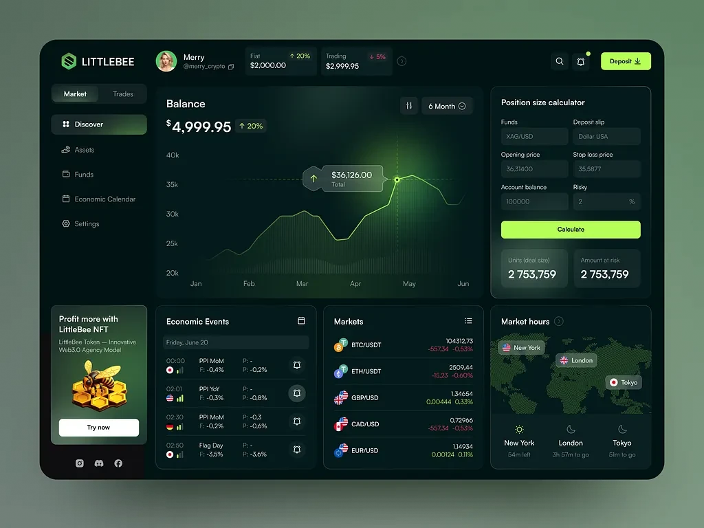

# Widgets e Gráficos Specification

**Approved**: 2026-11-16 - user: "Pode fazer todas features desse jeito, sem nem me perguntar."

## Problem Statement

Até aqui o dashboard só mostra tabelas. O pedido original é um gerador de dashboards com "os gráficos todos do shadcn" e o visual da referência. Esta feature entrega todos os tipos de widget do MVP (área, barras, linha, pizza/donut, radar, radial, KPI, lista e mapa), a regra que transforma o resultado de uma consulta em gráfico e a tela do dashboard com a aparência da captura.

## Goals

- [ ] O Editor escolhe entre 10 visualizações (tabela, lista, área, barras, linha, pizza, radar, radial, KPI, mapa) para qualquer widget, e o sistema sugere o mapeamento das colunas.
- [ ] O mesmo resultado e o mesmo mapeamento produzem sempre os mesmos dados de gráfico, por uma regra coberta por testes unitários.
- [ ] Um dashboard com área, listas, KPI e mapa, lado a lado com a captura, tem o mesmo visual, salvo as diferenças aprovadas.

## Out of Scope

| Feature | Reason |
| ------- | ------ |
| Visualização de grafo (nós e relacionamentos) | Excluída pelo usuário (AD-009) |
| Heatmap, Sankey, treemap, funil, gauge | Fora da lista de widgets (AD-009) |
| Widget de texto/Markdown, iframe, formulário ou calculadora | Fora da lista de widgets (AD-009) |
| Pivot de resultado em formato longo (uma coluna que vira séries) | Não foi pedido; as séries são as colunas numéricas do resultado |
| Personalização avançada (eixos, linhas de referência, formatação condicional, cores por widget) | Não foi pedida; as cores vêm do tema |
| Geração da visualização pela IA | Feature `ia-cypher` |
| Clique no gráfico para filtrar, exportação | Feature `interatividade` |
| Mapa pontilhado como o da captura | A escolha foi o mapa interativo de tiles (AD-022) |
| Agrupar marcadores próximos (clusters) | Não foi pedido |

---

## Assumptions & Open Questions

| Assumption / decision | Chosen default | Rationale | Confirmed? |
| --------------------- | -------------- | --------- | ---------- |
| Widgets do MVP | Gráficos shadcn (área, barras, linha, pizza/donut, radar, radial), KPI, tabela/lista, mapa por lat/long | AD-009 | y |
| Visual | A referência é o tema padrão, dark e light | AD-008 | y |
| Layout | Grade ajustável; a composição da captura é um arranjo possível | AD-011 | y |
| Configuração manual | O Editor escolhe a visualização e o mapeamento em um painel; o sistema sugere um mapeamento a partir dos tipos das colunas | Esta feature vem antes da IA e precisa ser demonstrável; a IA depois preenche o mesmo painel | y - delegado |
| Séries | Cada coluna numérica escolhida é uma série | É o formato que o Cypher devolve sem transformação | y - delegado |
| "Tabela/lista" | Duas visualizações: "Tabela" (de `dashboards-consultas`) e "Lista" (linhas no estilo da captura) | A captura desenha listas, e o questionário falava em tabela com ordenação | y - delegado |
| Formato de números e datas | Padrão brasileiro: `1.234,56` e `dd/MM/aaaa` | Interface só em português (AD-010) | y - delegado |
| Muitas categorias | Pizza, donut, radar e radial mostram as 12 primeiras linhas e avisam "Mostrando 12 de N categorias" | Esses gráficos ficam ilegíveis além disso; cortar é mais simples que agregar | y - delegado |
| Paleta | O layout da referência com o gradiente roxo → ciano da logo no lugar do verde-limão | AD-018; usuário: "Paleta da logo" | y |
| Cores das séries | Vêm dos tokens de gráfico do tema: 1ª ciano, 2ª roxo, 3ª magenta, 4ª e 5ª tons intermediários do gradiente; gráfico de uma série só usa o gradiente roxo → ciano no preenchimento | Deriva da logo e mantém séries vizinhas distinguíveis | y - delegado |
| Chips de variação | Alta na cor de destaque (ciano); baixa em vermelho, como na captura | O verde da captura sai com a paleta; o vermelho de queda não é cor de marca | y - delegado |
| KPI | Mostra o valor da primeira linha; a variação é uma coluna opcional já calculada pela consulta, em % | O NinBI não guarda histórico para calcular variação sozinho | y - delegado |
| Colunas do mapa | Latitude e longitude em duas colunas numéricas | Decisão do usuário: marcadores por lat/long | y - delegado |
| Valor não numérico em papel numérico | É tratado como ausente | Um valor ruim não deve derrubar o gráfico inteiro | y - delegado |
| Variantes dos gráficos shadcn | As essenciais: barras verticais ou horizontais, agrupadas ou empilhadas; área simples ou empilhada; pizza ou donut; uma variante para linha, radar e radial | Delegado pelo usuário: "Pode fazer todas features desse jeito, sem nem me perguntar." | y - delegado |
| Valor em destaque no card do gráfico | O card de gráfico mostra só o título; valor grande e chip de variação ficam no KPI (AD-021) | Delegado pelo usuário: "Pode fazer todas features desse jeito, sem nem me perguntar." | y - delegado |
| Controles no cabeçalho dos cards | Título e um único menu do widget; sem seletor de período por widget (AD-021) | Delegado pelo usuário: "Pode fazer todas features desse jeito, sem nem me perguntar." | y - delegado |
| Card "Position size calculator" | Sem equivalente; os dois blocos de resultado definem o visual do KPI (AD-021) | Delegado pelo usuário: "Pode fazer todas features desse jeito, sem nem me perguntar." | y - delegado |
| Linhas das listas | Texto principal, texto secundário opcional e até dois valores; sem ícones, botões ou cor por sinal (AD-021) | Delegado pelo usuário: "Pode fazer todas features desse jeito, sem nem me perguntar." | y - delegado |
| Mapa | Mapa interativo de tiles (MapLibre ou Leaflet), com zoom e arrasto, nas cores do tema; chip só com rótulo; sem relógios (AD-022). Opção (b), indicada pelo orquestrador por coerência com a escolha anterior do usuário de marcadores por lat/long | Delegado pelo usuário: "Pode fazer todas features desse jeito, sem nem me perguntar." | y - delegado |
| Servidor de tiles | Tiles baseados em OpenStreetMap, com URL alterável por variável de ambiente da instalação | Delegado pelo usuário: "Pode fazer todas features desse jeito, sem nem me perguntar." | y - delegado |
| Verificação de telas contra a captura | Dispensada; a captura segue como referência de layout para quem implementa (AD-023) | Delegado pelo usuário: "Pode fazer todas features desse jeito, sem nem me perguntar." | y - delegado |

**Open questions:** none - all resolved or logged above.

---

## User Stories

### P1: Escolher a visualização e mapear colunas ⭐ MVP

**User Story**: As a Editor, I want escolher como o resultado de um widget é mostrado e quais colunas alimentam cada parte do gráfico so that a mesma consulta vire o gráfico certo.

**Why P1**: É a regra central da feature e tem teste unitário obrigatório (AD-012).

**Acceptance Criteria**:

1. WHEN o editor do widget está aberto THEN o sistema SHALL mostrar o seletor "Visualização" com as opções "Tabela", "Lista", "Área", "Barras", "Linha", "Pizza", "Radar", "Radial", "KPI" e "Mapa" [VIZ-01]
2. WHEN o usuário escolhe uma visualização e há um resultado executado THEN o sistema SHALL mostrar os campos de mapeamento dela, preenchidos com a sugestão do sistema [VIZ-02]
3. WHEN a visualização é "Área", "Barras" ou "Linha" THEN o sistema SHALL sugerir como eixo X a primeira coluna não numérica, ou a primeira coluna quando todas são numéricas, e como séries todas as demais colunas numéricas [VIZ-03]
4. WHEN a visualização é "Pizza" ou "Radial" THEN o sistema SHALL sugerir como categoria a primeira coluna não numérica e como valor a primeira coluna numérica [VIZ-04]
5. WHEN a visualização é "Radar" THEN o sistema SHALL sugerir como eixo a primeira coluna não numérica e como séries todas as colunas numéricas [VIZ-05]
6. WHEN a visualização é "KPI" THEN o sistema SHALL sugerir como valor a primeira coluna numérica e deixar a variação sem coluna [VIZ-06]
7. WHEN a visualização é "Mapa" THEN o sistema SHALL sugerir como latitude a coluna chamada `lat` ou `latitude`, como longitude a coluna chamada `lon`, `lng`, `long` ou `longitude`, sem diferenciar maiúsculas, e como rótulo a primeira coluna não numérica [VIZ-07]
8. WHEN a visualização é "Lista" THEN o sistema SHALL sugerir como texto principal a primeira coluna não numérica e como valores as duas primeiras colunas numéricas [VIZ-08]
9. WHEN o usuário muda um campo do mapeamento THEN o sistema SHALL atualizar a prévia sem executar a consulta de novo [VIZ-09]
10. IF não há resultado executado THEN o sistema SHALL manter os campos de mapeamento desabilitados com "Execute a consulta para escolher as colunas" [VIZ-10]
11. IF um campo obrigatório do mapeamento está sem coluna THEN o sistema SHALL recusar "Aplicar" com "Escolha <campo>" [VIZ-11]
12. IF o mapeamento salvo cita uma coluna que o resultado não tem THEN o sistema SHALL mostrar no card "A visualização não combina com o resultado: a coluna <nome> não existe" [VIZ-12]
13. IF uma coluna em papel numérico não tem nenhum número THEN o sistema SHALL mostrar no card "A coluna <nome> não tem números" [VIZ-13]
14. WHEN uma coluna em papel numérico tem um valor nulo ou não numérico em uma linha THEN o sistema SHALL tratar esse ponto como ausente [VIZ-14]
15. WHEN o dashboard é salvo THEN o sistema SHALL gravar a visualização e o mapeamento de cada widget [VIZ-15]
16. The system SHALL usar "Tabela" como visualização de um widget novo [VIZ-16]
17. The system SHALL mostrar números no formato `1.234,56` e datas no formato `dd/MM/aaaa` em eixos, rótulos, dicas e KPI [VIZ-17]
18. The system SHALL aplicar a todas as visualizações os estados de carregando, sem dados e erro definidos em `dashboards-consultas` [VIZ-18]

**Independent Test**: Com `RETURN mes, vendas, custo`, escolher "Barras": X vem como `mes` e as séries como `vendas` e `custo`; trocar para "Pizza" e ver categoria `mes` e valor `vendas`.

---

### P1: Área, barras e linha ⭐ MVP

**User Story**: As a usuário logado, I want ver séries ao longo de um eixo em gráficos de área, barras ou linha so that eu compare valores entre categorias ou no tempo.

**Why P1**: São os gráficos mais usados do shadcn charts, e a área é o gráfico da captura.

**Acceptance Criteria**:

1. WHEN a visualização é "Área", "Barras" ou "Linha" THEN o sistema SHALL desenhar o gráfico correspondente do shadcn charts com um ponto por linha do resultado, na ordem retornada [CHART-01]
2. WHEN há mais de uma série THEN o sistema SHALL mostrar a legenda com o nome da coluna de cada série [CHART-02]
3. WHEN o usuário passa o cursor sobre um ponto ou barra THEN o sistema SHALL mostrar uma dica com o valor do eixo X e o valor de cada série [CHART-03]
4. WHEN o usuário escolhe "Horizontal" em "Barras" THEN o sistema SHALL desenhar as barras na horizontal [CHART-04]
5. WHEN o usuário escolhe "Empilhado" em "Barras" ou "Área" com mais de uma série THEN o sistema SHALL empilhar as séries [CHART-05]
6. WHEN os rótulos do eixo X não cabem THEN o sistema SHALL mostrar só uma parte deles, sem sobreposição [CHART-06]
7. The system SHALL colorir as séries com os tokens de gráfico do tema, com o ciano da logo na primeira série [CHART-07]
8. WHEN o card é redimensionado THEN o sistema SHALL redesenhar o gráfico no novo tamanho do card [CHART-08]

**Independent Test**: Um widget de área com uma série e um de barras empilhadas com duas séries, conferindo valores na dica contra a tabela.

---

### P1: Pizza, radar e radial ⭐ MVP

**User Story**: As a usuário logado, I want ver proporções e perfis em gráficos de pizza/donut, radar e radial so that eu compare partes de um todo.

**Why P1**: Completam "os gráficos todos do shadcn" do pedido original.

**Acceptance Criteria**:

1. WHEN a visualização é "Pizza" THEN o sistema SHALL desenhar uma fatia por linha, com o tamanho dado pela coluna de valor [CHART-09]
2. WHEN o usuário escolhe "Donut" em "Pizza" THEN o sistema SHALL desenhar o gráfico com o centro vazado [CHART-10]
3. WHEN a visualização é "Radar" THEN o sistema SHALL desenhar um eixo por linha e um polígono por série [CHART-11]
4. WHEN a visualização é "Radial" THEN o sistema SHALL desenhar uma barra radial por linha, com o comprimento dado pela coluna de valor [CHART-12]
5. IF o resultado de "Pizza", "Radar" ou "Radial" tem mais de 12 linhas THEN o sistema SHALL desenhar as 12 primeiras e mostrar "Mostrando 12 de N categorias" [CHART-13]
6. WHEN o usuário passa o cursor sobre uma fatia, um eixo ou uma barra radial THEN o sistema SHALL mostrar uma dica com a categoria e o valor [CHART-14]
7. IF a coluna de valor de "Pizza" tem um número negativo THEN o sistema SHALL tratar essa linha como ausente [CHART-15]

**Independent Test**: Um resultado de 5 categorias mostrado como pizza, donut, radar e radial; um de 30 categorias mostra o aviso de 12.

---

### P1: Cartão de KPI ⭐ MVP

**User Story**: As a usuário logado, I want ver um número em destaque com sua variação so that eu leia o indicador principal de relance.

**Why P1**: Widget do MVP (AD-009).

**Acceptance Criteria**:

1. WHEN a visualização é "KPI" THEN o sistema SHALL mostrar o título e, em destaque, o valor da coluna de valor na primeira linha do resultado [KPI-01]
2. WHEN há uma coluna de variação com valor maior ou igual a zero THEN o sistema SHALL mostrar um chip com seta para cima e o valor em %, no estilo do chip "↑ 20%" da captura [KPI-02]
3. WHEN há uma coluna de variação com valor menor que zero THEN o sistema SHALL mostrar um chip com seta para baixo e o valor em %, no estilo do chip "↓ 5%" da captura [KPI-03]
4. WHEN não há coluna de variação ou o valor dela é nulo THEN o sistema SHALL mostrar o KPI sem chip [KPI-04]
5. WHEN o valor do KPI não é numérico THEN o sistema SHALL mostrá-lo como texto [KPI-05]

**Independent Test**: `RETURN 4999.95 AS saldo, 20 AS variacao` mostra "4.999,95" e o chip "↑ 20%".

---

### P1: Lista ⭐ MVP

**User Story**: As a usuário logado, I want ver linhas como uma lista compacta so that rankings e itens recentes caibam em um card pequeno.

**Why P1**: Widget do MVP (AD-009), desenhado na captura.

**Acceptance Criteria**:

1. WHEN a visualização é "Lista" THEN o sistema SHALL mostrar uma linha por linha do resultado, com o texto principal à esquerda e até dois valores à direita, na ordem retornada [LIST-01]
2. WHEN há uma coluna de texto secundário THEN o sistema SHALL mostrá-la abaixo do texto principal, em tom mais apagado [LIST-02]
3. WHILE a lista passa da altura do card o sistema SHALL rolar as linhas dentro do card, com o título do card fixo [LIST-03]
4. WHEN um texto não cabe na largura da linha THEN o sistema SHALL cortá-lo com reticências [LIST-04]

**Independent Test**: `RETURN nome, categoria, total, variacao` em um card de 3 colunas mostra nome, categoria abaixo e dois valores à direita, com rolagem.

---

### P1: Mapa ⭐ MVP

**User Story**: As a usuário logado, I want ver linhas como marcadores em um mapa so that eu enxergue onde as coisas estão.

**Why P1**: Widget do MVP (AD-009), desenhado na captura.

**Acceptance Criteria**:

1. WHEN a visualização é "Mapa" THEN o sistema SHALL mostrar um marcador por linha do resultado, na latitude e longitude da linha [MAP-01]
2. WHEN há uma coluna de rótulo THEN o sistema SHALL mostrar o rótulo de cada marcador em um chip, no estilo dos chips de cidade da captura [MAP-02]
3. IF uma linha tem latitude fora de -90 a 90, longitude fora de -180 a 180, ou coordenada nula ou não numérica THEN o sistema SHALL não desenhar o marcador dela e mostrar "N linhas sem coordenadas válidas" [MAP-03]
4. IF nenhuma linha tem coordenadas válidas THEN o sistema SHALL mostrar "Nenhuma linha com coordenadas válidas" no card [MAP-04]
5. WHEN o mapa é desenhado THEN o sistema SHALL enquadrar a região que contém todos os marcadores [MAP-05]
6. WHEN o usuário passa o cursor sobre um marcador THEN o sistema SHALL mostrar uma dica com o rótulo e as coordenadas [MAP-06]
7. WHEN a visualização é "Mapa" THEN o sistema SHALL desenhar um mapa interativo de tiles, com zoom e arrasto, em estilo escuro no tema escuro e em estilo claro no tema claro [MAP-07]

**Independent Test**: Uma consulta com três cidades do dataset de exemplo mostra três marcadores com chips em um mapa que aceita zoom e arrasto; uma linha com latitude 200 é ignorada e avisada.

---

### P1: Tela do dashboard com o visual da referência ⭐ MVP

**User Story**: As a usuário logado, I want que o dashboard com widgets tenha o visual da referência so that o produto pareça o que escolhi.

**Why P1**: A referência é o tema padrão (AD-008).

**Acceptance Criteria**:

1. WHEN um usuário logado abre um dashboard com um gráfico de área, listas, KPIs e um mapa THEN o sistema SHALL mostrar os cards e os widgets com o visual de `.specs/features/widgets-graficos/captures/littlebee-dashboard.webp`, em tema escuro, com a paleta da logo no lugar dos verdes [LOOK-01]
2. WHEN a visualização é "Barras", "Linha", "Pizza", "Radar" ou "Radial" THEN o sistema SHALL desenhá-la com as mesmas cores de série, linhas de grade, tipografia e estilo de dica do gráfico de área da captura [LOOK-02]
3. WHEN o tema claro está ativo THEN o sistema SHALL desenhar todos os widgets com os tokens do tema claro, mantendo formas, raios e espaçamentos [LOOK-03]
4. WHEN o usuário abre o menu de um card em modo de edição THEN o sistema SHALL mostrar "Editar widget" e "Remover widget" [LOOK-04]

**Independent Test**: Montar no dataset de exemplo um dashboard com a mesma composição da captura e comparar as duas imagens na mesma largura.

---

## Edge Cases

- WHEN o resultado tem uma única linha em "Área" ou "Linha" THEN o sistema SHALL desenhar um ponto visível, não um gráfico vazio [CHART-16]
- WHEN o usuário troca a visualização e o mapeamento atual não serve para a nova THEN o sistema SHALL substituí-lo pela sugestão da nova visualização [VIZ-19]
- WHEN o Cypher de um widget muda e as colunas mapeadas deixam de existir THEN o sistema SHALL mostrar a mensagem de VIZ-12 até o Editor refazer o mapeamento [VIZ-20]
- WHEN dois marcadores têm a mesma coordenada THEN o sistema SHALL desenhar os dois e mostrar os dois rótulos na dica [MAP-08]
- IF os tiles do mapa não carregam THEN o sistema SHALL desenhar os marcadores sobre o fundo do tema e mostrar "Não foi possível carregar o mapa de fundo" [MAP-09]
- WHEN há mais séries do que tokens de cor THEN o sistema SHALL repetir as cores na mesma ordem [CHART-17]
- IF todas as linhas de "Pizza" têm valor zero THEN o sistema SHALL mostrar "A consulta não retornou dados" [CHART-18]

---

## Implicit-Requirement Dimensions

| Dimension | Resolution |
| --------- | ---------- |
| Input validation & bounds | VIZ-11 a VIZ-14, CHART-13, CHART-15, MAP-03, MAP-04 |
| Failure / partial-failure states | VIZ-12, VIZ-13, VIZ-18, MAP-03 (linhas inválidas não derrubam o mapa) |
| Idempotency / retry / duplicate handling | N/A because esta feature só transforma em tela um resultado já obtido; a regra de mapeamento é determinística (VIZ-03 a VIZ-08) |
| Auth boundaries & rate limits | N/A because não há rota nova de dados: escolher visualização é parte da edição do dashboard, já restrita a quem pode editá-lo em `dashboards-consultas` e `compartilhamento` |
| Concurrency / ordering | CHART-01 e LIST-01 (ordem retornada). Edição simultânea é a regra de `dashboards-consultas` |
| Data lifecycle / expiry | VIZ-15 (gravado com o dashboard e apagado com ele) |
| Observability | N/A because a transformação roda no navegador sobre um resultado cuja execução já é registrada em `dashboards-consultas` |
| External-dependency failure | MAP-09 (servidor de tiles fora do ar). Falha do Neo4j é VIZ-18 |
| State-transition integrity | VIZ-19, VIZ-20 (troca de visualização e de consulta) |

---

## Requirement Traceability

<!-- TRACE:START -->

| Requirement ID | Story | Phase | Status |
| -------------- | ----- | ----- | ------ |
| VIZ-01 | P1: Escolher a visualização e mapear colunas | - | Pending |
| VIZ-02 | P1: Escolher a visualização e mapear colunas | - | Pending |
| VIZ-03 | P1: Escolher a visualização e mapear colunas | - | Pending |
| VIZ-04 | P1: Escolher a visualização e mapear colunas | - | Pending |
| VIZ-05 | P1: Escolher a visualização e mapear colunas | - | Pending |
| VIZ-06 | P1: Escolher a visualização e mapear colunas | - | Pending |
| VIZ-07 | P1: Escolher a visualização e mapear colunas | - | Pending |
| VIZ-08 | P1: Escolher a visualização e mapear colunas | - | Pending |
| VIZ-09 | P1: Escolher a visualização e mapear colunas | - | Pending |
| VIZ-10 | P1: Escolher a visualização e mapear colunas | - | Pending |
| VIZ-11 | P1: Escolher a visualização e mapear colunas | - | Pending |
| VIZ-12 | P1: Escolher a visualização e mapear colunas | - | Pending |
| VIZ-13 | P1: Escolher a visualização e mapear colunas | - | Pending |
| VIZ-14 | P1: Escolher a visualização e mapear colunas | - | Pending |
| VIZ-15 | P1: Escolher a visualização e mapear colunas | - | Pending |
| VIZ-16 | P1: Escolher a visualização e mapear colunas | - | Pending |
| VIZ-17 | P1: Escolher a visualização e mapear colunas | - | Pending |
| VIZ-18 | P1: Escolher a visualização e mapear colunas | - | Pending |
| CHART-01 | P1: Área, barras e linha | - | Pending |
| CHART-02 | P1: Área, barras e linha | - | Pending |
| CHART-03 | P1: Área, barras e linha | - | Pending |
| CHART-04 | P1: Área, barras e linha | - | Pending |
| CHART-05 | P1: Área, barras e linha | - | Pending |
| CHART-06 | P1: Área, barras e linha | - | Pending |
| CHART-07 | P1: Área, barras e linha | - | Pending |
| CHART-08 | P1: Área, barras e linha | - | Pending |
| CHART-09 | P1: Pizza, radar e radial | - | Pending |
| CHART-10 | P1: Pizza, radar e radial | - | Pending |
| CHART-11 | P1: Pizza, radar e radial | - | Pending |
| CHART-12 | P1: Pizza, radar e radial | - | Pending |
| CHART-13 | P1: Pizza, radar e radial | - | Pending |
| CHART-14 | P1: Pizza, radar e radial | - | Pending |
| CHART-15 | P1: Pizza, radar e radial | - | Pending |
| KPI-01 | P1: Cartão de KPI | - | Pending |
| KPI-02 | P1: Cartão de KPI | - | Pending |
| KPI-03 | P1: Cartão de KPI | - | Pending |
| KPI-04 | P1: Cartão de KPI | - | Pending |
| KPI-05 | P1: Cartão de KPI | - | Pending |
| LIST-01 | P1: Lista | - | Pending |
| LIST-02 | P1: Lista | - | Pending |
| LIST-03 | P1: Lista | - | Pending |
| LIST-04 | P1: Lista | - | Pending |
| MAP-01 | P1: Mapa | - | Pending |
| MAP-02 | P1: Mapa | - | Pending |
| MAP-03 | P1: Mapa | - | Pending |
| MAP-04 | P1: Mapa | - | Pending |
| MAP-05 | P1: Mapa | - | Pending |
| MAP-06 | P1: Mapa | - | Pending |
| MAP-07 | P1: Mapa | - | Pending |
| LOOK-01 | P1: Tela do dashboard com o visual da referência | - | Pending |
| LOOK-02 | P1: Tela do dashboard com o visual da referência | - | Pending |
| LOOK-03 | P1: Tela do dashboard com o visual da referência | - | Pending |
| LOOK-04 | P1: Tela do dashboard com o visual da referência | - | Pending |
| CHART-16 | Edge Cases | - | Pending |
| VIZ-19 | Edge Cases | - | Pending |
| VIZ-20 | Edge Cases | - | Pending |
| MAP-08 | Edge Cases | - | Pending |
| MAP-09 | Edge Cases | - | Pending |
| CHART-17 | Edge Cases | - | Pending |
| CHART-18 | Edge Cases | - | Pending |

<!-- TRACE:END -->

**Coverage:** 60 total, 0 mapped to tasks, 60 unmapped ⚠️

---

## Differences from the source

A captura é de um app de trading. Só o visual vincula: cards, gráfico, listas, blocos de número, mapa, cores e tipografia. Os dados de exemplo dela não são copiados. Todas as linhas estão aprovadas.

| Source shows | Product shows | Confirmed |
| ------------ | ------------- | --------- |
| Rótulos em inglês | Rótulos em português | y - AD-010 |
| Composição fixa de cards em quatro colunas | Grade em que o usuário arrasta e redimensiona os cards | y - AD-011 |
| Verde-limão na linha, no brilho e nos chips, sobre fundo verde-escuro | Gradiente roxo → ciano da logo sobre fundo quase preto | y - AD-018 |
| Logotipo e itens da sidebar do LittleBee | O símbolo e "NinBI" em texto; os dashboards e grupos do usuário e "Configurações" | y - AD-017, AD-013, AD-016 |
| Alternador "Market / Trades", cartão promocional, ícones sociais, barra superior e moldura do LittleBee | O shell de `fundacao-auth` | y - AD-020 |
| Valor grande "$4,999.95" e chip "↑ 20%" dentro do card do gráfico "Balance" | Card de gráfico só com título; valor e chip ficam no widget de KPI | y - AD-021 |
| Botão de filtro e seletor "6 Month" no cabeçalho do card do gráfico | Um menu do widget no cabeçalho; sem seletor de período por widget | y - AD-021 |
| Ícones no canto dos cards "Economic Events", "Markets" e "Market hours" | Um menu do widget no cabeçalho | y - AD-021 |
| Card "Position size calculator" com campos e botão "Calculate" | Nada; os blocos "Units" e "Amount at risk" definem o visual do KPI | y - AD-021 |
| Linhas de lista com ícones de moeda, bandeiras e botões de sino | Linhas com texto principal, texto secundário e até dois valores | y - AD-021 |
| Linha de data "Friday, June 20" no topo da lista "Economic Events" | Nada | y - AD-021 |
| Valores das listas em verde ou vermelho conforme o sinal | Valores na cor de texto do tema | y - AD-021 |
| Chips do mapa com bandeira e nome da cidade | Chips só com o rótulo do marcador | y - AD-022 |
| Rodapé do mapa com três relógios ("New York", "London", "Tokyo") | Nada | y - AD-022 |
| Mapa-múndi pontilhado, inteiro e fixo | Mapa interativo de tiles, com zoom e arrasto, nas cores do tema, enquadrado nos marcadores | y - AD-022 |

## Sources

- Pedido original do usuário - "Teremos os gráficos todos do shadcn."
- `.specs/STATE.md` - AD-018 (paleta da logo), AD-014 (permissão por dashboard), AD-008 (tema), AD-009 (widgets), AD-010 (idioma), AD-011 (grade), AD-012 (testes do mapeamento).
-  - binding - a tela do dashboard: cards arredondados, gráfico de área com brilho verde-limão e dica flutuante, duas listas, blocos de número, mapa pontilhado com chips. O conteúdo de trading não é o produto, e os verdes dão lugar à paleta da logo (AD-018).

---

## Success Criteria

- [ ] As 10 visualizações funcionam sobre o dataset de exemplo, cada uma com um widget de demonstração.
- [ ] A regra de mapeamento tem teste unitário para cada visualização e para cada mensagem de erro.
- [ ] Um dashboard montado como a captura, lado a lado com ela, só difere nas linhas aprovadas de "Differences from the source".
